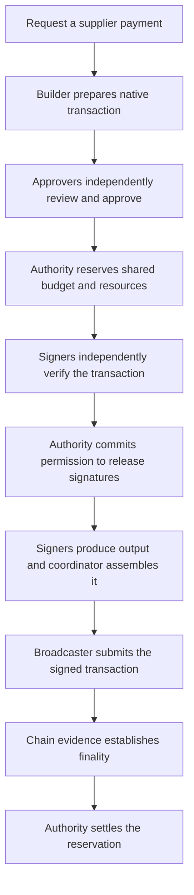

# Open Institutional Custody

Control **who can approve a payment, what the wallet can sign, and how much it can spend**.

Open Institutional Custody is a Rust toolkit for building an organization's wallet
infrastructure. It checks payment rules before signing EVM or Solana transfers and
tracks each signed transaction until the chain settles it.

**EVM** means Ethereum Virtual Machine, the execution environment used by Ethereum
and compatible chains. Solana uses a different transaction format and signature scheme.

If you have written a smart contract and sent a transaction, you have enough
background to start. The examples run locally with real signatures and simulated
chains. You do not need funds, an RPC account, or existing custody infrastructure.

**Current stage:** tested components and a command-line approval client. The first
complete product deployment is still under construction. The EVM example uses a
development single-key provider. Solana signing supports FROST threshold Ed25519.
[See the capability table](#what-works-today) before choosing an integration.

## Find your starting point

| You want to… | Start here |
| --- | --- |
| Understand the problem and vocabulary | [Why custody needs more than a private key](#why-custody-needs-more-than-a-private-key) |
| Run working code | [Try it locally](#try-it-locally) |
| Follow one payment through the system | [How a payment works](#how-a-payment-works) |
| Understand approvals, MPC, exposure, hashes, or finality | [Concepts from first principles](docs/concepts.md) |
| Review and approve a payment from the terminal | [Use the approval client](#use-the-approval-client) |
| Integrate or contribute | [Find the code and contribute](#find-the-code-and-contribute) |
| Fix a setup problem or ask for help | [Troubleshooting and help](#troubleshooting-and-help) |

## Why custody needs more than a private key

**Custody** means controlling the keys that can authorize movements of blockchain
assets. For an organization, key control also needs payment rules and an operating
process.

Imagine a treasury paying a supplier **1,000 tokens**. The organization wants the
payment to satisfy rules such as:

- Pay the registered supplier address on the intended network.
- Get approval from two enrolled treasury approvers.
- Stay within a spending limit shared by all pending payments.
- Keep the network fee below the approved maximum.
- Retain evidence of the approvals, signatures, and settled payment.

These are illustrative rules, not built-in defaults.

A valid blockchain signature proves that the transaction satisfies the account's
signature rules. It does not prove that a finance team approved the recipient or
that another pending payment already consumed the budget.

This project connects those business decisions to the **actual bytes the signers authorize**.
Each signer independently decodes the transaction and checks its authorization.
The system can reject altered recipients even when a compromised interface displays
the supplier's name.

### Where this sits relative to your smart contract

These components run **off chain**. They prepare, approve, sign, and deliver
transactions. The blockchain still verifies the resulting native signature and
executes the transfer.

For an EVM ERC-20 payment, the token contract remains on chain. The adapter checks
the concrete contract address and decodes its `transfer(address,uint256)` call.
For Solana, it checks the message's instructions and accounts.

The current custody path supports direct transfers. Arbitrary contract calls,
token approvals, swaps, and unrestricted message signing need separate verified
capabilities. [Read the current limits](#what-works-today).

## Try it locally

You need Git, Rust/Cargo, a native linker, and internet access for the first
dependency download. If Rust is new to you, use the
[official installation guide](https://rust-lang.org/learn/get-started/#installing-rust),
including its platform build tools. Then run:

```sh
git clone https://github.com/0xTheSingularity/oss-wallet-insitutional.git
cd oss-wallet-insitutional
rustc --version
cargo --version
```

Cargo is Rust's build and package tool. A **workspace** groups related packages so
one command can build or test them together. The current workspace has 21 packages.

The workspace declares Rust 1.85. We verified the current lockfile on macOS with
Rust/Cargo 1.99.0, without separately checking the declared minimum. A recent
toolchain avoids relying on that unverified minimum.

### 1. Run an EVM token transfer

```sh
cargo test -p oic-service-coordinator --locked --test coordinator \
  evm_erc20_end_to_end_signs_and_mines_in_the_simulator -- --exact
```

The test constructs the components, builds and approves an ERC-20 transfer, signs
it, and mines it locally. It checks the supplier's token balance and the retained
spending reservation. Expected result:

```text
running 1 test
test evm_erc20_end_to_end_signs_and_mines_in_the_simulator ... ok

test result: ok. 1 passed; 0 failed; 0 ignored; 0 measured; 8 filtered out
```

The test runner also prints timing information. Here, `-p` selects a package,
`--locked` preserves dependency versions, and `--exact` selects the named test.
Filtered tests did not run in this invocation.

This EVM test holds a whole development key in one process. It exercises the
authorization flow but provides no threshold-key security.

### 2. Run Solana with two of three signers

```sh
cargo test -p oic-service-coordinator --locked --test coordinator \
  solana_frost_2_of_3_end_to_end_for_every_signing_pair -- --exact
```

Expected result: one passing test. It runs three signing combinations: A+B, A+C,
and B+C. Each combination produces a native Ed25519 signature and moves lamports
in the Solana simulator. A **lamport** is Solana's smallest native unit.

The signer instances run in one process for this example. A distributed signing
algorithm and a deployed network of separate machines are different milestones.

### 3. Run the full suite

```sh
cargo test --workspace --locked
```

At source checkpoint `0910530`, the suite passed **363 tests, 0 failed, 0 ignored**.
It covers transaction parsing, authorization, signing, persistence, simulated chain
effects, and protocol compatibility. See [development](docs/development.md) for
focused tests and [getting started](docs/getting-started.md) for build details.

These examples are integration tests because the services currently expose Rust
library interfaces. There is no complete API-server or product launcher yet.

## How a payment works

The treasury example passes through the following components. Each component has
one owner for a different part of the decision.



1. **Request the payment.** An **intent** records the asset, amount, destination,
   network, purpose, and constraints. A **vault** groups wallets under a policy.
   A vault is an off-chain record, not a deployed Solidity contract.
2. **Build the transaction.** The **builder** uses a **chain adapter** to prepare a
   **candidate**, meaning one particular transaction attempt. An **evidence bundle**
   supplies observed chain state, such as the account nonce and fee estimates.
3. **Review independently.** The approval client decodes the candidate itself and
   shows the full recipient, asset, amount, fee ceiling, and policy version.
   Each approver signs an **approval grant** describing the permitted payment.
4. **Apply policy and reserve budget.** The **policy kernel** checks the rules.
   The **authorization authority** checks shared spending exposure and locks
   resources before it accepts a reservation. A preview alone cannot reserve money.
5. **Verify at every signer.** The **coordinator** delivers an **authorization
   envelope** containing the transaction and its commitments. Every **signer**
   independently checks the bytes, approvals, policy, evidence, and authority receipt.
6. **Commit release, then sign.** The authority records that a signature may
   exist and returns a signed release receipt. Signers require that receipt before
   exposing their signature contribution. The coordinator combines their output.
7. **Submit and observe.** The **broadcaster** sends the already signed bytes and
   checks chain evidence. **RPC** means remote procedure call: a request to a chain
   interface. Its acknowledgement reports acceptance for submission, without proving settlement.
8. **Settle the reservation.** At the required **finality**, the authority records
   the payment and actual fee. A failed on-chain execution can still incur a fee.

An [audit log](openwiki/operations/audit-log.md) can record signed, linked events
alongside this flow. It provides history rather than an independent financial ledger.

### Approving a payment and signing a transaction are separate jobs

A **quorum** is the required number of participants for a decision. This system
has three different quorums:

| Decision | Who makes it? | What their authorization permits |
| --- | --- | --- |
| Business approval | Enrolled approvers | A particular payment under the policy |
| Transaction signing | Signing participants holding key material | A native chain signature after all checks pass |
| Administrative change | Enrolled administrators | Changes to policy or registered destination records |

The same count can appear in each configuration, but the credentials and powers
are separate. Two payment approvals do not automatically permit two signer nodes
to bypass policy or change the supplier's address.

**MPC**, or multiparty computation, lets participants compute together while
keeping their private inputs separate. Threshold signing uses that idea to create
one signature from enough **key shares**. A key share is private cryptographic
material, not an approval vote.

The Solana provider uses **FROST**, a threshold Ed25519 signing protocol. In its
distributed key-generation path, participants create shares without assembling the
whole private key. The resulting signature uses Solana's native signature format.
[Learn about shares, DKG, and the development dealer path](docs/concepts.md#keys-shares-and-quorums).

### Why pending payments still consume budget

Suppose a vault has a 1,500-token limit and two concurrent requests each want
1,000 tokens. Both can pass a preview against the same empty spending history.
The authority reserves 1,000 tokens for the first request and refuses the second.

That reserved potential spending is **outstanding exposure**. It differs from
the wallet's balance and from finalized spending in a rolling time window.
If a signature might exist, a timeout cannot make the reservation disappear.
[See the exposure example and failure rules](docs/concepts.md#balance-budget-and-exposure).

## Use the approval client

Build the command-line client and inspect its commands:

```sh
cargo build -p oic-approval-client --locked
./target/debug/oic-approve --help
```

| Command | Purpose |
| --- | --- |
| `init-trust` | Pin enrolled administrator keys, chain profiles, and accepted verifier builds |
| `keygen` | Create an encrypted local approver credential |
| `show` | Decode and display a payment package independently |
| `approve` | Confirm the displayed operation and write a signed grant |
| `verify-grant` | Check a grant's signature and binding to the package |
| `inspect-envelope` | Compare package and envelope fields |

**Trust roots** are the keys and verification rules the client accepts in advance.
An approver credential signs business approvals. It does not hold custody key shares.
Generating a credential also does not enroll it automatically.

The client consumes a builder-produced `ApprovalPackage` and your enrolled input
files. It does not accept a raw transaction as a complete approval package.
The [approval client guide](docs/approval-client.md) explains each file, enrollment
step, command, and exit code.

`inspect-envelope` does not verify the authority receipt signature. Every signer
performs that separate check. A matching inspection report is not permission to
bypass the signing flow.

## What works today

| Capability | Current implementation and boundary |
| --- | --- |
| EVM transfers | Native value and registered standard ERC-20 `transfer` calls. Builds EIP-1559 transactions and verifies profile-enabled EIP-155 legacy transactions. |
| Solana transfers | SOL and classic SPL `TransferChecked`, checked destination token-account creation, and legacy/v0 message verification. Builder emits legacy messages. |
| Threshold signing | FROST Ed25519 with real DKG and threshold signing. No authenticated network transport, share refresh, or recover/replace yet. |
| EVM signing backend | Development single-key ECDSA. Production threshold ECDSA is not integrated. |
| Authorization | Policy rules, independent approvals, shared exposure, resource reservations, policy versions, and freezes. |
| Delivery and recovery | Recorded submission attempts, simulated chain clients, source disagreement handling, reorgs, and invalidation proofs. |
| Durable state and audit | File-backed stores, one-time-state consumption, signer generations, signed audit events, and checkpoints. |
| Product and networking | API, complete accounting/reconciliation workflows, deployment distribution, Commonware networking, and browser light client remain proposed work. |

The EVM adapter uses the **ECDSA** signature scheme. The Solana adapter uses
**Ed25519**. **DKG** means distributed key generation. **SPL** refers to Solana's
program library, including its token programs. The
[chain concepts guide](docs/concepts.md#how-evm-and-solana-express-a-transfer)
explains gas, fee formats, mints, token accounts, and message versions.

The simulator suites do not establish a production deployment or independent
security audit. The [implementation boundary reference](openwiki/concepts/implementation-boundaries.md)
separates working code, data schemas, and proposed requirements.

## Learn the concepts

The [beginner concepts guide](docs/concepts.md) expands the payment example with
definitions and failure cases. You can read it without knowing Rust or MPC.

| Question | Read next |
| --- | --- |
| What are wallets, vaults, policies, destinations, and chain profiles? | [The objects around a payment](docs/concepts.md#the-objects-around-a-payment) |
| How do signatures, key shares, DKG, and quorums relate? | [Keys, shares, and quorums](docs/concepts.md#keys-shares-and-quorums) |
| Why do we sign hashes and use a canonical encoding? | [Bytes, hashes, and envelopes](docs/concepts.md#bytes-hashes-and-envelopes) |
| What are nonces, blockhashes, exact approvals, and bounded approvals? | [Approvals, attempts, and retries](docs/concepts.md#approvals-attempts-and-retries) |
| Why does uncertainty keep spending reserved? | [Release, finality, and uncertainty](docs/concepts.md#release-finality-and-uncertainty) |
| How do I study or change the implementation? | [Documentation home](docs/README.md) and [OpenWiki task map](openwiki/quickstart.md) |

## Find the code and contribute

Start with the [coordinator integration test](services/coordinator/tests/coordinator.rs)
and its [construction fixtures](services/coordinator/tests/common/mod.rs). They show
how to assemble a working transfer before you explore each package.

| Location | Responsibility |
| --- | --- |
| `crates/domain-types`, `crates/canonical-encoding` | Shared objects and their signed representation |
| `crates/policy-kernel`, `crates/authorization-state` | Payment rules and globally reserved state |
| `crates/adapter-*` | Native chain parsing and verification |
| `crates/signer`, `crates/crypto-provider*`, `crates/one-time-state-ledger` | Key material, signing protocol, and one-time state |
| `crates/approval-verifier`, `apps/independent-approval-client` | Independent payment review and CLI |
| `services/builder`, `services/coordinator`, `services/broadcaster` | Prepare, orchestrate, and deliver payments |
| `crates/audit`, `crates/chain-simulator` | Signed history and reproducible test chains |
| `tests/golden-vectors`, `models/authorization-state-machine` | Protocol compatibility and bounded state exploration |

Use a focused test to prove a behavior change, then run the workspace suite.
Review serialized-byte changes against the committed **golden vectors**: known
inputs with expected encodings and hashes. See the
[development guide](docs/development.md) for commands and the
[system overview](openwiki/architecture/system-overview.md) for component ownership.

To discuss a change or report a problem, [open an issue](https://github.com/0xTheSingularity/oss-wallet-insitutional/issues).
Include the source commit, command, toolchain versions, expected result, and error
output. Keep private keys, shares, passphrases, and secret files out of reports.

The workspace declares Apache-2.0 in its package metadata.

## Troubleshooting and help

| Symptom | Next step |
| --- | --- |
| `cargo` is unavailable | Install the Rust toolchain, reopen the shell, and check `cargo --version`. |
| Offline dependency resolution fails | Run without `--offline` to download the locked crates and registry metadata. |
| Build runs out of space | Use the lower-disk command below. Review your generated build output if space remains insufficient. |
| A named demo runs zero tests | Copy the full test name and keep `--test coordinator` and `-- --exact`. |
| Approval input files are missing | Create enrolled roots/profile and export a builder package using the [client guide](docs/approval-client.md). |
| Evidence is stale or a grant expired | Obtain a fresh chain view or a new approval through the normal flow. |
| A payment outcome is unknown | Preserve its reservation and signed bytes. Use chain observation or invalidation proof to resolve it. |

The lower-disk profile passed the full workspace suite:

```sh
CARGO_PROFILE_DEV_DEBUG=0 CARGO_PROFILE_TEST_DEBUG=0 CARGO_INCREMENTAL=0 \
  cargo test --workspace --locked -j 2
```

For operator procedures, use [getting started](docs/getting-started.md),
[approval client](docs/approval-client.md), and [durable state and recovery](openwiki/operations/durable-state-and-recovery.md).

## Design documents

An **RFC** is a request for comments: a document proposing requirements or a design.
The implementation and its tests establish which parts exist today.

- [RFC 0001](spec/rfc-0001-open-institutional-custody.md): custody, authorization, signing, and chain behavior.
- [RFC 0002](spec/rfc-0002-product-completion.md): the complete treasury product, accounting, operation, and acceptance tests.
- [RFC 0003](spec/rfc-0003-institution-operated-signer-network.md): proposed institution-operated network and approver light client.

The [OpenWiki](openwiki/quickstart.md) provides 17 reference pages with claims
grounded in source and tests. Use it for implementation detail after the
[beginner guide](docs/concepts.md).
