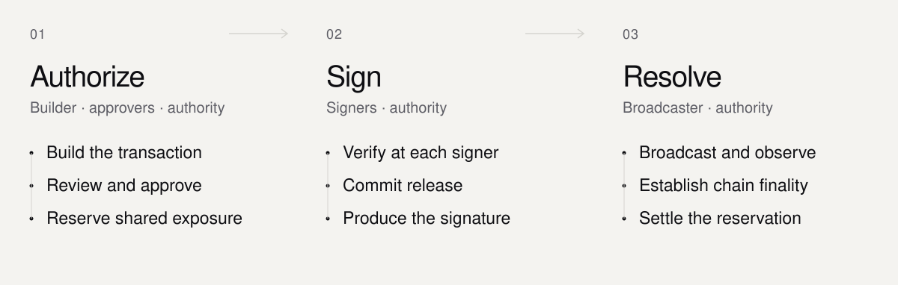

<p>
<picture>
  <source media="(prefers-color-scheme: dark) and (max-width: 640px)" srcset="docs/assets/custody-banner-mobile-dark.svg">
  <source media="(max-width: 640px)" srcset="docs/assets/custody-banner-mobile-light.svg">
  <source media="(prefers-color-scheme: dark)" srcset="docs/assets/custody-banner-dark.svg">
  
</picture>
</p>

# Open Institutional Custody

An open-source project by [The Singularity](https://thesingularity.so/).

**Rust components for institutional payment authorization and signing.**

Connect payment approvals and shared spending limits to the exact EVM or Solana
transaction each signer verifies. Approvers review the payment independently.
Signers check the bytes, rules, and receipts before producing signature output.

[Run a transfer](#try-it-locally) · [Follow a payment](docs/payment-flow.md) · [Documentation](docs/README.md) · [Contribute](docs/development.md)

> **Development preview.** Rust libraries and an approval CLI, with real signatures
> and simulated chains. A complete production deployment is still under development.

## Try it locally

Run an ERC-20 transfer without funds or RPC credentials. Install
[Git, Rust/Cargo, and platform build tools](docs/getting-started.md#prerequisites), then run:

```sh
git clone https://github.com/0xTheSingularity/oss-wallet-insitutional.git
cd oss-wallet-insitutional
cargo test -p oic-service-coordinator --locked --test coordinator \
  evm_erc20_end_to_end_signs_and_mines_in_the_simulator -- --exact
```

The test approves, signs, and mines a transfer locally. Expected result: **1 passed, 0 failed**.
The EVM demo uses a development single-key signer.

[Try Solana 2-of-3 signing](docs/getting-started.md#run-solana-threshold-signing) · [Start the local HTTP stack](docs/local-stack.md) · [Run the full suite](docs/getting-started.md#run-the-full-suite)

## Every decision has a boundary

<p>
<picture>
  <source media="(prefers-color-scheme: dark) and (max-width: 640px)" srcset="docs/assets/custody-flow-mobile-dark.svg">
  <source media="(max-width: 640px)" srcset="docs/assets/custody-flow-mobile-light.svg">
  <source media="(prefers-color-scheme: dark)" srcset="docs/assets/custody-flow-dark.svg">
  
</picture>
</p>

- **Review independently.** Approvers decode the proposed payment from native transaction bytes.
- **Reserve shared exposure.** Pending payments count toward the same spending limits.
- **Verify at the signer.** Each signer checks authorization. A recorded release gates signature output.
- **Resolve with evidence.** Uncertain payments retain their reservation until chain evidence resolves them.

Approval, signature issuance, and settlement are separate decisions. The default
D1 authority is a trusted single writer. The experimental D2 profile verifies
quorum-finalized authority blocks and re-executes them before authorizing signing.
Read the [payment walkthrough](docs/payment-flow.md) for responsibilities and failure cases.

## What works today

| Area | Implemented | Boundary |
| --- | --- | --- |
| **EVM** | Native value and registered ERC-20 transfers | Development single-key ECDSA |
| **Solana** | SOL and classic SPL transfers with FROST Ed25519 | Simulator-backed signing; no live-chain client |
| **Signer network** | Roster-admitted Commonware transport, separate signer cores, D1 authority RPC, and fixed-committee D2 Simplex consensus | [Network tests and limits](docs/signer-network.md); no production launcher or committee handoff |
| **Payment controls** | Independent approvals, policy rules, shared exposure, fee limits, and freezes | Off-chain authorization components |
| **Operations** | Durable deposits/backfill, reorg reversals, fee/rent journal, reconciliation, and bounded gas-funding/sweeps | Deterministic chain simulators; no live indexer |
| **Integration** | Vault-scoped HTTP intents, independent grants, crash-safe dispatch, status/evidence, and signed event replay | [Runnable local D1 stack](docs/local-stack.md) with durable simulators; no production launcher |
| **Recovery and audit** | File-backed state, recorded submissions, signed audit events, and checkpoints | Whole-host rollback needs an independent retained checkpoint |

Production threshold ECDSA, live-chain clients, arbitrary contract calls, and a complete
deployment stack need further implementation. The [protocol v1 contract](spec/protocol-v1.md)
documents the executable RFC002 behavior and remaining production gates. See the
[capability details](docs/getting-started.md#current-product-boundary) before integrating.

Exercise both zero-gas token funding/sweep loops and both HTTP approval flows:

```sh
cargo test --locked -p oic-service-reconciler --test money_loop
cargo test --locked -p oic-service-api --test http_flow
```

## Go deeper

| Start here | What you will find |
| --- | --- |
| [Payment walkthrough](docs/payment-flow.md) | One treasury payment, from request to settlement |
| [Core concepts](docs/concepts.md) | Keys, shares, approvals, exposure, and finality |
| [Approval client](docs/approval-client.md) | Review and approve payments with `oic-approve` |
| [Local HTTP stack](docs/local-stack.md) | Bootstrap independent development credentials, send payments, and restart the same stores |
| [Signer network](docs/signer-network.md) | D1 signing, D2 consensus, embedding contracts, and remaining RFC003 work |
| [Development](docs/development.md) | Workspace map, focused tests, protocol vectors, and bounded state exploration |
| [Documentation index](docs/README.md) | Subsystem references and design RFCs |

## Contribute

Start with the [development guide](docs/development.md). For setup problems, use
[troubleshooting](docs/getting-started.md#troubleshooting). For a question or bug,
[open an issue](https://github.com/0xTheSingularity/oss-wallet-insitutional/issues)
with the commit, command, toolchain, expected result, and error output.
Keep keys, shares, passphrases, and secret files out of reports.

Package metadata declares [Apache-2.0](Cargo.toml).
