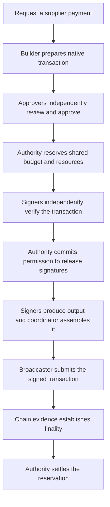

# Follow a treasury payment

An organization wants to pay a supplier **1,000 tokens**. This guide follows that
payment from business request to chain settlement. Use [getting started](getting-started.md)
to run the code and [core concepts](concepts.md) for definitions.

## Why a private key is only part of custody

**Custody** means controlling the keys that can authorize movements of blockchain
assets. An organization also needs payment rules and an operating process.
For this example, the treasury wants to:

- Pay the registered supplier address on the intended network.
- Get approval from two enrolled treasury approvers.
- Stay within a spending limit shared by all pending payments.
- Keep the network fee below the approved maximum.
- Retain evidence of the approvals, signatures, and settled payment.

These are illustrative rules, not built-in defaults. A valid blockchain signature
does not prove that a finance team approved the recipient or checked the shared budget.

Each signer independently decodes the actual transaction and checks its authorization.
The system can reject altered recipients even when a compromised interface displays
the supplier's name.

## Where your smart contract fits

These components run **off chain**. They prepare, approve, sign, and deliver
transactions. The blockchain verifies the resulting native signature and executes
the transfer.

For an EVM ERC-20 payment, the token contract remains on chain. The adapter checks
the concrete contract address and decodes its `transfer(address,uint256)` call.
For Solana, it checks the message's instructions and accounts.

The current custody path supports direct transfers. Arbitrary contract calls,
token approvals, swaps, and unrestricted message signing need separate verified
capabilities. See [current support](getting-started.md#current-product-boundary).

## From request to settlement

Each component owns a different part of the decision:

1. **Request the payment.** An **intent** records the asset, amount, destination,
   network, purpose, and constraints. A **vault** groups wallets under a policy.
   A vault is an off-chain record, not a deployed Solidity contract.
2. **Build the transaction.** The **builder** uses a **chain adapter** to prepare a
   **candidate**, meaning one particular transaction attempt. An **evidence bundle**
   supplies observed chain state, such as the account nonce and fee estimates.
3. **Review independently.** The approval client decodes the candidate itself and
   shows the full recipient, asset, amount, fee ceiling, and policy version.
   Each approver signs an **approval grant** describing the permitted payment.
4. **Apply policy and reserve budget.** The **policy kernel** checks the rules.
   The **authorization authority** checks shared spending exposure and locks
   resources before it accepts a reservation. A preview alone cannot reserve money.
5. **Verify at every signer.** The **coordinator** delivers an **authorization
   envelope** containing the transaction and its commitments. Every **signer**
   independently checks the bytes, approvals, policy, evidence, and authority receipt.
6. **Commit release, then sign.** The authority records that a signature may
   exist and returns a signed release receipt. Signers require that receipt before
   exposing their signature contribution. The coordinator combines their output.
7. **Submit and observe.** The **broadcaster** sends the already signed bytes and
   checks chain evidence. **RPC** means remote procedure call: a request to a chain
   interface. Its acknowledgement reports acceptance for submission, without proving settlement.
8. **Settle the reservation.** At the required **finality**, the authority records
   the payment and actual fee. A failed on-chain execution can still incur a fee.

An [audit log](../openwiki/operations/audit-log.md) can record signed, linked events
alongside this flow. It provides history rather than an independent financial ledger.

## Approval and signing are separate jobs

A **quorum** is the required number of participants for a decision. This system
has three different quorums:

| Decision | Who makes it? | What their authorization permits |
| --- | --- | --- |
| Business approval | Enrolled approvers | A particular payment under the policy |
| Transaction signing | Signing participants holding key material | A native chain signature after all checks pass |
| Administrative change | Enrolled administrators | Changes to policy or registered destination records |

The same count can appear in each configuration, but the credentials and powers
are separate. Two payment approvals do not automatically permit two signer nodes
to bypass policy or change the supplier's address.

Threshold signing creates one native signature from enough private key shares.
A share is cryptographic material, not an approval vote. Learn about
[MPC, FROST, and distributed key generation](concepts.md#keys-shares-and-quorums).

## Pending payments still consume budget

Suppose a vault has a 1,500-token limit and two concurrent requests each want
1,000 tokens. Both can pass a preview against the same empty spending history.
The authority reserves 1,000 tokens for the first request and refuses the second.

That reserved potential spending is **outstanding exposure**. It differs from
the wallet's balance and from finalized spending in a rolling time window.
If a signature might exist, a timeout cannot make the reservation disappear.
See [exposure accounting](concepts.md#balance-budget-and-exposure).

## When a payment gets interrupted

| Situation | What to preserve or check |
| --- | --- |
| A signer fails after authority release | Retain the reservation because a signature might exist. |
| Submission returns an error | Preserve the signed bytes and inspect chain evidence. |
| Chain sources disagree | Quarantine the family and retain its obligation. |
| An approval expires after signing | Resolve the existing signature through chain evidence. Expiry cannot revoke it. |
| Finalized execution fails | Account for the actual fee without an asset debit. |

Read [release, finality, and uncertainty](concepts.md#release-finality-and-uncertainty)
for the reasoning and [broadcast and finality](../openwiki/workflows/broadcast-and-finality.md)
for implementation details.

Continue with [core concepts](concepts.md) or return to the [documentation home](README.md).
