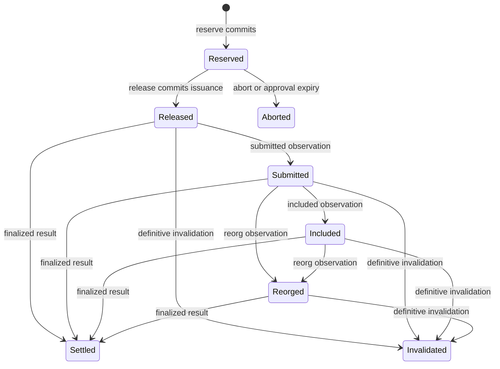

# Authorization authority and exposure

`oic-authorization-state` owns the globally ordered state that individual signers cannot infer: active policy, native resource locks, outstanding exposure, freezes, issuance records, and idempotency records. `Authority<S>` is a trusted single-writer library component. It injects its clock and receipt-signing key, executes the same deterministic transition function used for replay, and emits audit events only after a transaction commits.

## Ownership and caller responsibilities

An authority opens against an expected fence token, increments the writer generation and authority epoch, and rejects calls from older instances—including reads through its API. Every command is fenced and runs in an `AuthorityStore::transact` transaction. The store works on a private state copy and publishes it only after the transition and its persistence step both succeed. See [durable state and recovery](../operations/durable-state-and-recovery.md).

The authority enforces **stateful** authorization. `reserve` accepts a caller-provided `Decision::Allow`, resource claims, and grants; it does not decode native transaction bytes itself. It checks the active rule, recorded-grant bindings and distinct approver count, per-operation maxima, and global exposure. When ordered approvals are enabled, it verifies supplied grants against the enrolled roster and recorded approvals; the builder and signers also independently verify approvals and candidate semantics. Native decoding and candidate evidence validation belong to the [builder and coordinator](../workflows/build-and-coordinate.md) and [signers](signer-boundary.md). Likewise, `record_observation` applies chain observations already reconciled by the [broadcaster](../workflows/broadcast-and-finality.md).

## Register, reserve, and release

1. `register_intent` recomputes the canonical intent hash, checks institution/environment and idempotency scope, and creates a deterministic operation family. Repeating a key with the same body returns the existing family; a changed body is a `Conflict`.
2. `set_policy` requires an administrative quorum and a strictly newer policy epoch. A reservation must name the active epoch and hash.
3. `reserve` checks freeze state, policy, family ownership, approvals, deadline, duplicate resources, and the selected rule's amount/fee limits. Caller-supplied rolling limits must exactly equal limits derived from that rule.
4. In the same transaction, it checks and acquires native-resource locks in sorted order, inserts the proposed reservation, and calculates global exposure. A conflict, overflow, or limit breach aborts the entire mutation. A success returns a reservation and a signed `Reserved` receipt bound to the envelope body and signer session.
5. `release` checks reservation version and envelope/session binding. For a first release it also rechecks freeze epoch, policy epoch, issuance deadline, freshness against the authority clock, and recorded grants. It rejects a second possibly live payment when a sibling is not provably mutually exclusive.
6. Before a `Release` receipt is signed, the transaction writes an `IssuanceRecord`, changes the reservation to `Released`, and marks its family candidate possibly issued. This durable commit is the boundary after which an output may exist.

A candidate revision cannot be silently reused for another envelope or session. A matching `Reserved` replay is idempotent while the reservation is still `Reserved`. A matching released replay returns the existing issuance and a fresh receipt. That replay branch comes before first-issuance freeze and deadline checks: it cannot create a new output, and the issuance already stands.



This is the reservation lifecycle: only `Released` is possibly issued, so it retains obligations until finality or proof of invalidation resolves it.

## Exposure, locks, and replacement families

For a vault and budget (asset or native fee):

```text
exposure(window, now) = settled debits still in the window + outstanding potential debits
```

Both `Reserved` and `Released` reservations are active; outstanding claims do not age out. Settled debits remain while `settled_at + window_seconds > now`, and future-dated ledger entries are conservatively included. Checked arithmetic turns overflow into failure.

| Candidate relationship | Outstanding charge |
| --- | --- |
| Same family with the same EVM nonce claim | Maximum claim in that exclusive group |
| Different families | Sum; the same native resource cannot be locked by both |
| Other same-family claims, including rebuilt Solana blockhashes | Additive |

A new Solana blockhash does not prove an old transaction is unusable. Before releasing a non-exclusive sibling, the old possibly issued candidate must be resolved. EVM nonce exclusivity permits maximum accounting without creating an additional payment allowance. Locks are held by operation family, so eligible same-family replacements share a lock; locks are removed only when no active reservation in that family claims the resource.

## Ordered approvals and freeze ordering

Ordered approvals are an optional, irreversible profile enabled by the first admin-quorum credential enrollment. It records a grant once per enrolled credential and revalidates the supplied grants against current enrollment at reserve and first release. A retired credential or expired grant therefore cannot count, while its historical record remains available for audit. Pending legacy reservations must be aborted before this profile can be enabled.

A designated responder may sign a vault or global freeze. Unfreeze requires the administrative quorum over a proposal naming that freeze's commit sequence, so an old approval cannot lift a later freeze. Every mutation has a commit sequence; a freeze racing a first release has one ordered outcome. `releases_before(sequence)` identifies issuance committed before the freeze.

Freeze blocks new reservation and first issuance but cannot revoke an output already released. The shared freeze epoch also prevents release of a reservation made before a subsequent freeze or unfreeze; abort and reserve again instead. `approval_expired`, `expire_approvals`, and `abort_before_issuance` release an unissued reservation's locks and exposure. They return uncertainty rather than cancelling a possibly issued signature.

## Receipts, checkpoints, and persistence

Authority receipts are Ed25519 signatures over domain-separated canonical receipt bodies. A verifier checks the signature plus receipt kind, envelope, signing session, candidate revision, policy epoch, and validity interval. `checkpoint` similarly signs the authority epoch, commit sequence, and canonical state hash; an independent witness can use it to detect rollback or state divergence.

`InMemoryAuthorityStore` serializes callers through its mutex and may install a persist hook. `FileAuthorityStore` writes a canonical versioned snapshot by syncing a temporary file, renaming it, and updating a `.hwm` high-water mark. On open it refuses a snapshot below its high-water mark or a supplied minimum; `open_with_witness` additionally verifies the signed checkpoint and compares the state hash when sequences match. These stores are in-process serialization mechanisms, not cross-process locking or consensus.

## Chain-observation settlement

`record_observation` accepts observations only for the latest possibly issued revision of a candidate in its family. `Submitted` and `Included` update lifecycle but retain locks and exposure. Conflicting evidence quarantines the family; the broadcaster treats that as a stop to observation-driven release.

| Observation | Authority effect |
| --- | --- |
| Finalized success | Record each asset debit and actual native fee, settle the reservation, and release no-longer-active locks |
| Finalized failure | Record actual fee only; settle without an asset debit |
| Reorg before finality | Mark `Reorged`; retain obligations |
| Definitive invalidation | Invalidate that candidate, releasing its obligation and any unused locks |
| Reorg after resolution | Return `RecoveryRequired` for manual reconciliation |

When an exclusive EVM nonce candidate is finalized, active same-nonce siblings are invalidated because the nonce is consumed. Identical finality evidence is idempotent; contradictory finality evidence conflicts. A definitive invalidation can leave other active candidates in the family, in which case the family remains `ReplacementPending` rather than fully resolved.

## Focused tests and adjacent boundaries

[`tests/authority.rs`](../../crates/authorization-state/tests/authority.rs) exercises duplicate registration and issuance, concurrent budget races, split nonce views, persistence failure without partial state, stale policy, freeze races, expiry after issuance, window reset, EVM maximum versus Solana additive replacements, fee-only failure settlement, reorg/invalidation, and file-store rollback refusal. The same test suite verifies that a stale writer cannot read or mutate through an old `Authority` instance.

```sh
cargo test -p oic-authorization-state --locked
```

For stateless rule evaluation, see [policy evaluation](../concepts/policy-evaluation.md). For candidate construction and the caller-side trust boundary, see [build and coordinate](../workflows/build-and-coordinate.md). For signed-byte submission and cross-source evidence, see [broadcast and finality](../workflows/broadcast-and-finality.md).
