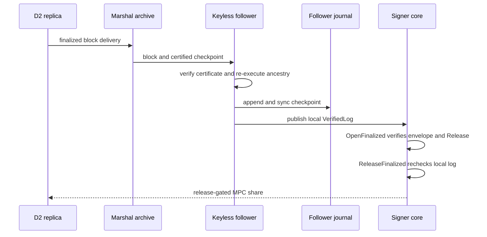

# Replicated authorization and signer network

D2 is an optional replacement for the D1 receipt path at the authorization boundary: a signer consumes a **local, process-only** `VerifiedLog` minted from finalized authority history, rather than accepting a gateway-supplied receipt or state snapshot. It is implemented as reusable Rust libraries and runtimes, not as a production node launcher or a complete deployment profile. For the underlying signer checks that remain in force in either path, see [Signer verification and share release](signer-boundary.md).

## What is trusted, and what is not

A `Follower` is the trust-minimizing reader of the replicated authority. It is configured independently with the genesis block and state, `FinalityTrust`, execution `Executor`, a journal partition, a local clock, and an independently retained `FinalizedFloor`. Opening it replays its journal from genesis: it authenticates each finalization, re-executes the contiguous blocks, checks state roots and the retained floor, and rejects invalid genesis or recovery history. A peer cannot grant authorization by sending a `VerifiedLog`, a state snapshot, a notarization, or a claimed finality tip.

Finalization authentication alone is deliberately insufficient. The follower verifies the genuine certificate on the certified descendant and executes every parent-linked ancestor before publishing the new tip. This matters because a descendant certificate can finalize earlier blocks without a certificate at every intermediate height. Checkpoints are limited to 256 blocks and a 4 MiB canonical journal record; overlarge or non-contiguous history fails closed. The follower writes and `sync_all`s the validated checkpoint before changing its in-memory tip/state. An append I/O error or cancellation poisons that instance, requiring reopen against the independent floor rather than an in-place retry.

`Follower::verified_log()` is only available while that synced journal and a finalization exist. Its unforgeable `VerifiedLog` carries the genesis and roster anchors, current floor, finalized timestamp, and ordered authority state. `authorize` then requires all of the following from that state:

- the native reservation proof and authority reservation have the exact envelope, envelope hash, and signer-session binding;
- the reservation is in `Released` state, not merely reserved or notarized; and
- the referenced issuance record exists.

The runtime publishes this capability through `Running::verified_log` only after journal sync and re-execution; it publishes `None` at genesis. `Running::progress` is useful status, but is an unsigned snapshot and is explicitly not signing evidence. `FinalizedReader` exposes bounded, read-only portable checkpoint evidence; it does not expose the capability or writer.

## Authority runtime and follower roles

`runtime::start` composes a persistent follower, Commonware marshal archives, a Simplex application, and five host-supplied, authenticated, ACL-isolated networks: vote (1), certificate (2), consensus resolver (3), blocks (4), and backfill (5). All runtime storage partitions contain confidential Class C data, so encrypted storage is an operator responsibility rather than a property supplied by these libraries.

A replica with `vote_key: Some(...)` must have an enrolled, distinct consensus identity and can receive a `Proposer`. The application re-executes candidate ancestry before voting and persists marshal verification before it accepts a candidate into its speculative cache. Its finalized anchor advances only from the independent follower, never from speculative execution.

A keyless follower has no vote key, voting engine, or proposer. It decodes certificate-channel traffic, accepts only authenticated finalization certificates for the configured epoch, and relies on marshal/backfill plus its own follower verification to catch up. In the production transport adapter, `ConsensusHost::start_follower` additionally requires an independent primary node with the `Signer` role; the signed ACL must allow replica-to-signer channels 2, 4, and 5 and signer-to-replica backfill on 5. It does not grant vote or consensus-resolver channels 1 and 3 to the signer.



The sequence shows the release gate: finalization is verified and durably synced locally before a `VerifiedLog` is published, and the core consults that local capability again immediately before releasing a share.

## Signer-core release gate

A signer selects D2 with `Signer::with_finalized_authority` **before** loading keys or opening sessions. The provisioned `FinalizedAuthorityConfig` pins a `LogAnchor` (genesis digest and roster hash), a rollback floor, and a nonzero maximum view age. This selection disables the D1 open/release entry points for that signer instance. The signer checks the capability anchor, timestamp skew and age, and monotonic floor; a floor regression or same-height digest mismatch requires recovery.

`SignerCore::with_finalized_log` accepts a watch receiver only from the core's own keyless follower and requires its roster anchor to match the locally validated roster. At open and release the core refuses a missing or closed source, pin mismatch, stale view, or regression. Before signing state advances, it fsyncs an `authority.finalized` audit event containing the exact source floor. The core also retains its normal local boundary: only an admitted Gateway may issue control calls, the configured build hash and committee/materials must match the roster, native payload verification and approval checks run, deadlines/halt state apply, and participant frames require both the authenticated transport origin and the sender's participant signature.

`OpenFinalized` verifies the complete local envelope against the finalized log and may prepare non-share MPC rounds. It cannot start from a reservation alone. `ReleaseFinalized` obtains the current local log again, calls `VerifiedLog::authorize`, checks the issuance deadline and finalized-release age, and re-verifies grants against the current ordered approver enrollment before releasing buffered output. If the audit record for released output cannot be persisted, the core aborts the session, clears outbound frames, and halts itself. Thus gateway control traffic requests an operation; it never supplies authorization evidence.

## Authenticated carrier and bridge boundaries

`oic-node::Transport` validates the signed roster at startup, checks its independent genesis anchor and local transport key, and derives the immutable admission view. Network identity is authenticated transport identity mapped to `NodeId`; application bytes remain untrusted to signer-core. A named-recipient send enforces roster ACL, channel size, quota, and a recent control-channel proof that the recipient has converged on the same roster epoch/hash. Submission means local queue acceptance, not delivery.

Inbound traffic is dropped before application delivery unless it comes from an admitted, unblocked identity; fits its channel limit; carries the expected protocol version, epoch, and roster hash; is allowed in that direction; and—outside control—has recent reciprocal convergence. The transport emits its canonical control record every second and expires convergence after five seconds. Roster changes are not live-updated: configuration is immutable and callers must validate/order activation and restart transport consumers.

`Bridge` is the D1 custody transport adapter, while its channel routing also carries D2 signer traffic: confidential control RPC uses channel 10, authority RPC uses 12, and signed MPC frames use 20. It sends blocking core/authority calls off its reactor, bounds pending RPCs, and only retransmits retained MPC frames; Open, Reserve, and Release mutations are not automatically retried. On channel 20 it forwards the authenticated `Event.from` plus frame bytes to `SignerCore::deliver`, which independently validates the participant signature and session constraints. The bridge process is intentionally not a share holder: signer-core owns chain shares and participant keys, and it communicates with the bridge through private IPC.

Transport padding is optional and local. `Transport::start` is unpadded; `start_with_padding(..., FixedBucketsV1)` applies fixed buckets only to channels 10, 20, and 21. Both endpoints must be restarted with the same setting: mixed profiles are rejected before event delivery. Padding does not alter ACLs, signatures, inner frame validation, or signer-core verification.

## Operations, integration, and gaps

Provision trust outside the network: compare the genesis roster hash independently; for later rosters provide the previously validated roster, authority-committed hash, and activation time. Keep transport, consensus-vote, participant, operator, audit, and share keys purpose-distinct. Retain follower floors and signer audit/halt floors outside the host rollback domain. For local tests, `Transport::start_loopback` requires every roster address to be loopback and only relaxes the connection cooldown; it is not production startup qualification.

The implemented runtime is deliberately constrained:

- It supports one fixed committee and has no implicit epoch rollover; ordered committee activation and handoff are unavailable.
- It does not implement verified chain observations, an encrypted-storage deployment, a production node entrypoint, or production qualification.
- It does not encrypt Commonware journals itself, despite those journals containing confidential candidates and grants.
- Removing a signer from a roster is not cryptographic revocation of an already-held share; generation enrollment and ordered fencing remain operator integration work.

These are deployment and lifecycle gaps, not RFC promises fulfilled by the library. See [Durable state and recovery](../operations/durable-state-and-recovery.md) for retained-floor rationale and [Implementation boundaries](../concepts/implementation-boundaries.md) for how to distinguish executable contracts from planned product infrastructure.

## Focused verification

The D2 contracts and composition have targeted tests:

```sh
cargo +1.95.0 test -p oic-replicated-authority --test contracts --locked
cargo +1.95.0 test -p oic-replicated-authority --test runtime --locked
cargo +1.95.0 test -p oic-replicated-authority --test signing --locked
cargo +1.95.0 test -p oic-service-signer-core --test finalized --locked
cargo +1.95.0 test -p oic-service-signer-net --test consensus --locked
cargo +1.95.0 test -p oic-service-signer-net --test finalized --locked
```

The contract tests reject tampered blocks and certificates that authenticate an incorrect execution root. The runtime test uses four real Simplex engines on a deterministic simulated network: a 2+2 partition cannot finalize release, while a healed 3-of-4 set can; it also exercises retained-floor restart and keyless catch-up. The signer-core test verifies that a reserved state cannot open a D2 session, then produces and natively verifies a Solana FROST signature only after release. The signer-net finalized test extends that path across authenticated TCP, two keyless followers, private IPC cores, and participant-authenticated MPC frames. These tests are strong integration evidence, but do not constitute a consensus-safety proof, security audit, live-chain execution, or production deployment qualification. For broader test selection, see the [verification guide](../testing/verification-guide.md).
