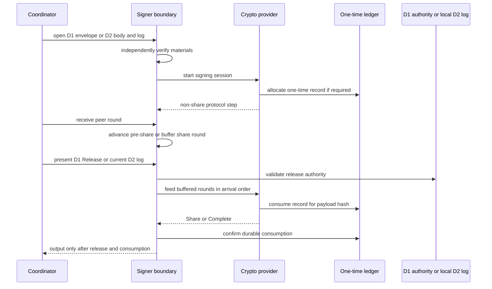

# Signer verification and release boundary

`oic-signer` is the boundary that holds a key share. It does not trust a coordinator's description of an operation: before its provider can contribute output, the signer derives the operation from the supplied objects and validates it against trust roots provisioned outside the coordinator. It also separates **authorization to prepare a session** from **authorization to release a share-producing round**.

Two mutually exclusive authority modes reach that boundary:

- **D1** takes a signed `Reserved` receipt in an `AuthorizationEnvelope` to open a session, then requires a matching signed `Release` receipt to process buffered share rounds.
- **D2** is selected before keys or sessions exist. It takes only a locally produced `VerifiedLog` from independently pinned finalized authority history; D1 envelope verification and D1 release are disabled for that signer instance. The same finalized history is rechecked at release time.

The adjacent [authorization authority](authorization-authority.md) owns global reservation and release decisions. The [replicated authorization and signer network](replicated-authorization-and-signer-network.md) describes the optional D2 source of local finalized authority. Neither changes the signer's native transaction verification or one-time-state gate.

## Independently enrolled inputs

`Signer::open` receives the signer identity, `TrustRoots`, pinned chain adapters, a `CryptoProvider`, a `OneTimeStateLedger`, and a durable `GenerationStore`. Trust roots contain the enrolled authority public key and key ID for D1, administrative quorum keys, approver credentials, accepted verifier-build hashes per adapter, chain profiles, and clock-skew allowance. These are local configuration, not envelope or coordinator input.

Before a share can be used, `load_key` verifies that its descriptor belongs to this institution and environment, includes this participant, matches the local backend and scheme, has distinct participants and a supported topology, and does not conflict with an already loaded newer or different descriptor. The provider authenticates and loads the sealed share; the signer then tombstones unconsumed one-time records from older generations for that key.

## Envelope verification

`verify_envelope` emits either `EnvelopeVerified` or `EnvelopeRejected` and fails closed with stable domain error codes. In D1 mode it executes the following ordered checks; `open_session` performs the same verification before it starts the provider protocol.

1. **Scope and key binding.** Institution/environment, loaded key ID and epoch, public-key hash, active wallet, vault, intent, candidate, and adapter references must agree. The participant set must include this signer, contain no duplicates, consist of key members, and meet the key threshold.
2. **Profile and evidence.** The chain profile ID and canonical hash must name an enrolled profile. Evidence is checked for scope and freshness, and its hash must equal both candidate and envelope commitments.
3. **Pinned adapter.** The locally registered adapter ID, version, and verifier build must match the envelope; the build must be accepted by trust roots. Candidate bytes must equal the envelope's native unsigned bytes.
4. **Policy and destination.** Administrative quorum signatures authenticate the policy and the destination registry object. The signer checks policy ID, epoch, activation, hash, allowlist version, and intent hash; it separately requires the envelope's `destination_hash` to match the signed destination on the wallet network. A destination ID alone cannot authorize substitution of its address.
5. **Grants and native interpretation.** Enrolled approver signatures, roles, expiry, and scope bindings are checked. The pinned adapter decodes the native bytes against the intent or a common bounded-transfer template, then re-derives operation and signing-payload hashes, resources, outflow and fee bounds, and exact-candidate previews. The template destination and intent destination ID/version must agree with the registered destination.
6. **Local policy and authority commitment.** The policy kernel must return `Allow`. The signer derives the reservation ID, envelope hash, intent hash, selected rule, and verified claims, and requires the D1 `Reserved` receipt to bind those values, the session and candidate, policy epoch, institution/environment, validity window, and issuance deadline.
7. **Single payload.** Exactly one re-derived native signing payload must target this key under the provider scheme. Zero or multiple matching payloads are unsupported.

The signer has no globally consistent exposure counter. It supplies zero settled and outstanding exposure for every policy rolling window, which still rejects an individual operation that exceeds a window by itself. The D1 authority's signed reservation is the proof that cumulative exposure was charged; the signer rejects a receipt naming different claims, rule, or intent.

## Session lifecycle and the release gate



This sequence shows the common output boundary: opening may prepare non-share protocol work, while share-producing input waits for D1 release or a current D2 authorization result.

A session ID can be opened only once for the lifetime of a signer instance; retry requires a fresh session. On session start, the signer wraps the ledger so it observes allocations rather than trusting the provider's report. A stateless backend must allocate none. A backend declaring one-time state must allocate **exactly one** unconsumed record bound to the session ID, key ID and epoch, and current signer generation; a start failure or malformed allocation burns captured records where possible.

`receive` only accepts a live session's message if its session, key/epoch, sender membership, recipient, and sender generation are valid. A message attributed to this signer must name this exact instance generation; another participant may not be below its locally recorded generation floor. Rounds before `share_producing_round` can advance immediately. Later rounds are queued in arrival order, capped by `MAX_BUFFERED_MESSAGES` (64), until release.

For D1, `release` requires a `Release` receipt from the enrolled authority key whose binding matches the opened session's envelope hash, candidate, reservation/version, policy epoch, intent, policy rule, and claims. It additionally requires the release freeze epoch to equal the `Reserved` receipt's freeze epoch. Only then does it mark the session released and feed the buffered rounds.

For D2, `with_finalized_authority` must be called once before key loading or any session; it pins a genesis/roster `LogAnchor`, an independently retained minimum `FinalizedFloor`, and a nonzero maximum age. `open_finalized_session` first checks that the local `VerifiedLog` has the pinned anchor, is fresh, has not regressed below the floor, and authorizes the body from finalized state. `release_finalized` obtains and checks the current log again, requires the authorization/issuance to remain timely, and re-verifies grants using the log's current approver enrollment. D1 and D2 release evidence cannot release the other mode's session.

Regardless of mode, `Share` and `Complete` are withheld until `released` is true. For a stateful backend, the signer also reads the record and requires it to be consumed and bound to `SHA-256(message_or_digest)` for the selected payload. Early output, missing or wrongly bound consumption, and backend errors during a share round abort the session. Abort clears buffered messages and best-effort consumes an unconsumed record against a session-abort sentinel; an aborted or output-complete session is never live again. `aggregate` is a public post-processing operation but still requires a released, non-aborted session, participant-set shares, the provider aggregate, and native verification against the session payload and public key.

## Durable generations and rollback fences

Each successful `Signer::open` loads the prior durable generation, increments it, and persists the new value. Before doing so it probes a per-participant fence key in the one-time ledger: if the generation store says a previous generation existed but the ledger permits an allocation below that prior floor, the signer returns `RecoveryRequired` rather than operating with an older or replacement ledger. It then raises the fence's tombstone floor to the new generation.

Loading a key similarly tombstones older-generation records for that key. Peer generation floors only move upward, so a peer can reject frames from a stale clone. These mechanisms detect a generation store paired with an older ledger; they cannot locally detect rollback of both durable stores together. Retain an independent freshness witness and follow the recovery procedures in [Durable state and recovery](../operations/durable-state-and-recovery.md).

## Provider and integration boundary

The signer owns verification, authorization mode selection, session state, and the final output gate. The provider owns the cryptographic protocol, key-share loading, and its use of one-time state; its declared `share_producing_round` determines which messages are buffered. A provider cannot bypass the signer merely by returning a share: `gate` checks release and ledger state before returning it. See [Development and FROST crypto providers](../integrations/crypto-providers.md) for capability, topology, and sealing contracts.

`SignerEndpoint` and `InProcessSigner` are coordinator-facing seams, not an authenticated institution signer network. D2's `VerifiedLog` is specifically a local capability from validated finalized history, not a gateway-supplied snapshot or receipt.

## Focused verification

```sh
cargo test -p oic-signer --locked
```

`tests/evm.rs` exercises envelope substitutions, destination binding, stale evidence and policy, receipt mismatches and expiry, buffered release behavior, bounded buffers, failed consumption, early/unconsumed output, and final abort behavior. `tests/generation.rs` covers monotonic persisted generations, rejection of restored or fresh ledgers, and key-generation tombstoning. `tests/solana.rs` drives a real two-of-three FROST flow through release, verifies the assembled Solana signature, rejects malicious shares, and fences a stale clone by generation and ledger state.

For authority issuance see [Build and coordinate](../workflows/build-and-coordinate.md); for the D2 finalized-history boundary see [Replicated authorization and signer network](replicated-authorization-and-signer-network.md).
