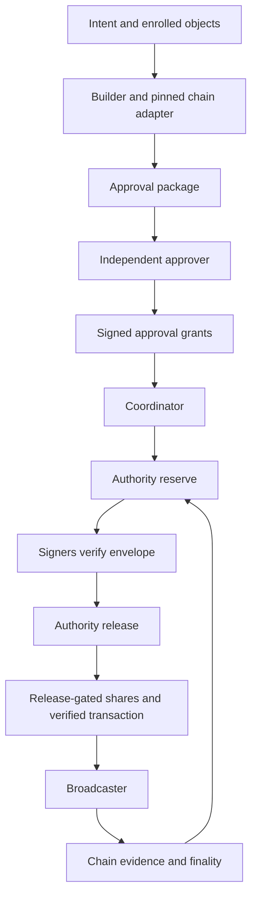

# System overview

Open Institutional Custody is a Rust workspace implementing authorization and signing components for direct EVM and Solana transfers. The current workspace has 21 member packages. The builder, coordinator, and broadcaster are service **libraries**; the independent approval client supplies the `oic-approve` executable. Integration tests assemble these components with in-process signers and deterministic simulated chains.

## End-to-end ownership

The builder checks object scope, builds native bytes, and re-verifies them through the adapter. The approver independently reconstructs the display and signs an exact preview or bounded template. The coordinator requires an allowing evaluation, obtains a reservation, orchestrates provider messages, obtains release, and assembles a natively verified signed transaction. The broadcaster owns durable submission attempts and chain observations. Finality resolves the authority's outstanding obligations.

The coordinator test suite demonstrates EVM ERC-20 signing/mining and Solana FROST two-of-three signing with every participant pair. These tests establish executable integration behavior; they do not establish production network deployment or security review.

## Component map

| System | Packages and responsibility | Read next |
| --- | --- | --- |
| Protocol objects | `oic-domain-types`, `oic-canonical-encoding`: typed objects, deterministic encoding, hash domains | [Security objects](../concepts/security-objects-and-encoding.md) |
| Stateless decisions | `oic-policy-kernel`: ordered policy checks and approval requirements | [Policy evaluation](../concepts/policy-evaluation.md) |
| Global authorization state | `oic-authorization-state`: reservations, exposure, locks, freezes, signed receipts | [Authority](authorization-authority.md) |
| Approval | `oic-approval-verifier`, `oic-approval-client`: independent verification, safe card, signed grants | [Independent approval](../workflows/independent-approval.md) |
| Preparation and orchestration | `oic-service-builder`, `oic-service-coordinator`: verified packages, sessions, provider drivers, operation records | [Build and coordinate](../workflows/build-and-coordinate.md) |
| Share boundary | `oic-signer`: independent envelope checks and release gating | [Signer](signer-boundary.md) |
| Native semantics | `oic-adapter-api`, `oic-adapter-evm`, `oic-adapter-solana` | [EVM](../integrations/evm-adapter.md), [Solana](../integrations/solana-adapter.md) |
| Cryptography | `oic-crypto-provider`, development single-key provider, FROST Ed25519 provider | [Providers](../integrations/crypto-providers.md) |
| Recovery | `oic-one-time-state-ledger`, signer generation store, authority and service stores | [Durable state](../operations/durable-state-and-recovery.md) |
| Audit | `oic-audit`: signed hash chain and checkpoints | [Audit log](../operations/audit-log.md) |
| Delivery | `oic-service-broadcaster`: submit, recover, rebroadcast, cross-check, resolve | [Broadcast and finality](../workflows/broadcast-and-finality.md) |
| Verification | `oic-chain-simulator`, `oic-golden-vectors`, `oic-model-authorization-state`, crate tests | [Simulators](../testing/chain-simulators.md), [test guide](../testing/verification-guide.md) |

## Trust boundaries

**Native bytes determine the operation.** Adapters re-derive signing payloads and semantics. Signers compare them with the envelope and approvals rather than accepting coordinator-provided descriptions. Chain identity comes from an enrolled profile plus adapter-consumed evidence, not a display label.

**Global exposure belongs to the authority.** Signers enforce local rules but do not maintain a distributed spending counter. Authority transactions serialize reservation, lock, budget, freeze, and issuance changes. `Authority::reserve` still has a caller contract: its `Allow` decision, authenticated grants, and decoded claims originate in the surrounding verification pipeline.

**Approval identity is separately authenticated.** Administrative quorum signs policy and destination records; enrolled approvers sign grants. A display name, token symbol, or editable address string does not replace the canonical object commitment.

**Release marks possible issuance.** Before release, coordinator failure can abort and release obligations. After release, failure becomes `IssuanceUnknown`; exposure persists until chain evidence establishes settlement or invalidation. RPC acknowledgement, inclusion, and finality are distinct states.

**Local disk is not an independent freshness witness.** File snapshots, high-water marks, signer generations, and consumed one-time records protect specific rollback boundaries. Restoring all local witnesses together needs an external minimum/checkpoint to detect the rollback.

## Integration seams and current limits

`ChainAdapter` is deterministic and receives chain state through evidence. `EvidenceSource` and `ChainClient` connect that contract to the supplied simulators. `SignerEndpoint` permits alternate transports, but the implemented endpoint is `InProcessSigner`; RFC 0003's Commonware network and approver light client are proposals.

The development provider creates real signatures but holds a complete private key in one process. FROST supplies threshold Ed25519 signing and DKG, with no authenticated network transport, share refresh, or recover/replace implementation. Current EVM orchestration uses the development ECDSA provider.

Operational types for deposits, holdings, journal entries, reconciliation, workflows, and lifecycle events exist, while the reconciler/API/deployment/product workflow remains separate implementation work. A workspace dependency path or an RFC requirement is not an implemented service. Read [implementation boundaries](../concepts/implementation-boundaries.md) before making readiness claims.

Start development with the [verification guide](../testing/verification-guide.md), then use the [quickstart task map](../quickstart.md) to find the narrow subsystem relevant to a change.
