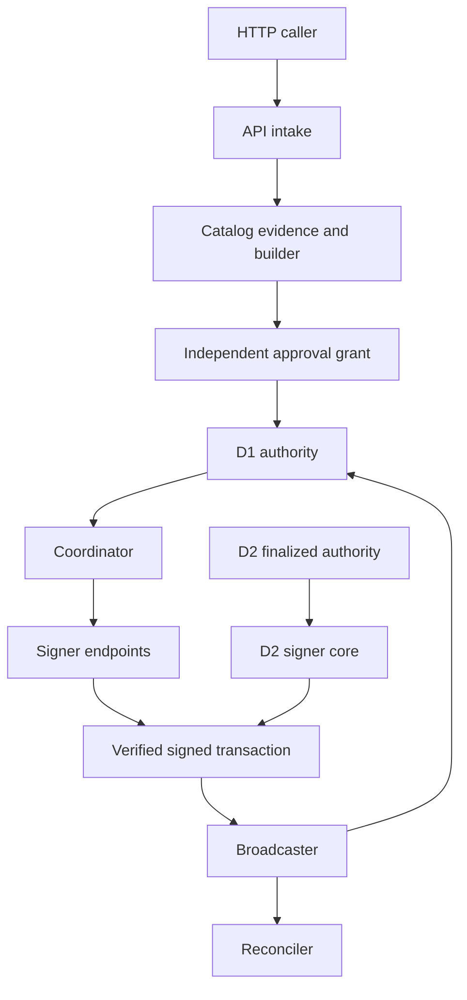

# Custody system overview

Open Institutional Custody is a Rust workspace for payment authorization and signing around exact EVM or Solana transaction bytes. Its workspace includes reusable domain, authorization, signer, network, API, reconciliation, and local-development packages, plus executable entrypoints such as `oic`, `oic-approve`, and `oic-local-stack`; it is not a single production service deployment ([workspace manifest](../../Cargo.toml), [approval client manifest](../../apps/independent-approval-client/Cargo.toml), [local-stack manifest](../../services/local-stack/Cargo.toml)).

The primary security split is deliberate:

- **D1** is a trusted, fenced, single-writer `Authority` that runs deterministic authorization transitions and signs its receipts. It owns global reservation, exposure, release, and chain-observation state.
- **D2** is an optional replicated-authority path. A signer uses a locally produced `VerifiedLog` only after authenticated finalization and contiguous re-execution; a block, snapshot, or unsigned transition result is not release evidence.
- **The local stack is development-only D1 composition.** It puts the D1 authority, simulated chains, and—even for its FROST demonstration—co-resident signing shares under one local OS account. It demonstrates integration; it is not D2, live-chain custody, or a production deployment profile.

## Runtime ownership and data flow



The diagram separates ownership rather than implying a single mandatory deployment path: the API pipeline uses the D1 `Authority` type today, whereas D2 signer authorization is driven by a locally verified replicated log. Both paths lead to signer-controlled chain output, and delivery reports chain evidence back to authorization while reconciliation maintains operational records.

### 1. HTTP intake owns request access and durable dispatch state

`oic-service-api` exposes authenticated `/v1` intent, preview, approval, submit, cancellation, operation, balance, event, and export routes. It requires a bearer credential, checks a vault-scoped `Read`, `Propose`, `Approve`, or `Submit` capability, limits bodies to 1 MiB, and deliberately exposes no arbitrary-transaction, key-import, enrollment, or administrative route. Credentials are stored and compared as token digests; a bearer capability is not an approval grant.

On creation, the API validates the immutable intent and its idempotency key, builds from its trusted catalog and current evidence, registers the intent with the authority, and persists an `IntentRecord`. On approval, it validates the grant's binding and signature before storing it. Submission re-evaluates policy using the authority's exposure view, marks dispatch durable, obtains a coordinator issuance, persists that exact signed transaction, then hands those bytes to the broadcaster. A repeated submit after an issuance reuses the stored bytes rather than creating a replacement payment.

### 2. D1 owns serialized authorization and global exposure

D1's `Authority` is the state owner, not a policy hint supplied by the coordinator. Opening it advances a fence token and authority epoch; an older instance subsequently cannot read or write through that API. Each command runs the deterministic transition inside the fenced store transaction, and a failed transaction emits neither state nor receipt.

The authority registers intents, maintains ordered approval enrollment and recorded grants, reserves exposure, commits release, and consumes chain observations. It signs reservation and release receipts. The coordinator supplies a candidate's verified claims and the matched `Allow` decision when requesting a reservation, but the authority is the component that serializes the resulting global state and computes the exposure view used for evaluation. A release is committed before its release receipt is signed; repeating release returns the original issuance rather than authorizing another envelope or session.

### 3. Signers own key shares and native verification

The coordinator is intentionally untrusted with policy override and share storage. It builds an envelope, reserves it, opens each signer session, relays or waits for pre-release MPC preparation, commits authority release, supplies that exact release receipt, aggregates output, and asks the pinned adapter to assemble and natively verify the signed transaction.

Each signer independently verifies scope, enrolled profile and evidence, pinned adapter and build, policy and grants, and native transaction semantics. It re-derives the signing payload from native bytes rather than trusting a coordinator description. It can prepare a session before release, but buffers share-producing rounds; it releases output only for the authority release receipt bound to that envelope and session, after consuming its one-time state durably. `SignerEndpoint` supports either an `InProcessSigner` or a remote authenticated endpoint, so in-process endpoints are a development/composition choice rather than the only implementation.

### 4. D2 replaces the D1 receipt input at the signer boundary

D2 does not turn a coordinator, gateway, or consensus message into signing authority. The replicated-authority crate contains no D1 receipt signing key. A D2 follower authenticates finalization, re-executes contiguous authority history, checks state roots and its independently retained floor, and syncs its journal before publishing a process-local `VerifiedLog`. The signer core consults that local capability at open and release, requiring a released reservation and issuance record.

The signer-network bridge carries bounded authenticated RPC and MPC traffic but is not a share holder. The bridge's gateway can reach a signer core or authority handler over the authenticated transport; the signer core remains behind private IPC and validates its own inputs. Fixed-committee Simplex consensus and keyless follower support are implemented as library/runtime composition. They do not provide a production node launcher, encrypted storage deployment, committee handoff, or live-chain observation.

For the D2 trust model and runtime details, see [Replicated authorization and signer network](replicated-authorization-and-signer-network.md). For D1 state transitions, see [Authorization authority](authorization-authority.md).

## Delivery, resolution, and reconciliation

The broadcaster holds no signing keys. It binds a profile, pinned adapter, and chain client; durably records an attempt **before** handing signed bytes to the chain; then records acknowledgement or uncertainty. Per-operation-family serialization prevents concurrent submits from overwriting newer chain evidence. It polls all configured evidence sources, reports agreed inclusion, reorg, and finality observations to the authority, and quarantines a family when sources conflict.

Acknowledgement is not finality. After a crash or an unacknowledged chain hand-off, the record becomes submission-unknown. For a possibly issued transaction, recovery first checks the chain; only unanimous definitive invalidation evidence can release the reservation. Otherwise the operation remains unknown. This conservative behavior matches coordinator issuance semantics: before a successful release, opened sessions and the reservation can be aborted; after release succeeds, a signature may exist, so errors return issuance uncertainty and exposure remains outstanding.

Reconciliation is a separate operational observer and journal owner, not an alternate authority or signing path. `Reconciler` opens by verifying stored journal, event, and checkpoint evidence, binds records to an institution and environment, and signs future operational events and checkpoints. It can plan bounded fee-funding and sweep workflows from accepted deposits, but workflow children are ordinary intents that must traverse the regular authorization and signing path.

## Development-only local stack and entrypoints

`oic-local-stack` is the runnable D1 demonstration entrypoint. Its `bootstrap`, `intent`, and `start` subcommands provision a private state directory, write an unsigned enrolled transfer intent, and serve only on a loopback address. Its process lock prevents another writer for the same state directory. On open it composes a file-backed D1 authority, API SQLite store, coordinator operation log, broadcaster submission log, reconciler store, signer ledgers/generations, and durable EVM and Solana simulators.

The stack gives separate local bearer capabilities to its console, reader, approver, and simulator operator. It uses development 1-of-1 secp256k1 for EVM and FROST Ed25519 2-of-3 for Solana, but all components are co-resident development components. Its router's catalog explicitly labels the profile and backend limits as development-only. Keep the whole state directory together on restart: recreating or selectively restoring stores to escape an uncertain payment is unsafe.

The independent `oic-approve` client is the separate approval executable. The `oic` CLI's `demo` command creates a throwaway temporary local stack, drives it over loopback HTTP, settles development EVM and Solana examples, and tests that an altered approval package is refused. These commands are useful focused integration entrypoints, not evidence of production readiness.

Useful checks include:

```sh
cargo test --locked -p oic-service-api --test http_flow
cargo test --locked -p oic-service-local-stack --test money_loop
cargo test --locked -p oic-replicated-authority --test contracts
cargo test --locked -p oic-service-signer-net --test finalized
```

See [Local development stack](../../docs/local-stack.md) for provisioning and operator behavior, [Broadcast and finality](../workflows/broadcast-and-finality.md) for delivery state, [Durable state and recovery](../operations/durable-state-and-recovery.md) for rollback boundaries, and [Implementation boundaries](../concepts/implementation-boundaries.md) before treating a runnable development flow as a production deployment.
