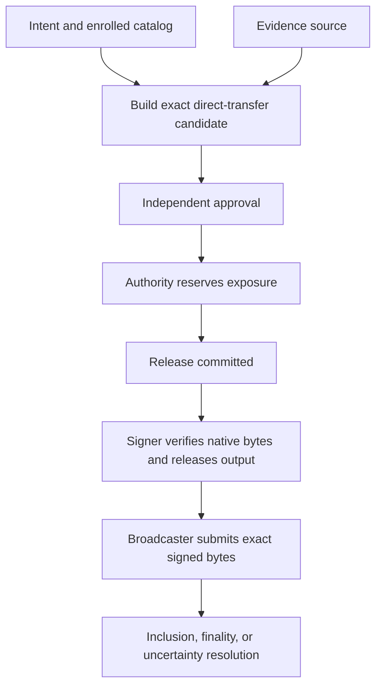

# Implementation and deployment boundaries

Open Institutional Custody is a **development preview**: it contains executable Rust libraries, services, CLIs, a local HTTP stack, real-node development-network clients, and signer-network components. That is not equivalent to a qualified production custody deployment. In particular, a passing simulator, local-stack, Commonware, or protocol-conformance test establishes behavior within that test's inputs; it does not establish live-chain operating readiness, independent signer domains, an audit, or production approval.

The workspace inventory is the source of truth for what can be built: it includes API, reconciler, Commonware membership/node/peer-wire, signer-network, witness, chain-RPC, local-stack, and node-runner members, in addition to builder, coordinator, and broadcaster. Earlier descriptions that treated those paths as reserved dependencies or missing services are obsolete.

## Supported direct-transfer surface

The supported chain operation is deliberately narrow. The adapters build or verify exact native transaction/message bytes, while the surrounding authorization path independently evaluates policy, approval grants, exposure, release, and finality. They do not expose a general transaction or arbitrary-digest signing service.

| Network | Executable direct-transfer scope | Signing boundary |
| --- | --- | --- |
| EVM | Native value and registered standard ERC-20 `transfer` operations. The builder emits EIP-1559 transactions; verification can also accept profile-enabled replay-protected EIP-155 legacy transactions. | The available EVM backend is development 1-of-1 secp256k1 ECDSA, not threshold custody. |
| Solana | SOL and classic SPL `TransferChecked`; an associated-token-account create/create-idempotent instruction can precede the transfer. The builder emits legacy messages; enrolled v0 messages can be verified and assembled. | FROST Ed25519 has executable DKG and threshold signing, including 2-of-3 test paths. Its DKG harness is in-process, and share refresh and lost-share recovery are not implemented. |

Unsupported EVM surfaces include arbitrary contract calls, approvals, permits, batches, contract creation, and unfamiliar transaction families. Unsupported Solana surfaces include multiple value-moving instructions, Token-2022, durable nonces, arbitrary programs, and extra multisig signers. Adding an adapter or RPC endpoint does not broaden this allowlist: a new operation needs native decoding, exact authorization binding, and failure tests.



This is the executable authorization-to-delivery boundary: signature issuance follows a durable release, while settlement still depends on subsequent chain evidence.

The [EVM adapter](../integrations/evm-adapter.md) and [Solana adapter](../integrations/solana-adapter.md) specify the accepted native formats and evidence requirements. The [system overview](../architecture/system-overview.md) describes component ownership, and [replicated authorization and signer network](../architecture/replicated-authorization-and-signer-network.md) describes the optional D2 authorization path.

## Runnable development compositions

### D1 local HTTP stack

`oic-local-stack` is the clearest runnable end-to-end entrypoint. Its bootstrap/start scripts compose the authority, independent approval client, builder, coordinator, signer, broadcaster, API, reconciler, durable stores, and EVM/Solana simulators. It binds to `127.0.0.1:8787`; separate local bearer credentials distinguish console, reader, approval, and simulator-operator actions. The API itself is scoped HTTP intake: it stores bearer-token digests, checks vault and permission scope, and still sends a request through builder, policy, authority, signer, broadcaster, and reconciler rather than signing a caller-provided digest.

The stack is explicitly a single-machine D1 trial. Its EVM key is development 1-of-1; its Solana FROST shares and authority are under one local OS account; its chain controls are simulator faucets; and its persistent state is local crash-durability machinery, not an independent rollback witness. Preserve the complete state directory on restart. In particular, an uncertain issuance or submission must remain reserved and be resolved from evidence, not cleared by recreating stores.

The documented local flow is useful for exercising fixed transfers and recovery behavior, but cannot move real funds and is not institutional SSO, a D2 deployment, or a production installation. See [the local-stack guide](../../docs/local-stack.md) for its commands, credential separation, durable-state requirements, and bounded scope.

### Real-node and network development paths

`oic-service-chain-rpc` provides JSON-RPC implementations of the broadcaster `ChainClient` and reconciler `BlockSource` for live EVM and Solana **development networks**. It uses the same adapter evidence formats as the simulators and makes no threshold-ECDSA claim for EVM. This is a real-node integration boundary, not a statement that mainnet operations or production monitoring have been qualified.

The repository also includes roster-admitted Commonware transport, process-separated signer-core/authority RPC composition, a fixed-committee D2 runtime, and `oic-node`, a per-role D1 reference runner. Those components exercise authenticated transport, local signer verification, and—in D2—finalized-history re-execution before a signer can release a share. They remain development compositions: the node runner provisions all secrets on one machine and uses a simulator; the D2 runtime lacks committee handoff, a deployment-grade encrypted-storage setup, verified chain observations, and production qualification. A roster removal is not cryptographic revocation of an already-held share.

## Operations are implemented services, not only schemas

`domain-types` defines operational contracts for deposit addresses, observed movements, cursors/backfill, journal and reconciliation records, workflows, and lifecycle events. The repository now also has `oic-service-reconciler`, which observes operational inputs and proposes bounded workflows without holding chain keys or becoming a signing path. It verifies stored journal/event/checkpoint evidence on open, binds its store to an institution and environment, and keeps new deposit addresses inactive until the required activation evidence is committed.

The reconciler's presence does not turn every declared product operation into a deployed service. Its workflow children remain ordinary intents and must use the normal authorization/signing route. Its file-backed journal, signed events, checkpoints, and local fences detect specified corruption/recovery failures, but a host that rolls back both state and its retained fence still needs an independently retained checkpoint or witness. Likewise, an HTTP event feed is operational observation, not a complete transactional audit outbox.

## Production gates and safe interpretation

The protocol v1 document is an interoperability contract for executable development behavior. It expressly separates its simulator-backed Gate B exercise from live RPC integration, independently operated signers, production threshold ECDSA, installation/recovery qualification, security review, and pilot operating approval. Specifications and RFCs can define intended requirements, but neither they nor package names prove an operational deployment.

Current production-relevant gaps include:

- No reviewed production threshold-ECDSA backend for EVM; its executable path is single-key development ECDSA.
- No supported live-chain production deployment claim. Chain-RPC code targets development networks, while simulator and local-stack evidence are not independent finality witnesses.
- No production launcher or committee handoff for the signer network; D2 is fixed-committee runtime composition with operator responsibilities outside the libraries.
- No network DKG, FROST share refresh, or recover/replace ceremony. Losing an unsupported signing subset requires key replacement and asset migration rather than a claimed automatic recovery path.
- No independent whole-host rollback protection from local files alone, and no asserted independent security audit or consensus-safety proof.

When extending the system, retain the critical ordering: authority release is committed before signature-enabling output; after release or uncertain submission, preserve exposure until chain evidence resolves the outcome. Keep credentials and key purposes separate, pin catalogs/profiles/adapter builds, and add focused negative and recovery tests for any new signer, chain operation, transport, or store. Start with the [verification guide](../testing/verification-guide.md), but treat its tests as scoped evidence—not deployment certification.

## Focused checks

```sh
cargo test --locked -p oic-service-api --test http_flow
cargo test --locked -p oic-service-reconciler --test money_loop
cargo test --locked -p oic-service-local-stack --test money_loop
cargo test --locked -p oic-service-signer-net --test network
cargo test --locked -p oic-replicated-authority --test contracts
```

These checks cover development HTTP behavior, operational money loops, durable local-stack recovery, authenticated network composition, and replicated-authority contracts. Run them alongside adapter and relevant live-development-network integration tests when changing those boundaries; none is a substitute for production operational qualification.
