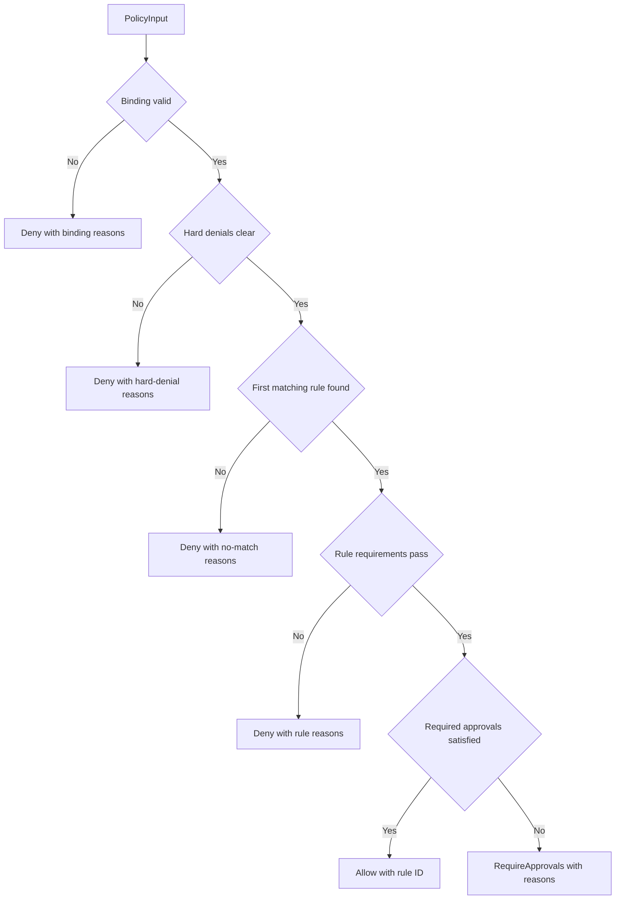

# Policy evaluation

`oic_policy_kernel::evaluate(&PolicyInput)` is the stateless, deterministic decision point for one candidate. It reads neither a system clock nor external state: callers supply `FreshnessContext`, a verified operation, evidence, authenticated grants, and an `ExposureView`. Equal inputs produce equal `Decision` values and stable `ReasonCode`s. Configuration mismatches, missing exposure, stale evidence, and checked-arithmetic failure fail closed.

## Authentication is a caller boundary

`PolicyInput` contains security objects, but `evaluate` is **not** the signature-authentication entry point. It recomputes the supplied policy and intent hashes and validates their bindings, then evaluates the bodies of grants it was given. Before calling it, a builder, authority replica, or signer must authenticate policy and destination administration, independently decode and verify the candidate, and call `verify_grants` against the enrolled approver roster.

`verify_grants` rejects a set with more than `MAX_GRANTS` (64) entries or any invalid member. It verifies enrollment, enrolled role, signature scheme and signature, and the half-open validity interval `[issued_at, expires_at)`. It returns distinct credential IDs only after the whole set passes; different enrolled credentials assigned to the same person cannot satisfy a multi-person quorum. This is stronger than the kernel's later diagnostic count, which evaluates the supplied grant bodies after this authentication boundary.

## Binding-to-approval order

The order below is binding. `Deny` at any stage stops processing; neither a later rule nor approvals can override an earlier failure.



This is the kernel's binding, hard-denial, rule, and approval decision flow.

### 1. Binding

The bundle must be at the authority's expected policy epoch and active at that epoch. The kernel recomputes `policy_hash` and `intent_hash`, and requires the policy, intent, and vault to share institution and environment; the intent must name the supplied vault, and the vault must name the policy ID. A failure returns `Deny` with all failed binding reasons.

### 2. Hard denials

Hard denials protect transaction meaning before rule lookup. They reject denied assets or destinations; mismatched IDs, network, version, activation epoch, or destination asset registration; and a `Nonstandard` asset profile. They also require the evidence network to match the decoded operation network.

The evidence timestamp cannot be in the future. Its maximum age is the smaller of the policy's `max_evidence_age_seconds` and the bundle's `max_staleness_seconds`; the exact boundary is accepted. Trust is environment-sensitive: validating nodes and cross-checked providers are accepted everywhere, a single provider is rejected on `mainnet`, and the development simulator is accepted only in `dev`.

Decoded transaction semantics must equal the registered destination and intent: recipient, amount, and concrete native/ERC-20/SPL asset identity must match. Native transfers must carry native value equal to their amount, ERC-20 transfers must carry zero native value, and SPL native movement is left to adapter fee accounting. The decoded maximum native fee may not exceed the intent constraint. An intent allowing zero successful payments and a grant list longer than 64 are unsupported hard denials.

### 3. Select one rule, then enforce it

Rules are searched in bundle order. The selected rule is the first whose vault, asset, destination, and purpose scopes all match; an empty scope list is a wildcard. If a vault/asset/destination scope matches but its purpose does not, `NoMatchingRule` is accompanied by `PurposeNotPermitted` unless a later rule matches fully. Once selected, a stricter first rule cannot be bypassed by a later permissive rule.

`match_rule` exposes this selection for status and approval-requirement explanations. It deliberately performs no binding, hard-denial, limit, or approval test, so it must not be used to authorize an operation.

The selected rule enforces the per-operation amount and native-fee ceilings, its UTC operating window, rolling limits, and automated-path configuration. Operating windows are half-open seconds-of-day intervals `[start, end)`: `start > end` wraps midnight; equal endpoints and out-of-range bounds are empty and fail closed; an absent window permits all times. A zero-approval rule is allowed only when its roles explicitly include `ApprovalRole::Automated`.

## Exposure and rolling limits

For every configured rolling limit, the kernel requires an exposure entry for exactly the intent asset and that limit's `window_seconds`. It charges the larger of the decoded transfer amount and the checked sum of adapter-claimed outflows for that asset:

```text
settled + outstanding + operation_outflow <= max_outflow_base_units
```

All additions are checked. A missing entry produces `MissingExposureData`; overflow produces `ExposureOverflow`; equality at the limit is permitted. `settled` represents finalized debits in the window, while `outstanding` represents potential debits from reserved or issued operations and is not aged out by the kernel.

The [authorization authority](../architecture/authorization-authority.md) owns the global state that produces this view and must atomically reserve exposure; a favorable preview is not a reservation. Signers have no global view: their local exposure helper supplies zero settled and outstanding values for every declared window, so they still reject an operation that exceeds a limit by itself while relying on the authority receipt for cumulative exposure.

## Approval decision and scope

If the selected rule requires approvals, the kernel examines grant bodies in supplied order (up to the hard 64-entry maximum). A grant must bind the same intent ID/hash, institution, environment, vault, policy ID/epoch, approved role, and current time. The kernel uses `issued_at <= now < expires_at`; it can exclude the proposer credential when `exclude_proposer` is set.

Scope must correspond to the intent's approval mode:

- `ExactCandidate` binds candidate ID, candidate revision, and `preview_hash`.
- `BoundedDirectTransfer` binds chain wallet, decoded network, asset, exact amount, destination ID/version/address, and a maximum native fee at least as large as the decoded fee. It also requires a positive successful-payment allowance.

A valid grant from a credential already counted is reported as `DuplicateApprover` and counts once. A body that fails kernel checks contributes its first failure reason but does not by itself force a denial: if enough other distinct, role-permitted grant bodies pass, the result is `Allow`. Otherwise the result is `RequireApprovals`, including the rule ID, required and satisfied counts, permitted roles, individual grant reasons, and `InsufficientApprovals`. In production call paths, pre-verification normally rejects malformed, untrusted, expired, or role-mismatched grant sets before they reach this diagnostic stage.

## Commitments, integration, and tests

`policy_hash` and `destination_hash` use unsigned views that exclude their own administrative signature arrays. An exact approval's `preview_hash` commits candidate ID, revision, decoded-operation hash, and evidence-bundle hash. See [security objects and canonical encoding](security-objects-and-encoding.md) for those formats and [independent approval](../workflows/independent-approval.md) for producing and checking grants.

The builder's `evaluate` first verifies every grant against enrolled approvers, then invokes the kernel with explicit time and exposure. Signers repeat grant verification and kernel evaluation against independently reconstructed candidate semantics, but use a zero-prior local exposure view. The replicated authority verifies grants and provides the cumulative exposure view before accepting the decision. These layers keep policy evaluation deterministic while preserving independent authentication and stateful reservation checks.

```sh
cargo test -p oic-policy-kernel --locked
```

[`tests.rs`](../../crates/policy-kernel/src/tests.rs) covers binding failures, hard-denial dominance, evidence trust and age boundaries, native semantics, first-rule selection, operating windows, rolling-limit equality/missing data/overflow, automated rules, grant scopes and expiry, duplicate approvers, and deterministic property tests. The approval verifier's grant tests additionally cover signature, roster, role, and whole-set rejection behavior.
