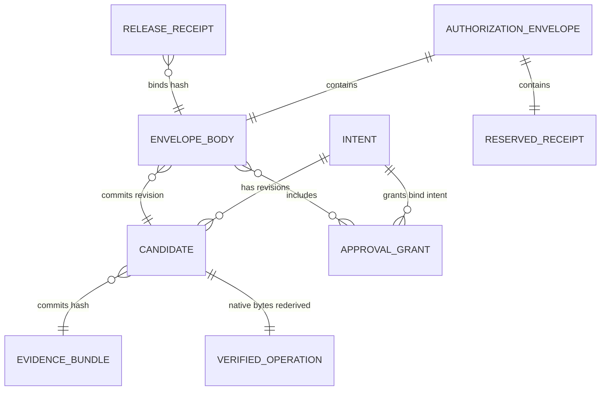

# Security objects and canonical encoding

`oic-domain-types` is the chain-neutral vocabulary that crosses custody trust boundaries. It deliberately owns neither cryptography nor I/O: canonical byte production belongs to `oic-canonical-encoding`, and interpretation of chain-native fields belongs to a pinned adapter. This separation matters because an object that is convenient to send as JSON must still be reconstructed as a typed value and canonically encoded before it can be committed or signed.

## Two representations, one security preimage

REST endpoints accept and return Serde JSON representations such as `Intent`; that is a transport boundary, not an authorization format. `Amount` is a canonical decimal string in JSON (and in canonical CBOR) so a JSON client does not lose `u128` precision. In human-readable formats, `Bytes` is `0x`-prefixed hex and `Hash32` is hex; in canonical CBOR they are raw byte strings. `Hash32` decoding requires exactly 32 bytes, and typed `Bytes` deserialization has a 1 MiB limit.

The signing preimage for a security object is instead:

```text
SHA256(UTF8(domain) || CanonicalEncode(typed object))
```

There is no separator, length prefix, or terminating NUL between the domain and bytes. `canonical_bytes` serializes the typed value to the restricted CBOR model; `domain_hash` then applies SHA-256. Never hash JSON serializer output, use JSON member ordering as a signature convention, or treat a JSON Schema validation as cryptographic verification. In particular, native EVM and Solana signatures use adapter-derived chain-native payloads rather than these internal SHA-256 domains.

## Custody objects and bindings

| Object | Security role |
| --- | --- |
| `Vault`, `ChainWallet`, `KeyDescriptor` | Establish the institution/environment and policy scope, native wallet address and profile, and key scheme, epoch, backend and participant threshold. A wallet is active only when its `active` flag is true. |
| `Asset` and `CounterpartyDestination` | Identify an asset by network plus native/ERC-20/SPL identity and a versioned beneficiary address. A destination carries administrative signatures; an approval names its exact destination version. |
| `Intent` | The immutable business request: wallet/profile, transfer asset, amount, destination/version, fee ceiling, approval mode, purpose, proposer and creation time. The implemented intent operation is `AssetTransfer`. |
| `Candidate` and `EvidenceBundle` | Bind an intent revision to exact unsigned native bytes, declared signing payloads, adapter version/profile, and an evidence commitment. |
| `VerifiedOperation` and `ResourceClaims` | Capture the adapter's independently derived transaction meaning, signing payloads, build identity, native resources, asset outflows, and native fees. An adapter must produce a supported decoded operation or fail rather than summarize an unknown transaction as a transfer. |
| `ApprovalGrant` | A credential signature over `ApprovalGrantBody`, binding an intent hash, policy epoch, approver role and lifetime to either an exact candidate preview or a bounded direct-transfer template. |
| `AuthorizationEnvelope` | Carries an authorization body and a `Reserved` authority receipt. The final `Release` receipt is separate, binds the same body hash, and gates signature-enabling output. |



This shows the object commitments that carry a custody decision: the envelope binds a particular candidate revision and approvals, while both receipt phases bind its body hash.

## Approval scopes

An `ExactCandidate` grant names the candidate ID and revision plus a preview hash. That preview commits to the candidate identity, decoded-operation hash, and evidence-bundle hash; substituting transaction meaning or evidence changes the approved preview.

A `BoundedDirectTransfer` grant instead carries a `BoundedTransferTemplate`: wallet, network, asset, amount, destination ID/version/address, maximum native fee, maximum successful payments, and the only fields the builder may fill later. The defined fillable fields are EVM nonce, EVM fee fields, EVM gas limit, and Solana recent blockhash. This is not authority to sign arbitrary native bytes: signer verification still re-derives and checks the native operation, payloads, resource claims, destination, and declared bounds. See [independent approval](../workflows/independent-approval.md) for the approval workflow and [policy evaluation](policy-evaluation.md) for policy constraints.

## Envelope and receipt commitment

`AuthorizationEnvelopeBody` commits the institutional and wallet scope; intent hash; family, candidate and revision; profile/key/public-key/adaptor/build identities; policy hash and epochs; exact native bytes and payloads; decoded-operation, evidence and destination hashes; grants; reservation and resource/fee maxima; deadlines and chain validity constraints; signing session; and participants. Its hash is:

```text
envelope_body_hash = SHA256("OIC/AUTHORIZATION/v1" || canonical_bytes(body))
```

The envelope includes only the `Reserved` receipt so the body does not recursively contain a receipt that signs its own commitment. Both receipt kinds contain the body hash, reservation and candidate identity, signer session, intent and resource-claims commitments, policy epoch, issuance/expiry times, and ordered authority commit sequence. Receipt verification checks the authority signature, receipt kind, every expected binding, and the half-open validity window. A signer additionally re-derives its trusted inputs: it rejects mismatched evidence, pinned adapter/build, policy/destination commitments, native bytes/payloads, decoded operation, and uncovered claims before allowing signing. See the [signer boundary](../architecture/signer-boundary.md).

## Canonical CBOR profile and failure behavior

The profile is a deliberately limited deterministic CBOR subset. It accepts unsigned and signed-range integers, bytes, UTF-8 text, arrays, maps, `false`, `true`, and `null`. It rejects floating point, tags, indefinite-length values, undefined and other simple values, non-shortest integer encodings, invalid UTF-8, unsorted or duplicate map keys, and trailing bytes. Map keys sort by the bytewise lexicographic order of their *complete canonical key encodings*, not JSON key order. Structs encode as maps keyed by their serialized field names; unit enums are text and payload enums are one-entry maps.

The decoder imposes a maximum depth of 64, at most 65,536 array items/map pairs across the input, and a 4 MiB total input limit. `from_canonical_bytes` first enforces those byte-level rules and then performs typed deserialization; it rejects unknown struct fields. `is_canonical` only establishes that bytes are one canonical value—it does not establish that the value is an authorized object for a particular schema or policy. Canonical encoding also rejects direct `u128`, `i128`, and float serialization; `Amount` is the domain type that supplies the safe decimal-text representation.

## Domains and signed views

The `domains` module names internal commitment domains including authorization, intent, candidate, decoded operation, evidence, policy, approval, preview, authority receipt, resource claims, chain profile, audit, key/public key, configuration, destination, journal, reconciliation, workflow trigger, webhook, signer fence, network roster, verification attestation, peer message, authority block, and P2P. Domain separation is meaningful only if producers use the correct object view.

For example, `policy_hash` and `destination_hash` deliberately encode unsigned views that omit their own `administrative_signatures`; those signatures cover the resulting hash. Approval signatures cover `ApprovalGrantBody`, and authority signatures cover `AuthorityReceiptBody`, rather than the wrapper that contains each signature. By contrast, raw native bytes and public-key material can use plain `sha256` where their producer specifies a raw-byte commitment. Changing a serialized field name, enum spelling, field presence, ordering of an array, unsigned view, or domain tag changes the commitment and is a protocol compatibility change.

## Verification and change discipline

Golden-vector conformance re-encodes every domain input through the real producer, compares recorded canonical CBOR and `SHA256(domain || canonical)` outputs, strictly decodes vectors, verifies included Ed25519 signatures over the 32-byte hash, and checks native EVM/Solana payload derivation against adapters and independent libraries. It also demonstrates that the reserved and release receipts in an end-to-end flow bind the exact envelope-body vector.

Run focused checks before changing a domain type or codec rule:

```sh
cargo test -p oic-canonical-encoding --locked
cargo test -p oic-golden-vectors --locked --test conformance
```

A safe compatibility review follows the commitment from typed input through its signed view and canonical bytes to every verifier—not merely the REST handler. Continue with the [verification guide](../testing/verification-guide.md).
