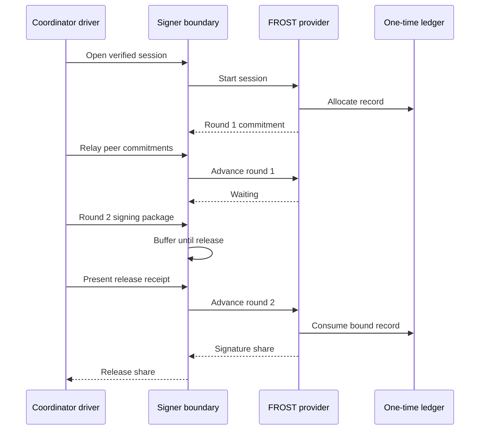

# Cryptographic providers

`oic-crypto-provider` is the narrow interface between the [signer boundary](../architecture/signer-boundary.md) and a cryptographic backend. The signer—not the provider or coordinator—verifies authorization and holds back share-producing traffic until release. A provider instead owns participant-local key material, its signing protocol, and correct use of one-time state. It produces a native chain signature or signature share only after its own protocol checks and durable consumption requirements are met.

This boundary must not be confused with other quorums: a policy's approval quorum authorizes an operation, consensus votes finalize replicated state, and a signing threshold specifies how many key-share holders are needed to make a native signature. They are distinct controls.

## Capability and topology contract

`BackendDescriptor` is the backend's explicit contract: identity and pinned upstream version, license, scheme and message convention, reviewed topology, native-verifier compatibility, refresh/recovery support, whether one-time state exists, the first share-producing round, and an operator-facing security note. Capabilities are deny-by-default: the signer must not call an undeclared operation or treat a backend requiring all members as a t-of-n backend.

`check_topology` enforces the declaration before key generation:

- `Threshold` accepts only a nonzero `t` in the descriptor's supported range and at most its participant limit.
- `AllParticipants` requires exactly its declared membership and threshold; it is not a threshold substitute.
- `SingleKeyDevelopmentOnly` accepts only 1-of-1 and makes no secret-sharing claim.

A `CryptoProvider` can generate and load sealed shares, start a single-payload session, advance authenticated peer traffic, aggregate where that backend permits it, and independently verify the final native signature. `refresh_shares` and `recover_or_replace` return `UnsupportedCapability` unless a backend explicitly overrides them. `PeerMessage` carries session, key/epoch, claimed sender and sender generation, recipient, round, sequence, protocol version, and opaque payload. The transport must authenticate the claimed sender; provider checks add protocol and scope binding, not a transport identity system.

## Available backends

| Property | `DevSingleKeyProvider` | `FrostEd25519Provider` |
| --- | --- | --- |
| Security topology | Exactly 1-of-1; one process holds the complete private key | Real FROST t-of-n, `2 <= t <= n <= 16` |
| Schemes and input | Prehashed secp256k1 ECDSA with an exact 32-byte digest, or pure Ed25519 over the full message | Pure Ed25519 over the full authorized message |
| Native output | ECDSA `r \|\| s \|\| recovery_id`, 65 bytes and low-s; or 64-byte Ed25519 | Standard 64-byte aggregate Ed25519 signature |
| First share-producing round | 1 | 2 |
| Key generation | Local single-key generation | Per-participant three-part DKG phases; an explicit development dealer exists |
| Session/nonces after restart | Sessions are in memory | Sessions and FROST nonces are in memory and are never resumed |

The development provider produces real signatures that native EVM/Solana verification can accept, but it has **no threshold security**: compromise of its process or sealing key compromises the whole key. It supports ECDSA for the EVM development profile and pure Ed25519 for development/conformance; it is not a production threshold-ECDSA implementation. For the ECDSA path, input must already be the adapter's 32-byte digest; the provider neither accepts an arbitrary-length preimage nor applies the chain-specific digest itself. It rejects high-s signatures and checks the recovery ID during verification.

FROST is the threshold backend used for pure-Ed25519 signing, including the [Solana adapter](solana-adapter.md)'s full serialized message. It is not a generic Ed25519 key API: each provider instance represents one enrolled participant's FROST share. A session may select any enrolled subset at or above the key threshold, but the current protocol package and aggregator require a commitment and share from **every participant selected for that session**. Therefore a non-cooperating member can block that selected subset; retrying with a different viable subset means starting a fresh session.

## Signing and release flow



This is the FROST path: pre-share commitments may flow before release, while the signer releases the round-two package only after authorization and returns the share only after record consumption.

For `DevSingleKeyProvider`, `start_signing_session` allocates a record and returns `Waiting`. Its only protocol input is round 1 at version `oic-dev-single-key/1`, addressed to the participant or broadcast, with payload `SHA-256(message_or_digest)`. It binds the release to the exact payload, durably consumes the record, signs, and returns `Complete`; further advances are aborted. The signer buffers that first, share-producing round until authorization release just as it would for a threshold share.

For FROST, each selected signer allocates a record, generates fresh in-memory signing nonces, and emits one broadcast round-1 commitment at `frost-ed25519/2`. The coordinator collects commitments and uses `build_signing_package` to create the round-two package for the exact authorized message. Before signing, a provider checks the package message, exact selected participant set, its own commitment, and commitments received directly from peers. It also checks message context, recipient, protocol version, monotonic sender sequence, and the generation floor captured when the session started. Only then does it consume the record bound to `SHA-256(message)`, wipe/take the nonces, and call FROST round-two signing.

Aggregation accepts one serialized share from every selected participant, rejects duplicates and outsiders, and uses FROST verification to detect an invalid share. On success it independently verifies the resulting 64-byte signature with strict `ed25519-dalek` verification. A substituted package is rejected before consumption; a ledger failure, signing failure after consumption, explicit abort, or replay leaves the session permanently unable to yield another share. Retrying requires a new session, a new ledger record, and fresh nonces.

The coordinator drivers are protocol routers, not an authority. `FrostEd25519Driver` broadcasts commitments, constructs the package, and relays it as round two; `DevSingleKeyDriver` constructs the single hash-bound release message. Each signer and provider rechecks received material, and the signer independently enforces the authorization release gate.

## Key generation and key-material boundary

Normal FROST key creation is distributed: each participant runs `dkg_part1`, sends its round-one package to every other participant, sends round-two packages only to their recipients, then calls `dkg_part3` to derive and install its own share. The in-process `run_dkg` helper drives those calls for tests and development; it requires exactly one provider per ceremony participant. In a deployed ceremony, round one requires authenticated broadcast with the same view for all participants, while round two requires mutually authenticated encrypted point-to-point transport. This crate supplies neither transport.

`generate_distributed_key` on one FROST instance deliberately rejects normal ceremonies. It permits a trusted dealer only when `recovery_profile == "dev-trusted-dealer"`; that dealer sees the group secret and all shares, so it is development-only. Dealer-produced shares are sealed using the dealing instance's sealing key, which means recipient instances must have that same key to load them. This is not the normal distributed topology.

Both backends return a public key descriptor plus opaque per-participant sealed blobs, not raw secret material. The shared sealing format is `OICSEAL1 || random 12-byte nonce || ChaCha20-Poly1305 ciphertext/tag`. Canonical-CBOR associated data binds the format, backend ID, key ID, key epoch, and participant; a blob replayed under another context or opened with a wrong sealing key fails authentication. Provider sealing keys, unsealed buffers, FROST key packages, and signing nonces are zeroized on their relevant drop/consumption paths. Loading also validates backend, scheme, participant, public key, threshold, and membership consistency before installing key material.

A sealed-share backup can be loaded by a correctly provisioned replacement instance in the test harness, but this must not be represented as backend support for `recover_or_replace`: the FROST descriptor declares that capability false, as it does share refresh. In particular, removing a participant does not revoke a share it already holds; absent a reviewed refresh/replacement process, changing the signing population requires key replacement and asset migration.

## One-time state, durability, and operations

The ledger stores only a record identity, session/key/generation binding, payload hash binding, and consumption state—never the secret FROST nonce or preprocessing. A provider allocates one record when it starts a session and must successfully consume it before returning a dependent signature or share. `consume` is exactly-once and message-hash bound; a repeated consume, different message hash, or tombstoned record fails.

`InMemoryLedger` is suitable for tests and single-process development, not restart durability. `FileLedger` is the persistent option: it appends canonical-CBOR mutations in length-prefixed, checksummed frames, syncs a successful mutation before returning, and keeps a high-water-mark sidecar. Replay validates contiguous sequence numbers and derived record identities. A torn final frame is truncated because it was not acknowledged; other corruption, or a log below the supplied or retained high-water mark, requires recovery. There is no OS file lock, so operators must not run competing processes against the same ledger.

On restore or replacement, `tombstone_generations_before` retires unconsumed older-generation records and raises a per-key generation floor. This protects against stale signer instances when paired with signer generation fencing, but local disk alone cannot detect a rollback of the log and its sidecar together. Preserve an independent sequence/freshness witness and follow [durable-state recovery procedures](../operations/durable-state-and-recovery.md). A lost in-memory FROST session must be abandoned, never resumed; a post-release failure remains issuance uncertainty rather than evidence that no signature was made.

## Extension checklist and focused tests

A new provider should declare only reviewed topology and lifecycle capabilities; implement native-compatible verification and strict message conventions; define who authenticates protocol transport; bind sessions, messages, generations and key epochs; and make its `share_producing_round` agree with the signer and coordinator driver. Stateful providers must document exactly when a record is allocated, durably consumed, aborted, tombstoned, and recovered. Do not equate a backend's signing threshold with approval policy or consensus membership.

```sh
cargo test -p oic-crypto-provider-dev -p oic-crypto-provider-frost-ed25519 --locked
```

Development-provider tests cover ECDSA recovery/low-s behavior, Ed25519 native verification, sealed-share binding, bad message/session context, consumption failure, and replay. FROST tests cover every two-of-three subset, three-of-five signing, DKG and sealed reload, explicit dealer gating, malformed/substituted packages before consumption, malicious shares, replay, failed consumption, nonce-wiping aborts, and stale-generation peer traffic. Run signer and coordinator tests too when changing the release gate or driver protocol.
