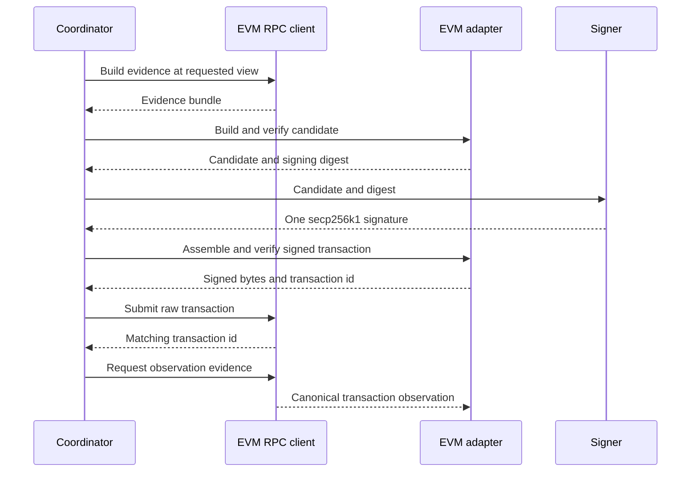

# EVM adapter contract

`oic_adapter_evm::EvmAdapter` is the stateless implementation of the shared `ChainAdapter` lifecycle for EVM transfers. It performs no I/O and has no clock: chain facts are inputs in an `EvidenceBundle`. In particular, signer-local decode, candidate verification, signing-payload derivation, and signed-transaction verification are pure over their inputs. The separate `EvmRpcClient` is the live JSON-RPC boundary that obtains those facts and broadcasts bytes; it is not part of adapter verification.



*The coordinator supplies evidence to the pure adapter, while the RPC client handles live-node reads and raw-transaction submission.*

## Capability boundary and profile binding

The profile must name adapter `evm`, encode its chain ID as an eight-byte big-endian `network_binding`, and enable only the accepted version strings `eip1559-type2` and/or `eip155-legacy`. The adapter rejects an empty version list and fails closed on an unknown string. Type-2 is the only build format; legacy EIP-155 transactions may be decoded, verified, signed, and assembled only when the profile explicitly enables `eip155-legacy`.

The supported operation is a direct transfer:

| Asset | Accepted transaction meaning |
| --- | --- |
| Native | Empty calldata, a 20-byte `to` address, and native `value` sent to the registered destination. |
| ERC-20 | A registered `AssetKind::Erc20` contract with `behavior = Standard`, called using exactly `transfer(address,uint256)`. The transaction target must be that registered contract, its native value must be zero, and calldata must be exactly 68 bytes with a clean address word and an amount that fits `u128`. |

ERC-20 identity is network plus registered contract address, not a token symbol or decimals. A `code:<contract>` item must contain a non-empty-code hash at the evidence state. This establishes that code exists at the registered address; it does **not** prove that the code implements a safe or standard token behavior.

Contract creation, arbitrary contract calls, approval, permit, batches, account execution, and arbitrary message signing are outside this contract. The parser also rejects non-empty access lists; EIP-2930, EIP-4844, EIP-7702, unknown typed envelopes, and pre-EIP-155 legacy signatures. The `manifest` records known external authorities such as token administrators and pre-existing delegations or allowances; these are operational risks, not adapter-approved transaction forms.

A candidate is scoped to the profile, adapter ID, and exact pinned adapter version. The wallet must be on the profile network and match the address derived from its enrolled secp256k1 key; the key must be enrolled for that network. `identify_network` additionally checks `chain_id` evidence against the profile binding and returns the evidence state together with the profile hash. The verifier build identity is `SHA256(VERIFIER_BUILD_ID)`, allowing enrollment to bind trust to the verification code as well as its adapter version.

## Building, authorization, and resource claims

`build_candidate` takes the intent, enrolled wallet/key, asset, destination, profile, and evidence. It always constructs a type-2 transaction with an empty access list. The nonce comes from `nonce:<sender>`; the fee fields use `max_priority_fee_per_gas = priority_fee` and `max_fee_per_gas = 2 * base_fee + priority_fee`, with checked arithmetic; and `gas_limit` comes from evidence. The builder rejects a worst-case fee above the intent fee ceiling and self-verifies the resulting candidate before returning it.

`verify_candidate` independently parses the exact unsigned bytes rather than trusting decoded coordinator data. It re-derives the signing payload and requires the candidate's declared payload array to match. It also binds the asset, destination address and version, intent or template, amount, and fee maximum. The nonce may be ahead of the evidence account nonce, but never below it; verification emits a resource lock `(network_id, sender, nonce)`, one asset-outflow claim, and one worst-case native-fee claim.

The worst-case fee is checked `gas_limit * max_fee_per_gas` for type 2 or `gas_limit * gas_price` for legacy, all in `u128`; there is no L2 data-fee component. The fee ceiling is an authorization limit, not an estimate of what will be paid.

A `BoundedTransferTemplate` can allow only `EvmNonce`, `EvmFeeFields`, and/or `EvmGasLimit` to differ from evidence-derived build fields. If a field is not fillable, the verifier requires the evidenced value. The amount and destination bindings remain fixed, and the template's native-fee maximum is still enforced. A Solana blockhash fillable field is rejected for an EVM wallet.

## Transaction bytes and signatures

The handwritten RLP decoder limits input to 128 KiB and nesting to eight levels. It rejects malformed or non-canonical RLP, including non-minimal encodings, leading-zero integers, truncation, trailing data, and unsupported magnitudes. Parsed nonce, gas limit, and chain ID fit `u64`; value and fee fields fit `u128`.

For type 2, the signing digest is Keccak-256 of `0x02 || RLP(unsigned fields)`. Legacy uses the EIP-155 preimage with chain ID and trailing zero fields. In both cases the transaction ID is Keccak-256 of the canonical signed encoding. The signing API produces exactly one `EcdsaSecp256k1Keccak256Prehashed` digest and an EVM-specific signing context.

Assembly accepts exactly one 65-byte `r || s || recovery_id` signature with parity 0 or 1. It validates scalar ranges and low-`s` canonicality, encodes the signed transaction, then re-verifies it. Verification requires canonical re-encoding, requires the signed transaction to re-encode to the approved unsigned candidate bytes, checks that `chain_tx_id` hashes the signed bytes, and recovers the signer address to compare with the enrolled key.

## Evidence and lifecycle

All evidence keys use lowercase hexadecimal address/hash suffixes without `0x`.

| Evidence item | Required value and use |
| --- | --- |
| `chain_id` | Eight-byte big-endian chain ID used by network identification. |
| `nonce:<sender>` | Eight-byte big-endian next account nonce, used for build, verification, and invalidation. |
| `base_fee`, `priority_fee` | Sixteen-byte big-endian per-gas values used to construct or constrain fee fields. |
| `gas_limit` | Eight-byte gas limit, including any client-provided margin. |
| `code:<contract>` | 32-byte Keccak-256 code hash used to reject a no-code ERC-20 target. |
| `tx:<hash>` | Canonical `TxObservation` for lifecycle observation or invalidation. |
| `signed_tx:<candidate_id>:<revision>` | Signed bytes for every possibly issued family candidate, required to prove invalidation. |

Before using a bundle, the shared scope check requires matching profile and network IDs, an accepted trust level, and a declared staleness window no wider than the profile permits. Build additionally checks the bundle against its supplied `built_at`; the pure verifier does not obtain time itself.

`observe` maps an absent-included `TxObservation` to `Submitted`, an included observation below the profile's required depth to `Included`, and one at or above `max(finality_depth, 1)` to `Finalized`. Finalized observations bind the inclusion block and profile finality commitment. Both included and finalized observations report whether execution succeeded and calculate paid fee as checked `gas_used * effective_gas_price`. Missing, malformed, or internally inconsistent observation evidence is stale/unusable evidence, not a claim that a transaction disappeared.

## Replacement and invalidation

EOA transactions have no on-chain expiry, so envelope approval deadlines do not make an already signed EVM transaction invalid. Same-sender, same-nonce transactions are replacements and retain exposure until the nonce is consumed under the profile's finality rule. `validity_constraints` therefore has no expiry height and describes this replacement rule.

`prove_invalidation` returns definitive evidence only when all of the following hold:

1. Evidence is at the profile's finality commitment.
2. Every candidate belongs to the requested operation family and has matching `signed_tx` evidence whose recovered signer is the same sender.
3. The evidenced account nonce is greater than every family candidate nonce.
4. Every family transaction has a non-included observation that names a nonce-consuming transaction.
5. Each named consumer is **not** a family transaction and has an included observation with sufficient confirmations.

A family member that lands, a submitted replacement, a nonce that has not advanced, absent signed bytes, or incomplete/insufficiently final evidence yields `InvalidationEvidence::Unknown`, rather than releasing the family. This prevents a same-family fee bump from being mistaken for cancellation.

## Live RPC integration, separate from verification

`oic_service_chain_rpc::evm::EvmRpcClient` connects to an anvil, reth, or geth-compatible endpoint, reads `eth_chainId` once, and creates a profile that enables type 2. Its evidence bundles carry one configured source and its declared trust level; declaring `ValidatingNode` does not itself establish that trust. `EvmRpcConfig::development` uses a ten-second timeout, `SingleProvider`, finality depth one, and a 65,000 gas evidence limit.

For building, the client pins account nonce and code reads to a selected block with EIP-1898 block-hash references and supplies chain ID, base fee, priority fee, gas limit, requested nonces, and requested contract code hashes. `submit` uses `eth_sendRawTransaction` and rejects a node response whose transaction hash differs from the local Keccak-256 hash.

For transaction evidence, the client only treats a receipt as included if its block is canonical at or below the selected view. Otherwise it produces a not-included observation; for candidate-family evidence it also fetches signed bytes, sender nonces, and scans up to 64 recent canonical blocks for a replacement consuming the same nonce. That bounded scan can fail to find an older consumer, in which case invalidation remains unknown.

The same client is also a reconciler `BlockSource`, which is a different concern from adapter approval. It indexes nonzero fees, successful top-level native value transfers, and well-formed classic ERC-20 `Transfer` logs. Optional `trace_internal_transfers` uses `debug_traceTransaction` with `callTracer` for successful internal `CALL`, `CREATE`, `CREATE2`, and `SELFDESTRUCT` value movement; a refused or malformed trace fails the block read rather than silently returning partial effects. Balances are read at a canonical block hash using `eth_getBalance` or ERC-20 `balanceOf`.

## Validation and operations

The adapter tests cover native and ERC-20 round trips, profile gating, byte and payload tampering, authorization/template bindings, no-code and malformed-calldata cases, canonical signatures, lifecycle mapping, and foreign-consumer invalidation. Property tests bound hostile RLP and candidate inputs. Differential tests compare encodings, signing digests, signed transaction hashes, and recovered signers with Alloy.

The live Anvil test is intentionally separate: it starts a real `anvil` process when available, obtains build evidence, signs and submits a native transfer, observes it, obtains candidate evidence, indexes its effects, and reads the recipient balance. It prints a skip and passes when the Foundry `anvil` binary is unavailable; CI is expected to install Foundry for the real loop.

```sh
cargo test -p oic-adapter-evm --locked
```

Relevant checks include [`crates/adapter-evm/tests/adapter.rs`](../../crates/adapter-evm/tests/adapter.rs), [`crates/adapter-evm/tests/differential.rs`](../../crates/adapter-evm/tests/differential.rs), and [`services/chain-rpc/tests/evm_anvil.rs`](../../services/chain-rpc/tests/evm_anvil.rs). For contrasting nonce/expiry behavior, see the [Solana adapter](solana-adapter.md); for development-node scope, see [chain simulators](../testing/chain-simulators.md); and for the broadcast lifecycle, see [broadcast and finality](../workflows/broadcast-and-finality.md).
