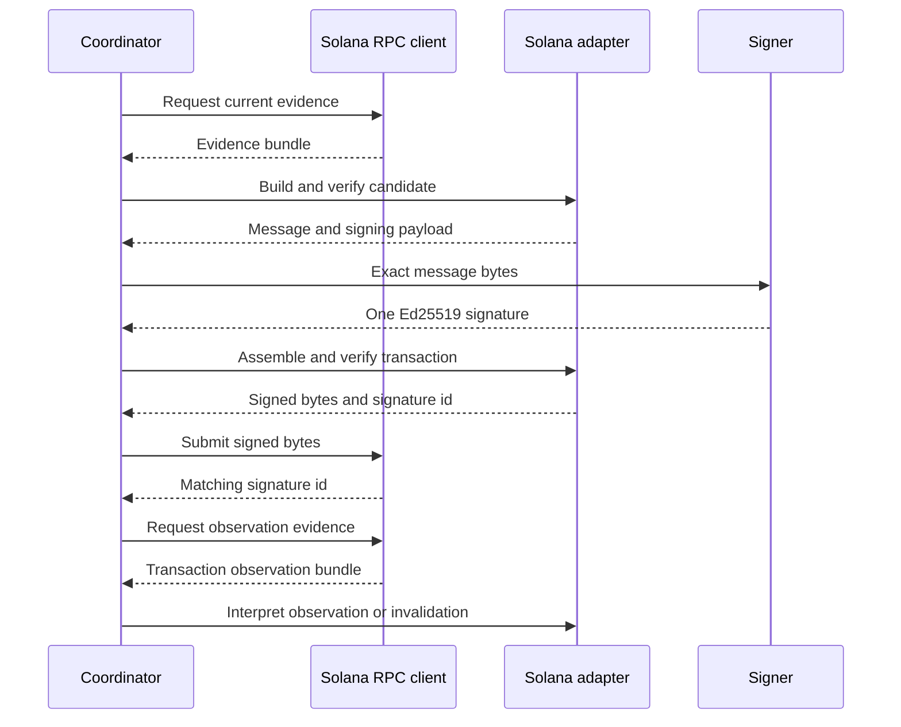

# Solana adapter contract

`oic_adapter_solana::SolanaAdapter` is the stateless `ChainAdapter` implementation for a narrow Solana transfer contract. It has no RPC, clock, or production Solana SDK dependency: every chain fact enters through an `EvidenceBundle`. Consequently, signer-local candidate decoding and verification, signing-payload derivation, and signed-transaction verification are deterministic functions of their inputs. The separate `SolanaRpcClient` obtains evidence and submits already-signed bytes; neither that transport client nor the chain simulator expands what the adapter accepts.



*Evidence crosses from the live client to the pure adapter; the adapter does not make network calls.*

## Profile, message, and signing boundary

A Solana profile must identify adapter `solana`, use a 32-byte genesis hash as `network_binding`, name a recognized finality commitment, and enable only `legacy` and/or `v0`. `identify_network` checks the scoped evidence and its `genesis_hash` against that binding. This is necessary because a Solana message carries no native network ID; genesis binding is an off-chain enrollment and evidence check, not an extra signing domain.

The candidate's `native_unsigned_bytes` is the serialized **message**, not a transaction. The adapter emits one `Ed25519Pure` payload containing those full message bytes—never a prehash—with a version-specific signing context. It accepts only one 64-byte signature, validates it strictly against the enrolled 32-byte Ed25519 key, and constructs:

```text
shortvec(1) || signature(64) || message
```

The `chain_tx_id` is the base58 form of that signature. Re-verification requires the transaction message to match the approved candidate byte-for-byte and the ID to match the fee-payer signature.

The builder requires `legacy` to be profile-enabled and emits only legacy messages. It self-verifies the output. Profile-enabled v0 messages can be decoded, verified, signed, and assembled, but are not built by this release; other version prefixes fail closed.

## Supported transfer semantics

The message must require exactly one signer. That signer is the registered wallet, which must be the writable fee payer at static account index zero. The adapter decodes every top-level instruction and accepts exactly one value-moving instruction:

| Transfer | Required interpretation |
| --- | --- |
| SOL | System Program `Transfer` from the fee payer to the registered destination. |
| Classic SPL | Original SPL Token Program `TransferChecked` of the registered mint and decimals, with the wallet as authority. |
| Destination setup | At most one ATA `Create` or `CreateIdempotent`, before an SPL transfer, for exactly the transfer destination. |
| Compute budget | At most one each of `SetComputeUnitLimit` and `SetComputeUnitPrice`. |

All other programs and instruction forms are denied, including Memo, plain SPL `Transfer`, approvals, authority changes, close/mint/burn/freeze operations, durable nonce operations, multiple transfers, and multisig signer arrangements. Token-2022 and non-standard asset behavior profiles are unsupported. Asset identity is the enrolled network plus mint and token-program identity, not token symbol or decimal count.

For an SPL transfer, source-account evidence must describe an initialized account owned by the wallet for the registered mint. The destination owner is established only by either the derived ATA for the registered destination owner or explicit destination token-account evidence. Such evidence must match the mint, be initialized, have no delegate, and have no close authority other than its owner. An optional ATA creation additionally checks payer, owner, mint, original token program, exact accounts, ordering, and PDA derivation; an address that merely looks like an ATA is not enough.

## Structural safety and lookup tables

The handwritten legacy/v0 parser accepts canonical, fully consumed wire bytes only. It rejects non-minimal or malformed compact lengths, inconsistent headers and signature counts, invalid indexes, duplicate static keys, trailing data, and messages that cannot re-encode exactly. The eventual signed transaction is bounded to 1,232 bytes and the static plus lookup-resolved account list to 64 accounts. Lookup-resolved accounts cannot be signers and invoked program IDs must be static accounts.

Each v0 address lookup table requires canonical `alt:<table>` evidence. The adapter resolves its writable and readonly indices in evidence order, records the resolution and table extension slot in decoded native detail, and rejects deactivated tables, invalid indices, and duplicate accounts across the resolved list. Missing or malformed table evidence is stale evidence, while an inactive table or impossible resolution is unverifiable transaction content.

## Fees, authorization, and resource claims

Verification independently derives the signing payload, binds the parsed recipient, asset, amount, destination version, and fee ceiling to an intent or bounded template, then emits one asset-outflow claim, one native-fee claim, and this resource:

```text
(network_id, fee_payer, recent_blockhash)
```

The maximum native fee is calculated with checked `u128` arithmetic:

```text
required_signatures * lamports_per_signature
+ ceil(compute_limit * micro_lamports_per_unit / 1_000_000)
+ worst-case ATA rent
```

Absent an explicit limit, the limit is 200,000 units for each non-compute-budget instruction, capped at 1,400,000. Absent a price, the priority fee is zero. ATA rent is included even for idempotent creation because it is a worst-case ceiling; it remains distinct from the SPL token amount and is reported as native value. A fee above the authorization ceiling fails verification.

A `BoundedTransferTemplate` may make only `SolanaRecentBlockhash` fillable. It cannot admit EVM fillable fields, and it does not make destination, asset, amount, or maximum fee variable.

## Evidence, expiry, and lifecycle

Evidence item integer values are little-endian; address and signature suffixes are base58. The core items are `genesis_hash`, `recent_blockhash`, `blockhash_last_valid_height`, `lamports_per_signature`, optional `cu_limit`/`cu_price`, optional token-account rent, and canonical token account or lookup-table records. A transaction observation is stored under `tx:<signature>`; possibly issued signed bytes are stored as `signed_tx:<candidate_id>:<revision>`. For an older family blockhash, use `blockhash_last_valid_height:<blockhash>`.

Candidate verification requires the message blockhash to equal `recent_blockhash` evidence and rejects it when `EvidenceBundle.state.height` exceeds its last valid **block height**. `validity_constraints` commits that height as `expires_at_height`. `observe` consumes canonical signature-status evidence and returns `Included` below the profile finality commitment or `Finalized` at or above it, including failed executions. Actual charged cost is RPC fee plus actual token-account funding, so settlement does not replenish rent that was actually spent. Missing observation evidence is `StaleEvidence`, not a not-visible result.

A fresh-blockhash rebuild is a new candidate with a distinct resource; it is not mutually exclusive with the prior candidate, so exposure must be retained additively. The adapter returns definitive invalidation only when all candidates in the operation family have evidence at the profile's finality commitment, every blockhash is at least `last_valid_height + finality_depth`, each retained signed transaction exactly matches and has valid signatures, and no family signature has successful observation evidence. A timeout, an RPC submission error, or one expired predecessor is insufficient. The [broadcast and finality workflow](../workflows/broadcast-and-finality.md) polls for landings before asking for that proof.

## Live RPC integration and operational limits

`oic_service_chain_rpc::solana::SolanaRpcClient` is a development-network JSON-RPC implementation of broadcaster `ChainClient` and reconciler `BlockSource`. `connect` binds the endpoint to `getGenesisHash`; `build_evidence` obtains a latest blockhash, its `lastValidBlockHeight`, configured signature fee, token-account rent, and requested classic SPL account records. Submission sends base58 signed bytes through `sendTransaction` and rejects an acknowledgement whose signature differs from the transaction's first signature.

This client must not be mistaken for a general mainnet evidence source. Its evidence state height is a **slot**, although Solana blockhash validity is expressed in block height; they coincide only on an unskipped development chain. RPC cannot query validity for arbitrary old blockhashes, so it records a per-blockhash height only for the view blockhash and relies on the adapter's bundle-wide fallback for that case. It does not resolve address lookup tables for candidate evidence and returns `UnsupportedCapability` when one is encountered. Plain RPC also cannot retrieve historical balances: reconciliation returns stale evidence unless the node still answers at the checkpoint slot.

The real-validator test starts `solana-test-validator` when installed, runs FROST 2-of-3 key generation and signing over a legacy native-transfer message, submits the aggregated standard Ed25519 signature, then observes, discovers, and reconciles the transfer through the RPC client. The test skips locally if the validator binary is absent; CI is expected to install Solana tools.

## Focused verification

```sh
cargo test -p oic-adapter-solana --locked
```

Adapter tests cover native and classic SPL transfers, ATA variants and rent, incorrect mint/account evidence, v0 lookup resolution, rejected authority and memo operations, compute-budget fee caps, altered bytes and signatures, templates, blockhash retry/invalidation, and parser size/fuzz boundaries. The live integration test is in `services/chain-rpc/tests/solana_validator.rs`; it exercises only the live RPC boundary and validator behavior, not additional adapter capabilities. For threshold signing context, see [crypto providers](crypto-providers.md).
