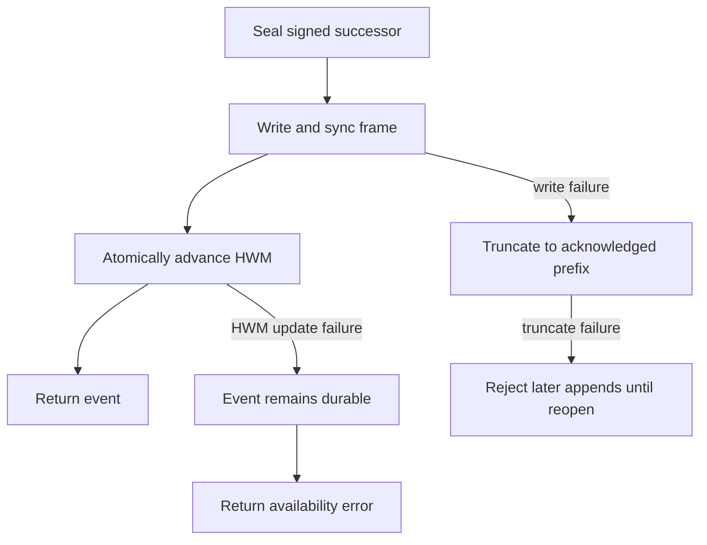
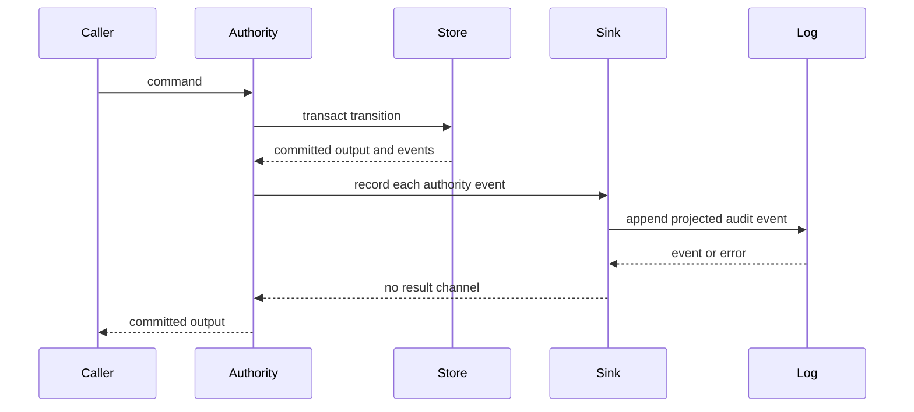

# Audit log and checkpoints

`oic-audit` provides signed, append-only evidence of actions and committed-object references. It is **not** the authorization-state database, and a durable audit event is not the same thing as authority transaction success: the authority commits its own state before it calls the audit sink. Treat the two stores and their recovery signals separately.

## Signed event chain

An `AuditLog` seals one `AuditEvent` per successful `append`, exposes its signed head through `checkpoint`, and supports ordered export with `events_since(sequence, limit)`. Event sequences start at one, increase by exactly one, and the first event uses `Hash32::ZERO` as its previous hash.

```text
event_hash = SHA256("OIC/AUDIT/v1" || CanonicalEncode(event_body))
```

The audit service signs this hash using `Ed25519Pure`. The body holds the sequence, prior event hash, timestamp, actor, action, object commitments, policy epoch, and detail. Its `event_id` is separately derived from a domain-separated commitment to all body fields except the identifier, avoiding a circular definition. `verify_event` revalidates the bounded content, derived id, and signature; `verify_chain` additionally checks strict sequencing and hash linkage, and can continue from a previously verified `(sequence, hash)` head.

Append-time bounds deliberately constrain what can enter the log: actor, action, and commitment labels must be nonempty and at most 256 bytes; detail is at most 4,096 bytes; and there are at most 64 commitments. Details containing case-insensitive `begin private key`, `seed:`, or `share:` are refused. That is a narrow tripwire, not secret redaction: callers must never pass secrets, nonce material, or key shares, and should commit to sensitive objects instead.

## File log lifecycle and recovery

`FileAuditLog` stores a stream of frames: a four-byte big-endian payload length followed by canonical-CBOR `AuditEvent` bytes. An append seals the successor, writes and syncs its whole frame, then advances `<path>.hwm` by an atomic replacement whose file and parent directory are synced. The append is acknowledged only if both steps succeed.



This is the `FileAuditLog::append` durability and failure path. A high-water-mark update failure is especially important operationally: the event is already in the file and the in-memory head advances, but `append` returns `AuthorityUnavailable` because rollback protection was not advanced. Do not blindly retry such an error as though no audit event exists; reopen/replay or inspect the log before deciding how to reconcile it.

On `open(path, expected_min_sequence, config)`, the implementation replays the complete file, checks service-key identity, and verifies every event id, signature, sequence, and link. It compares the verified head to the maximum of the local `.hwm` and supplied independent minimum **before** changing the file.

| Reopen condition | Result |
| --- | --- |
| Final length prefix or payload is incomplete | Truncate only that unacknowledged tail, sync it, and report the discarded byte count through `truncated_tail_bytes()` |
| Zero, oversized, or otherwise impossible frame length | `RecoveryRequired`; leave the file untouched |
| Complete frame cannot decode, names a different service key, or fails chain verification | `RecoveryRequired` |
| Verified head is below `.hwm` or `expected_min_sequence` | `RecoveryRequired` for suspected rollback |

An independently retained minimum protects when an old backup includes both the event file and its local sidecar. Preserve it or a checkpoint outside the file's failure domain; do not “recover” by deleting `.hwm`. See [durable state and recovery](durable-state-and-recovery.md).

## Checkpoints and independent witnesses

A checkpoint is a service-signed statement of `(service_key_id, sequence, head_event_hash, time)` under `OIC/AUDIT_CHECKPOINT/v1`; an empty log has sequence zero and a zero head hash. A checkpoint authenticates the service's claim but is not independent evidence while it remains solely with that service.

`compare_checkpoints` verifies both checkpoint signatures and requires they name the same service key. Equal sequences are either `Consistent` or `Diverged`. For different sequences, the caller must supply exactly the later history's events from `low + 1` through `high`; every bridging event is signature-checked and the chain is linked from the lower checkpoint. Missing, malformed, or internally inconsistent bridge data is an error, not evidence of equivocation. `first_divergence` verifies two complete histories before returning their first different sequence (or `None` when one is a prefix).

The witness service retains authenticated observations in its own hash-linked journal. For audit checkpoint messages, it uses its enrolled audit-key binding, verifies an included bridge before comparison, retains observations by key and sequence, and records `AuditDivergence` evidence if comparison returns divergence. Once evidence exists, the witness is quarantined until operators investigate; a higher sequence alone does not prove an audit history extends a lower one.

## Authority projection and failure visibility

Attach `AuthorityAuditSink` with `Authority::with_audit`. The authority first commits its fenced store transaction; it only calls `AuditSink::record` for the emitted events afterwards. `record` returns `()`, so an audit append failure cannot roll back, block, or turn a successful authority command into a failed one.



The sink projects each `AuthorityEvent` into an `authority.*` action, always commits the complete source event as `authority_event`, and adds domain-separated commitments for named objects. Current variants include opening, policy activation, credential change, approval recording, reservation, release, freeze/unfreeze, abort, and observation. Detail contains the authority commit sequence and relevant identifiers. `PolicyActivated` supplies its own epoch; later events use the sink's most recently known epoch, or `Epoch(0)` with `policy_epoch=unknown` until one is known. Its mutex holds epoch mapping and append together so concurrent records observe policy activations in append order.

Monitor `failure_count()`, `last_error()`, and `recorded_count()` on every `AuthorityAuditSink`. A nonzero failure count means committed authority changes may be missing from the audit log; alert, review the affected scope and authority commit sequences, and apply any halt or remediation policy at the application boundary. The sink advances its remembered policy epoch even if the corresponding append fails, so a later successful event can carry the current epoch without proving the missing event was backfilled.

For authority state semantics and durable transaction boundaries, see [authorization authority](../architecture/authorization-authority.md). Audit evidence complements rather than replaces reconciliation of potentially issued transactions; see [reconciliation and treasury workflows](reconciliation-and-treasury-workflows.md).

## Operational verification

Run the focused acceptance suite:

```sh
cargo test -p oic-audit --locked
```

The audit tests exercise tampering and incremental verification, input bounds, file replay and torn-tail behavior, foreign keys and rollback detection, checkpoint comparison/divergence, complete authority-event mapping, sink failure visibility, and reopening an authority sink backed by a file log. Witness contract tests additionally cover authenticated checkpoint observation and quarantine behavior.
