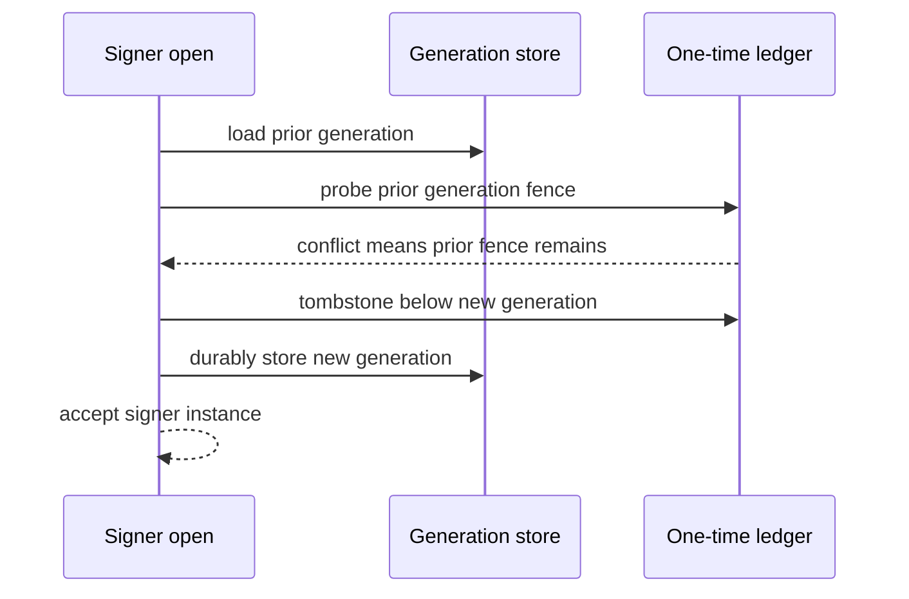
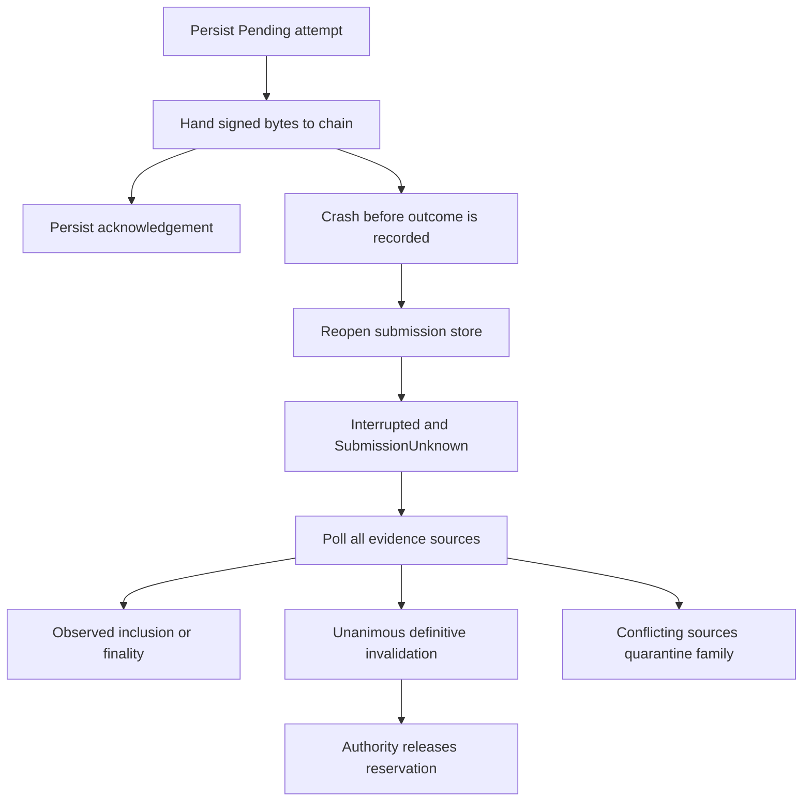

# Durable state and recovery

Durability is deliberately split by responsibility. Authority state determines whether an operation may be issued; signer state prevents one-time cryptographic reuse; coordinator and broadcaster logs preserve the fact that issuance or submission might have happened; reconciliation and audit retain separate evidence. A healthy file in one domain does **not** prove that another domain is current or recoverable.

## Persistence domains

| Domain | Durable implementation | What it establishes | Important boundary |
| --- | --- | --- | --- |
| Authorization authority | `FileAuthorityStore` | Canonical authorization snapshot, commit sequence, and writer fence | Not a cross-process lock or a transaction with other stores |
| One-time signer state | `FileLedger` | Allocation, consumption, tombstones, and generation floors | Stores metadata, never nonce/preprocessing secrets; no OS file lock |
| Signer generation | `FileGenerationStore` | A monotonically increasing signer-instance generation | Its local freshness depends on the ledger fence and external evidence |
| API intake | `ApiStore` | Scoped intent records and compare-and-swap dispatch state | Public operation material only; it does not replace authority or signer state |
| Coordinator | `FileOperationStore` | Append-only lifecycle history, including possible issuance | A replay log, not a universal crash-recovery controller |
| Broadcaster | `FileSubmissionStore` | Exact signed bytes and every submission attempt per operation family | Does not prove a chain hand-off did not occur |
| Reconciler | `OperationsStore` and signed event key | Reconciler operation data and event identity | Separate from authorization and chain-simulator history |
| Local simulator | `simulator.jsonl` and its floor | Replayed simulator calls and outcomes | Development crash durability, not an independent anti-rollback witness |
| Audit | `FileAuditLog` and checkpoints | Signed, hash-linked history | Audit completion does not make an authority command atomic with the audit log |

The local development stack opens these domains separately: authority, one ledger and generation file per signer, coordinator and submission logs, simulator journal, reconciler store, and API SQLite database. It takes an exclusive `process.lock` before doing so, then calls broadcaster recovery. That lock is a local-stack operational safeguard; standalone file-backed authority, ledger, coordinator, and broadcaster stores use in-process mutexes and should not be treated as a distributed database.

## Authority state: snapshot, fence, and witness

`AuthorityStore::transact` runs against a private state copy and publishes it in memory only after its persistence hook succeeds. `FileAuthorityStore` writes a versioned canonical-CBOR snapshot through a synced temporary file and rename, then atomically advances `<path>.hwm`. It refuses an oversized/unencodable successor rather than committing a snapshot it cannot reopen.

On open, the snapshot sequence must meet both the local `.hwm` and any caller-provided minimum; a missing snapshot beside a retained positive `.hwm` is therefore rollback. `open_with_witness` additionally verifies an authority-signed checkpoint. At the same sequence it requires the exact state hash; at a newer local sequence, the witness supplies a sequence floor rather than a proof of every intervening transition. The caller must independently select and retain the trusted witness and authority key.

Opening an `Authority` consumes the current fence token and advances it, so an older `Authority` instance using the same store fails its fence check. This is a writer-generation mechanism inside that store—not an OS-level exclusive lock across separately opened file handles.

## One-time state and signer fencing

A one-time record binds key ID and epoch, signer generation, session, and allocation counter. It can be consumed once for one message hash; a different hash, repeat consumption, or tombstoned record conflicts. Tombstoning older generations burns their unconsumed records and raises a per-key allocation floor.

`FileLedger` logs canonical-CBOR mutations in length-prefixed, checksummed frames. It fsyncs a mutation before success, replays only contiguous sequences, and recomputes allocation identities while replaying. An incomplete final frame is discarded as unacknowledged; a bad checksum, malformed frame, sequence gap, or inconsistent mutation requires recovery. Its `.hwm` and an optional supplied sequence floor detect a log restored behind either floor.



This is the signer-open fence sequence. If a prior generation exists but an allocation below it succeeds, `Signer::open` rejects the ledger as restored or replaced. Otherwise it raises the fence before persisting the new generation. `FileGenerationStore` itself rejects backward values and unreadable or foreign files, using a synced atomic replacement. `load_key` also tombstones older records for that key.

The fence is intentionally local: rolling back the generation file **and** the ledger together cannot be detected from those files alone. Retain an independent authority/audit checkpoint or provide a trustworthy minimum sequence. Likewise, the ledger does not contain secret nonce material. Providers must handle that material safely and consume the record before share production; the signer checks that the record is durably consumed for the payload before releasing a share. See [the signer boundary](../architecture/signer-boundary.md).

## Workflow replay and submission uncertainty

The coordinator appends and syncs each lifecycle transition before further action. Replay validates complete JSON lines and the issuance monotonicity rule: a candidate that may have issued cannot return to a pre-issuance state, and an older possibly-issued candidate cannot be hidden by a newer pre-issuance candidate in the same family. A final line lacking its newline is an unacknowledged torn tail and is truncated; a malformed complete line requires recovery.

The broadcaster persists a `Pending` attempt, including the exact signed transaction bytes, **before** calling the chain client. After restart, `recover` changes every remaining pending attempt to `Interrupted`; if there is no inclusion or terminal result, the record becomes `SubmissionUnknown`. A client error also remains uncertain rather than proving the transaction was not sent. Recovery does not invent a new signature: polling first uses cross-checked chain evidence; for an unresolved transaction, `resolve_unknown` only releases the reservation after every source supplies definitive invalidation evidence. Conflicting observations quarantine the family and stop further feeds to the authority.



This is the conservative broadcaster recovery path; uncertainty is preserved until chain evidence resolves it. For the broader lifecycle, see [broadcast and finality](../workflows/broadcast-and-finality.md).

## API, local-stack, simulator, reconciler, and audit operations

`ApiStore` is a scoped SQLite intake database configured for WAL and `synchronous=FULL`. It binds the database to one institution/environment, rejects another scope, preserves an existing intent's candidate and dispatch state, and uses a compare-and-swap replacement so concurrent API workers do not silently drop approvals or launch duplicate coordinator dispatch. It explicitly contains public operation material; authorization and signer ledgers remain independent durability domains.

The development stack requires the complete state directory: API SQLite/WAL, authority snapshot and fence, signer ledgers and generations, sealed shares, coordinator and broadcaster logs, reconciler data/event key, and simulator seeds, genesis, journal, and floor. Do not delete sidecars, reset a generation, or bootstrap a new installation to make an uncertain payment appear recoverable.

The simulator journal scratch-replays and validates an intended public simulator call, fsyncs a hash-linked command/outcome and local floor before applying the effect, then replays original seeds and times on reopen. It truncates only a partial final record, rejects complete mismatches or a journal below the local floor, and poisons a process after an ambiguous write until restart. These are useful development crash guarantees, but not power-loss proof, safe live-backup semantics, or an independent anti-rollback witness.

The reconciler store and its event signing key are separate from both authority and simulator persistence. Audit is separate again: `FileAuditLog` verifies signed hash-linked frames and enforces local or supplied rollback floors, while the authority commits state before invoking its audit sink. Monitor audit-sink failures and retain checkpoints outside the audited file's failure domain; audit history complements authorization state rather than replacing it. See [audit log and checkpoints](audit-log.md).

## Recovery procedure and tests

1. Stop competing writers; for the local stack, use its state-path lock and reopen the same installation.
2. Preserve every file and sidecar first. Treat `RecoveryRequired`, corrupt complete records, a floor violation, a missing expected fence, or an unknown submission as evidence to investigate—not as permission to reset state.
3. Reopen and replay each domain. Reconcile authority and ledger floors against retained independent witnesses, then inspect coordinator and broadcaster history before any new signing or submission.
4. For a pending or uncertain submission, retain the exact signed bytes, poll the chain, and accept only observed inclusion/finality or unanimous definitive invalidation. Rebroadcast only those stored bytes when the operation remains eligible.

Focused checks include:

```sh
cargo test -p oic-authorization-state -p oic-one-time-state-ledger -p oic-signer --locked
cargo test -p oic-service-coordinator -p oic-service-broadcaster -p oic-audit --locked
```

The focused suites exercise failed persistence, snapshot and ledger rollback floors, witness divergence, torn tails, generation monotonicity and restored-ledger fencing, issuance monotonicity, pending submission recovery, and corrupted submission history. The local-stack acceptance test additionally covers process death/reopen with pending approval or submission and lost RPC acknowledgements.
