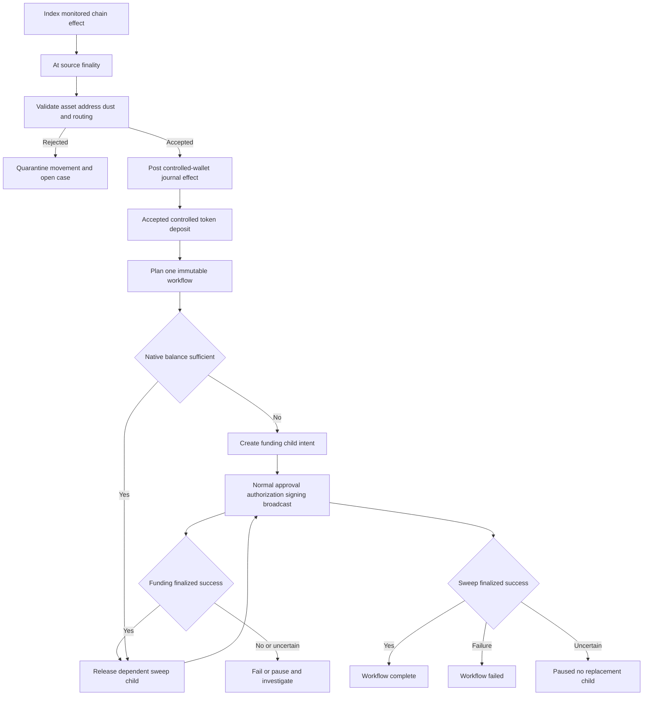

# Reconciliation and treasury workflows

The reconciler is an **observer and workflow planner**, not a signer or a policy override. It indexes effects for enrolled addresses, turns finalized controlled-wallet effects into journal postings, signs operational events and checkpoints, and can propose a bounded funding-and-sweep workflow after an eligible deposit. It has no chain keys and no signing entry point. The resulting child intents are still ordinary custody operations: they must be built, approved, authorized/reserved, signed, broadcast, and finalized through the standard pipeline.

This division is important operationally. A chain balance, a journal balance, an accepted deposit, an approved workflow, and a finalized payment are distinct facts. In particular, the availability of a balance is not authorization to spend it.

## Operating model and durable records

`Reconciler::open` first verifies the stored journal, lifecycle-event signatures, and reconciliation-checkpoint signatures using its service key, then binds the operations store to one institution and environment. The store retains enrollments and assets; indexed block hashes and cursors; movements; the journal; cases; checkpoints; signed events; backfill jobs; workflow records and their private planning context; and transaction-to-operation-family links. The export deliberately excludes chain keys and MPC material.

`OperationsStore` permits one file writer through an exclusive sidecar lock. It commits a revised snapshot by writing and syncing a temporary file, atomically replacing the high-water mark first and then the snapshot, and syncing the directory. An ambiguous persistence failure poisons the live store: reopen and recover rather than continuing to operate. On reopen, unreadable data or a snapshot revision below the retained high-water mark requires recovery; cryptographic integrity is separately checked when opening the reconciler. See [durable state and recovery](durable-state-and-recovery.md).

An `OperationsExport` verification checks hash-linked journal sequence and hashes, contiguous event sequence plus Ed25519 signatures, and signed checkpoint journal commitments. Signed lifecycle events are consumable in sequence order with `events_since(sequence, limit)`; callers can replay from a cursor rather than inferring state from notifications.

## Indexing, finality, and journal acceptance

A `BlockSource` supplies a profile, source identity and time, canonical head and finalized checkpoint, parent-linked effects by height/slot, and balances at an exact checkpoint. The shipped development sources recognize EVM transaction-value and classic ERC-20 `Transfer` legs plus fees, and Solana balance effects including failed-transaction fees; production sources must meet the same source contract.

`sync` catches up all missed heights in one store transaction. It records every scanned block hash, detects a changed or vanished retained tip, walks to the first fork, and reverses canonical movements at and after that height with compensating journal entries and a reorg case. It rejects noncontiguous history and also rechecks both head and finalized references before committing, so a moving source does not splice two histories. A new monitored enrollment causes a historical rescan; `backfill(from, to)` makes an inclusive, durable operator job whose result is `Complete` or `Failed`.

For each monitored effect, the reconciler derives a movement identity from network, transaction ID, and leg index. It deduplicates the same canonical effect, rejects contradictory content under that identity, records it as `Observed`, and associates it with a known operation family when the transaction was linked before acceptance. Movements only become eligible for acceptance once their observed height is at or below the source finality height.

Acceptance is deliberately restrictive:

- Unknown or unsupported assets, nonstandard asset profiles, retired or inactive addresses, configured routing references, and inbound amounts below the enrollment's dust threshold are **quarantined** with an open treasury case. A quarantined deposit receives neither an automatic credit nor automatic funding/sweep.
- Accepted effects at controlled wallets post credits or debits. Transfers are classified as accepted receipts, outgoing movements, or—when both controlled legs and an operation family are present—paired internal-transfer legs. Fees and account funding receive their own journal kinds.
- Watch-only movements can be accepted as observations but do not post controlled-wallet journal entries. A removed canonical movement is not deleted; its original postings are retained and compensated during reversal.



This workflow shows the accepted-deposit trigger, conditional funding dependency, pauses, and terminal outcomes. “Normal” always means the ordinary custody pipeline, not an automatic signing shortcut.

## Holdings and reconciliation checkpoints

`holdings(wallet, asset, reserved)` reports:

- **settled**: accepted journal credits minus debits;
- **pending inbound**: canonical observed inbound movements not yet accepted;
- **available**: `max(settled - reserved, 0)`.

Pending inbound never increases availability. A negative journal position is a recovery condition for the holdings API; overflow is unverifiable. Reservation input is supplied by the caller, so operational reporting can reflect the authorization authority's outstanding exposure without giving the reconciler authority over those reservations. For the authority's reservation and exposure model, see [authorization authority and exposure](../architecture/authorization-authority.md).

`reconcile(source, reserved)` only compares a fully indexed finalized checkpoint: the retained scanned hash and cursor finality must exactly match the source's current finalized reference, and finality is checked again before the checkpoint is committed. For every controlled enrolled wallet and supported asset, it reads the exact chain balance and compares it with journal balance, shortfall, reservations, and pending inbound. It signs the checkpoint and opens a critical `ReconciliationDifference` case for each inconsistency; it never silently creates a balancing journal entry.

A correction is an explicit administrative action. `resolve_difference` requires a nonempty exact correction scoped to the open difference case and current checkpoint, signatures from the authority's administrative quorum, and the precise difference amount and debit/credit side. It posts an `ExternalAdjustment`, resolves the case, and emits an event atomically. If journal or checkpoint history advanced, operators must reconcile again and authorize a fresh correction.

## Deposit-triggered funding and sweeps

`plan_sweep` is idempotent per `DepositAccepted` movement trigger: it computes a trigger hash and returns the existing workflow rather than re-planning on retry. Planning is allowed only for a canonical, accepted, inbound deposit of the exact configured asset/profile into the configured **active controlled** source wallet. The token amount is the wallet's available journal holdings and must meet both threshold and minimum-useful-value. Only token sweeps qualify for deposit-triggered gas funding; a native-asset deposit is rejected for this workflow type.

The planner validates the gas and sweep bounds, enrolled native asset, destination network/version/allowed assets, and controlled active funding source. It permits only one non-terminal workflow to own a source wallet's token balance. When finalized native balance is below the gas minimum or the sweep's required native balance, it plans a bounded native refill to the exact configured token wallet; the per-operation and per-period refill ceilings include in-flight allocations. The workflow's native-spend ceiling includes refill plus both child fee caps.

The generated child intents are immutable and use exact-candidate approval, one successful payment maximum, configured fee caps, and distinct purposes: `Fees` for an optional refill and `Internal` for the sweep. The sweep depends on the funding step when a refill exists; otherwise it begins ready.

### Execution is a handoff, not autonomous custody

`next_intent` refreshes progress from authority state and returns the next existing eligible child. It does **not** sign. Its caller must send the child through the ordinary intent API and its builder, independent approval, authority reservation, signer/coordinator, broadcaster, and finality path. The API persists an issuance before broadcast and links the signed transaction to the reconciler so indexed effects can be classified as workflow legs. See [broadcast, finality, and uncertain outcomes](../workflows/broadcast-and-finality.md).

A funding child must reach `FinalizedSuccess` before the dependent sweep can be released; acknowledgement or inclusion is insufficient. A successful sweep similarly completes the workflow only after finality. A child finalized unsuccessfully fails the workflow while retaining recorded fees. The same durable child intent is returned after a lost acknowledgement or reconciler restart; no duplicate child is planned.

The workflow pauses rather than creates or re-signs a replacement when any of the following is true:

| Condition | Recorded outcome |
| --- | --- |
| Existing child is `IssuanceUnknown` or `SubmissionUnknown` | `Paused` with uncertain issuance; inspect evidence, never create a replacement child |
| Trigger no longer canonical/accepted, source inactive, or vault frozen | `Paused` for policy conflict |
| Index does not match the current source head or exceeds the profile evidence-age limit | `Paused` for stale evidence |
| Estimated fee exceeds that child's cap | `Paused` for fee ceiling |
| Finalized balance after active reservations cannot cover child and native requirement | `Paused` for insufficient funds, with no attempt consumed |
| Attempt or workflow native-spend ceiling is exceeded before a new child | `Exhausted` and a critical case |

These pauses are stored state, so `next_intent` can return `None` for pause, failure, exhaustion, completion, or no eligible step; operators must inspect the workflow record. An uncertain child is especially not permission for automatic re-signing: preserve its evidence and follow the ordinary uncertainty-resolution procedure.

## Local development operation and tests

The local stack exposes `GET /local/v1/status` as an explicit refresh: it polls broadcasting, synchronizes reconciliation, and returns balances and signed checkpoints. `GET /v1/export` includes reconciler events, journal, and checkpoints, while `POST /local/v1/controls` has a distinct operator bearer for simulator `receive`, `fund_fees`, and bounded `advance` controls. Those controls are development faucets, not external deposits or approved treasury workflows. The stack runs only EVM and Solana simulators and is not a production deployment.

Focused coverage is in `services/reconciler/tests/money_loop.rs`: it exercises observed-versus-accepted holdings, restart and backfill without duplicated journal credit, actual EVM/Solana fees and Solana account-rent postings, signed export verification and event replay, deposit-triggered refills and dependent token sweeps, idempotent child recovery after restart, fee/funds/stale-index pauses, and finality-gated completion. Run it with:

```sh
cargo test -p oic-service-reconciler --test money_loop --locked
```

For an end-to-end development-stack check—including process death/reopen, lost RPC acknowledgement, balances, fees, signed export, and no signing retry after ambiguous release—use:

```sh
eto-build env RUSTFLAGS='-C link-arg=-fuse-ld=mold' cargo +1.95.0 test -p oic-service-local-stack --locked --offline --test money_loop -- --nocapture
```
