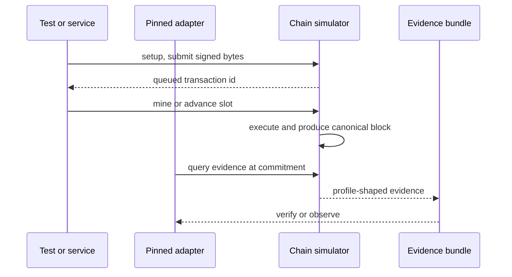

# Chain simulators and chain integration tests

`oic-chain-simulator` provides deterministic, in-process `EvmSimulator` and `SolanaSimulator` instances. A simulator is simultaneously a signed-transaction target, an evidence producer in the pinned adapter's item format, and a canonical block/effects feed. It is therefore the default controlled environment for exercising the build, signing, broadcast, observation, invalidation, and reconciliation paths together—not an RPC mock.

This is **development-only** infrastructure. Simulator profiles accept only `DevelopmentSimulator` evidence, and their faucet and mint-authority keys derive from public seeds. Do not use their credentials, evidence trust level, or deterministic economics as a production-chain security assumption. For adapter-specific verification rules, see [EVM adapter](../integrations/evm-adapter.md) and [Solana adapter](../integrations/solana-adapter.md).

## Control boundary and deterministic lifecycle

All mutable simulator state is behind a mutex and can be shared in an `Arc`; a `SimClock` is shared, manually driven, monotonic, and checked for overflow. Block/slot timestamps and evidence observation time come from that clock rather than wall time. Given the same seed, configuration, clock movements, and calls, tests assert the same block hashes and evidence hash.



This shows the explicit simulator progression boundary: submission only queues; the test controls inclusion and then asks for evidence.

A test controls the lifecycle explicitly:

| Concern | EVM | Solana |
| --- | --- | --- |
| Queue signed transaction | `submit` | `submit` |
| Produce canonical progress | `mine`, `mine_blocks` | `advance_slot`, `advance_slots` |
| Development funding | `fund`, `erc20_fund` | `airdrop` |
| Direct setup state | `deploy_erc20`, `install_code` | `create_mint`, `create_ata`, `mint_to`, `freeze_token_account`, `create_lookup_table` |
| Query output | `receipt`, `block`, balances/nonce, `evidence` | `tx_status`, `block`, lamports/token balances, `evidence` |
| Replace nonfinal history | `reorg(depth, drop_tx_ids)` | `fork(discard_after_slot, drop_tx_ids)` |

`fund`, `erc20_fund`, and `airdrop` construct real faucet-signed transactions and remain queued until the next block or slot. In contrast, direct setup operations update working state immediately so a following submission can use it, but are recorded in the next produced block/slot before they appear in block-derived evidence. Mine or advance after setup when testing an evidence consumer.

## Execution contracts, not full nodes

### EVM

The EVM simulator accepts EIP-1559 type-2 and replay-protected legacy signed transactions decoded by the pinned adapter. It recovers the native ECDSA signer, checks chain ID, nonce continuity or eligible replacement, fee cap, and the sender's worst-case pending obligation. An accepted submission is a mempool acknowledgement, never inclusion. Mining takes includable transactions in sender-nonce order and arrival order across senders; a fee cap below the current base fee remains pending.

Accounts carry native balance, nonce, and code. The execution model covers native transfers and registered ERC-20 `transfer(address,uint256)`, including `Transfer` logs. It charges the modeled effective gas price; a reverting call changes neither native nor token value but still pays fees. `set_fees` deliberately supplies fee-spike cases. This is not a general EVM: contract creation, arbitrary bytecode execution and contract-internal native transfers, access lists, calldata gas/refunds, and fullness-based base-fee adjustment are outside its contract.

### Solana

The Solana simulator produces one block per slot, so height equals slot in this model. It stores accounts as lamports, owner, and data, with classic SPL mint and token-account bytes in their real packed layouts. A submitted transaction must have strict Ed25519 signatures over its exact message, a valid recent blockhash, resolvable lookup tables, supported programs/instructions, no replayed signature, and a fee payer able to pay.

Queued transactions run in arrival order at `advance_slot`. Expired or orphaned blockhashes and now-unaffordable transactions are dropped. For an executable transaction, signature and priority fees are charged first; instruction effects are atomic, so an execution failure retains the fee but rolls back all instruction effects. The supported surface is System transfer, classic SPL `TransferChecked`, ATA create/create-idempotent, Compute Budget, Memo, and active lookup tables. It intentionally excludes, among other things, Token-2022, general CPI, durable nonces, delegates/multisig, wrapped SOL, rent collection for system accounts, and lookup-table lifecycle changes.

Commitment is also deterministic: the EVM exposes `latest` and depth-based `finalized`; Solana reports the head as `processed`, earlier nonfinal slots as `confirmed`, and slots at least the configured finality depth behind the head as `finalized`. A Solana blockhash is valid only through its configured slot window. These rules let tests prove expiry and finality without treating a timeout as cancellation. See [broadcast and finality](../workflows/broadcast-and-finality.md).

## Evidence, adversarial sources, and forks

Evidence queries read a requested canonical commitment; working-state queries read the head. Both simulators provide an honest default source plus `evidence_from(source, query)`. `set_lie` can override only a chosen transaction observation for a non-honest source; it does not mutate the chain. This is a controlled way to test cross-source disagreement and quarantine behavior. Several labeled simulator sources are still one process, not independent production RPC providers.

A reorg/fork is all-or-nothing: it refuses to cross finalized history, restores the fork-point snapshot, replays direct setup operations, requeues discarded transactions unless named in `drop_tx_ids`, then produces replacement blocks/slots with new hashes. A dropped transaction's effects and canonical observation disappear; a requeued transaction can be included on the replacement chain. The Solana tests specifically verify a lying source can report a finalized transaction while honest evidence remains stale, and that clearing the override restores honest items.

## Local-stack persistence and fault injection

The development local stack wraps both simulators in `DurableChains`. It journals controls and signed submissions before applying them, reconstructs fresh simulators by replay on open, and rejects a journal whose sequence, hash chain, identity, or replayed outcome differs. This makes local development state restartable, but the journal is explicitly not an independent rollback witness.

Controls can fund a wallet, advance one to 64 blocks/slots, or request `LoseNextSubmissionAck`. The last fault records the submission durably and then returns an acknowledgement-loss error, allowing broadcaster recovery paths to distinguish uncertain RPC acknowledgement from chain inclusion. The durable journal caps its retained entries/file size and poisons itself after an ambiguous write/effect until restart.

## Deterministic simulator tests versus live-node integration tests

Run the hermetic simulator contract suite with:

```sh
cargo test -p oic-chain-simulator --locked
```

The EVM suite covers native/ERC-20 transfers, nonce replacement, fee spikes, finality, reorg atomicity, source conflict, determinism, and sharing. The Solana suite covers SOL/SPL transfers with ATA handling, blockhash expiry and invalidation, signature/replay rejection, fee-retaining atomic failure, forks, v0 lookup tables, source conflict, determinism, and sharing. These are reliable tests of the repository's stated model and its adapter-format evidence boundary; they do not claim equivalence to all behavior of public chains.

The separate `oic-service-chain-rpc` integration tests use actual JSON-RPC clients against local node binaries:

```sh
cargo test -p oic-service-chain-rpc --locked --test evm_anvil
cargo test -p oic-service-chain-rpc --locked --test solana_validator
```

`evm_anvil` starts Foundry Anvil when available, then submits, observes, discovers effects for, and settles a real native transfer through `EvmRpcClient`; without `anvil`, it prints a skip notice and passes. `solana_validator` similarly starts `solana-test-validator` only when available, runs a FROST 2-of-3 threshold-signed transfer through `SolanaRpcClient`, and checks observation, discovery, settlement, and reconciliation; without the binary it skips successfully. Thus these are optional environment-dependent compatibility checks, not substitutes for deterministic simulator coverage and not proof of public-network behavior.

For a broader test-selection map and SDK differential/model checks, see the [build and verification guide](verification-guide.md).
