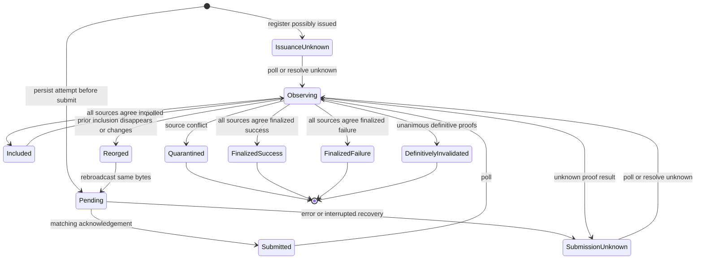

# Broadcast, finality, and uncertain outcomes

`oic_service_broadcaster::Broadcaster<S>` is the boundary between an already-authorized, already-signed transaction and the chain. It retains the exact candidate and signed transaction, hands only those bytes to a `ChainClient`, and reports reconciled observations to the [authorization authority](../architecture/authorization-authority.md). It has no signing keys, and neither a successful RPC acknowledgement nor an `Ok` return from `submit` is evidence that a transaction executed or finalized.

## Enrollment and durable ownership

Construct the service with an `Authority`, a `SubmissionStore`, and a `Clock`; then call `register_network(profile, adapter, client)`. Registration rejects a client whose network differs from the profile, an adapter whose manifest ID differs from the profile, or a client with no evidence sources. The `ChainClient` interface separates raw signed-byte submission from evidence queries for a transaction or possibly-issued candidate, and exposes both head and finalized state references.

Before recording bytes, `submit` and `register_possibly_issued` check that the candidate names the requested family and profile and that the signed transaction is bound to that candidate ID and revision. A family can retain one candidate/signed-byte pair: repeating that pair is idempotent where applicable, but a different pair conflicts rather than silently replacing a potentially live transaction. `register_possibly_issued` stores recovered signer output without broadcast, with lifecycle `IssuanceUnknown` and no attempt.

A per-family claim serializes each public mutating read-modify-write sequence. This prevents a delayed submission from overwriting newer inclusion/finality data and makes concurrent submissions preserve attempt history.

`SubmissionRecord` is the durable operational record: it stores the family/profile/network bindings, candidate, exact signed bytes, attempt history, authority lifecycle, latest inclusion/observation, quarantine flag, and timestamps. The production `FileSubmissionStore` is append-only JSON Lines: each snapshot is fsynced before `put` returns and the last snapshot for a family wins on replay. An incomplete final line is truncated as an unacknowledged torn tail, while a malformed complete line makes opening fail with `RecoveryRequired`. See [durable state and recovery](../operations/durable-state-and-recovery.md) for its role among the independent persistence domains.

## Submission and uncertainty lifecycle

`submit` first rejects a family already quarantined at either the authority or the submission record. It creates or reloads the compatible record; if it already has inclusion or a terminal released lifecycle, it returns it without another network handoff. Otherwise `attempt` appends `Pending` and persists the record **before** calling `ChainClient::submit`.

After the call, a matching transaction ID becomes `Acknowledged`. Only then, when the record has neither inclusion nor a terminal lifecycle, the broadcaster reports `ChainObservation::Submitted` to the authority using one configured source. A wrong returned ID or client error becomes `ErrorReported`; if no earlier acknowledgement or inclusion exists, the lifecycle becomes `SubmissionUnknown`. An error is not proof that bytes were not accepted.



*This diagram combines persisted attempt outcomes with authority lifecycle transitions: polling or resolution observes first, and only finality or definitive invalidation releases the outstanding reservation.*

`rebroadcast` executes another attempt using the stored signed bytes; it cannot construct a replacement or a new signature. It rejects quarantined families and lifecycles that are terminally released. A replacement candidate, including one with different fee fields, belongs in the authorization/build workflow rather than in broadcaster retry logic.

On restart, `recover` scans stored records, changes every remaining `Pending` attempt to `Interrupted`, and persists each changed record. If there is no inclusion or terminal release, it sets `SubmissionUnknown`; it does not call the chain. Operators must call `poll` or `resolve_unknown` after recovery. This preserves the crucial crash window between durable intent to send and recording an acknowledgement: it can be uncertain, never safely reclassified as “not sent.”

## Polling: evidence, agreement, finality, and reorgs

`poll` loads the record under its family claim and stops unchanged for a terminal lifecycle. A family already quarantined by the authority or record is persisted as quarantined without further evidence feed. Otherwise the broadcaster queries **each** configured source at the latest commitment. It validates evidence scope against the profile and current time, rejects a reported height above the client head, and asks the pinned adapter to interpret it. Adapter `StaleEvidence` is classified as not visible; other adapter errors stop the operation.

For a visible transaction, it also obtains that source's finalized view. It returns a `Finalized` classification only when the finalized evidence has the profile's finality commitment, its height does not exceed the client finalized height, and the adapter returns `ChainObservation::Finalized`; otherwise the latest observation remains inclusion. All sources must produce equal classifications. A conflict is reported to the authority, marks the record quarantined, and prevents later observation-driven release. Configuring multiple named simulator sources exercises the comparison path but does not demonstrate independent provider failure domains.

When all sources agree, the broadcaster feeds one observation to the authority:

| Agreed result | Effect |
| --- | --- |
| Not visible with no recorded inclusion | Preserve the current outstanding lifecycle and reservation. |
| Not visible after an inclusion | Clear `last_inclusion` and report `Reorged`; exposure remains outstanding. |
| Included in a new block hash | Report a reorg for the previous inclusion, then report the new inclusion. |
| Included but not final | Record `Included`; no settlement occurs. |
| Finalized success or failure | Report finality. The authority settles the reservation and actual fee; successful execution also records asset outflow. |

The authority owns accounting, not the broadcaster. It accepts submitted/included observations only while the reservation is released, charges a nonzero actual fee on finalized success **or** failure, and charges asset outflows only on successful final execution. A reorg after a resolved record is a `RecoveryRequired` condition because it exceeds the profile's finality guarantee.

## Resolving issuance and submission unknowns

`resolve_unknown` is deliberately observation-first. It calls the same polling path before considering invalidation, so an actual inclusion or finality wins over an expiry or other negative proof. It returns without release if the record is quarantined, terminally released, or currently included.

For an unresolved, not-visible record, it asks every configured source for candidate evidence at `Commitment::Finalized`, scoped to the exact stored candidate and signed bytes, then calls `adapter.prove_invalidation`. Every source must return `InvalidationEvidence::Definitive`; the first `Unknown` persists the appropriate unknown lifecycle (`IssuanceUnknown` for no attempts, otherwise generally `SubmissionUnknown`) and retains the obligation. The definitive proof reason and state retained for the authority are taken from one source; proof payloads from all sources need not be byte-identical. If all sources are definitive, `DefinitivelyInvalidated` is fed to the authority, which invalidates the released reservation and refreshes family locks; the family may become `ReplacementPending` if another active reservation remains.

The proof is adapter-specific. The EVM adapter requires finalized evidence that another transaction consumed the relevant nonce; the Solana adapter requires finalized expiry of the recent blockhash and absence of a successful signature for the candidate family. A timeout, expired approval, transport failure, or an unconfirmed RPC response alone does not justify releasing exposure or issuing a fresh live payment. Consult the [EVM adapter contract](../integrations/evm-adapter.md) and [Solana adapter contract](../integrations/solana-adapter.md) when implementing a production `ChainClient`.

## Operational checks and focused tests

Use the broadcaster crate tests to validate a client or changes to lifecycle handling:

```sh
cargo test -p oic-service-broadcaster --locked
```

The EVM tests cover acknowledgement distinct from inclusion, an RPC failure that occurs after chain acceptance, reorg/drop and reinclusion, conflicting-source quarantine, crash-before-ack file recovery, and registration/binding checks. The Solana tests cover two-source agreement through finality, fork/rebroadcast, and an issuance-unknown record that can be invalidated only after definitive expiry evidence. For the underlying deterministic environments, see [chain simulators](../testing/chain-simulators.md).
