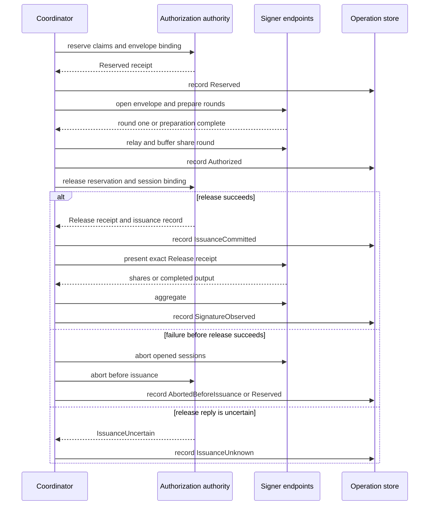

# Build, authorize, and coordinate signing

`oic-service-builder` is a pure candidate-construction and policy-preview library. `oic-service-coordinator` is an untrusted protocol orchestrator: it can request authority actions, relay signing protocol traffic, and assemble an output, but it has neither a policy override nor key-share storage. The [authorization authority](../architecture/authorization-authority.md) owns global reservation and release; each [signer](../architecture/signer-boundary.md) independently verifies the objects it receives and will not release output merely because the coordinator asks.

The coordinator returns an `Issuance` containing the completed authorization envelope, the authority release receipt and issuance record, and a natively verified signed transaction. That is an issuance result, not submission or finality; the reservation and its exposure remain outstanding until the [broadcast and finality workflow](broadcast-and-finality.md) provides resolving chain evidence.

## Build a candidate and evaluate a preview

A caller supplies `BuildInputs`: intent, vault, wallet, key, asset, destination, chain profile, policy, evidence, candidate identity and revision, operation family, and build time. `build` first cross-checks their institution, environment, vault, wallet, key/epoch, network, profile, policy, asset, destination, evidence, and deterministic operation-family bindings. It performs these scope checks before it calls the chain adapter.

The pinned adapter builds native unsigned bytes. The builder then verifies those bytes against the intent, checks that the candidate's evidence hash matches the supplied bundle, recomputes the decoded-operation hash, and requires re-derived signing payloads to equal the candidate's payloads. For `BoundedDirectTransfer`, it also derives the common bounded-transfer template and verifies the same candidate against that template, requiring identical decoded meaning and payloads. The result (`BuiltCandidate`) contains the verified and decoded operation, preview hash, optional template, and an `ApprovalPackage` containing the independently checkable inputs.

Chain state reaches this otherwise deterministic process through `EvidenceSource`, not through builder I/O. An evidence source requires the requested profile, wallet, asset, and destination to belong to its served network/profile and does not fabricate absent data; the adapter decides whether a missing item is required. The supplied simulator sources support EVM and Solana evidence with either latest or finalized commitment.

`required_approvals` only explains the matched rule's nonzero approval requirement; it is not a decision. `evaluate` verifies every grant against the enrolled approver roster, requires the policy hash to equal the policy in the approval package, and invokes the policy kernel with the expected epoch, supplied exposure view, and explicit time. Its `Evaluation` records the decision, verified approvers, and matched rule. The authority repeats stateful checks at reservation and release, so an `Allow` preview is not authorization by itself.

## Construct the envelope

`envelope_body` binds the built candidate to the adapter manifest and profile, policy and key commitments, unsigned native bytes and verified signing payloads, decoded/evidence/destination hashes, grants, claim-derived resource/outflow/fee maxima, validity constraints, participant set, fresh signing session ID, and issuance deadline. Its reservation ID is deterministically derived from operation family, candidate ID, and revision, with reservation version `1`.

`signing_materials` copies the package objects into the signer-facing material. These helpers do not confer trust: signers authenticate their locally enrolled roots and rederive the envelope's claims, policy result, native interpretation, and payload before starting a session.

## Execute: reserve, prepare, release, assemble

`SigningCoordinator::execute` accepts a `SigningJob` with a built candidate, profile, policy, grants, evaluation, participant set, and deadline. It proceeds in this order:

1. **Decision gate.** Only `Decision::Allow` proceeds. `RequireApprovals` records `AwaitingApproval` and returns `ApprovalRequired`; `Deny` records `Rejected`. Neither reaches the authority.
2. **Static preparation.** It checks the job policy against the built package, ensures that the decision's rule exists and equals `matched_rule`, looks up the candidate adapter and every selected signer endpoint, selects a driver from the key backend/scheme, validates the participant set, creates a UUID-based session ID, and builds the envelope body. Mixed endpoints—some coordinator-relayed and some peer-networked—are rejected. These failures are recorded as `Rejected` before reservation.
3. **Reserve.** The coordinator sends the authority a `ReserveRequest` with the envelope/session hash binding, verified claims and grants, selected rule, and rolling exposure limits derived from that rule. A reserve failure is `Rejected`; no reservation exists to clean up. On success it completes the `AuthorizationEnvelope` with the signed `Reserved` receipt and records `Reserved`.
4. **Prepare signing.** Each endpoint opens and verifies the envelope. For coordinator-relayed endpoints, the coordinator collects round-one outputs, asks the driver to produce round-one relays and share-producing messages, and delivers them; signers buffer the latter until release. For peer-network endpoints, no MPC messages may be exposed to the coordinator, and it waits for every endpoint to report preparation complete. It records `Authorized` only after preparation succeeds.
5. **Commit release.** The authority receives the reservation/version, exact envelope hash and session, expected policy epoch, and a fresh clock value. A successful release durably crosses the possible-issuance boundary and the coordinator records `IssuanceCommitted`.
6. **Produce and verify.** The exact release receipt returned by the authority is passed to every selected signer. The coordinator collects one `Share` or `Complete` output per participant, asks the first endpoint to aggregate, assembles the transaction with the chain adapter, and natively verifies it against the candidate and key. It then records `SignatureObserved`.



*Reserve through release, including safe pre-release abort and the lost-release-reply path that must remain uncertain.*

## Driver and endpoint contracts

`SignerEndpoint` is a transport seam, with an `InProcessSigner` implementation that forwards to a real `Signer`. It exposes participant identity and generation; opening, receiving, waiting for peer preparation, release, aggregation, and abort. The trait's owned inputs/outputs permit a remote authenticated transport, but this crate does not implement one. An endpoint that declares `exchanges_peer_messages()` keeps MPC messages off the coordinator and must implement `await_prepared`; all selected endpoints must use the same coordination mode.

`BackendDriver` holds protocol routing knowledge, not key shares or release authority. `driver_for` supports:

- `FrostEd25519Driver` for `Ed25519Pure` keys on `frost-ed25519`. It requires distinct enrolled participants and at least the key threshold, validates exactly one correctly scoped commitment per participant, broadcasts commitments to peers, constructs a FROST signing package for the selected payload, and delivers a share-producing message attributed to a peer at the appropriate generation.
- `DevSingleKeyDriver` for `Ed25519Pure` or prehashed secp256k1 keys on `dev-single-key`. It requires exactly one key member and participant, accepts no round-one messages, and sends one message whose payload is the SHA-256 of the native payload.

Other backend/scheme pairs fail static preparation with `UnsupportedCapability`. In either protocol, endpoint and signer checks remain authoritative: the driver cannot turn a prepared session into a share without a receipt bound to that envelope and session.

## Failure semantics and durable record

The successful `authority.release` call is the hard boundary. A failure while opening sessions, relaying messages, recording `Reserved`/`Authorized`, or a definite failed release is **pre-issuance**. The coordinator aborts every session that opened and calls `abort_before_issuance` on the reservation. If the authority confirms that abort, it records `AbortedBeforeIssuance` and returns the original failure. Endpoint-abort, authority-abort, and lifecycle-log failures are appended to the returned error detail. A definite authority-abort failure leaves the reservation held and records `Reserved`, rather than falsely claiming its locks and exposure were released.

A release call that itself returns `IssuanceUncertain`—for example, an RPC reply lost after the authority committed—is different: the coordinator neither retries nor aborts. It records `IssuanceUnknown` and returns `IssuanceUncertain` naming the reservation and session. Once release succeeded, any later failure to record commitment, release a signer, aggregate, assemble, verify, or record the final state follows the same rule: no authority abort, retained exposure, an attempted `IssuanceUnknown` transition, and `IssuanceUncertain`. Missing coordinator output never demonstrates that no signer output exists; resolve it with chain evidence before considering a replacement.

`OperationStore` is an append-only local workflow log, not the authority's accounting database. It records refusal and lifecycle transitions with candidate/session/reservation/envelope/issuance/transaction identifiers. Its monotonicity rule prevents a candidate that may have issued from returning to a pre-issuance state; at family level, a later pre-issuance candidate cannot hide a possibly issued sibling. `FileOperationStore` writes and `fsync`s each JSON-lines transition, replays complete lines at open, truncates an unacknowledged torn final line, and requires recovery for a malformed complete line.

## Focused verification

```sh
cargo test -p oic-service-builder --locked
cargo test -p oic-service-coordinator --locked --test coordinator
```

The [coordinator integration tests](../../services/coordinator/tests/coordinator.rs) exercise EVM ERC-20 issuance and mining, every two-of-three Solana FROST subset, bounded template signing, byte tampering before release, a signer failure after release, a lost authority release reply, concurrent global-limit reservation, missing approvals, counterfeit or wrong-session receipts, and configuration failures before reservation. Continue with [signer verification and release boundary](../architecture/signer-boundary.md) and [broadcast, finality, and uncertain outcomes](broadcast-and-finality.md).
