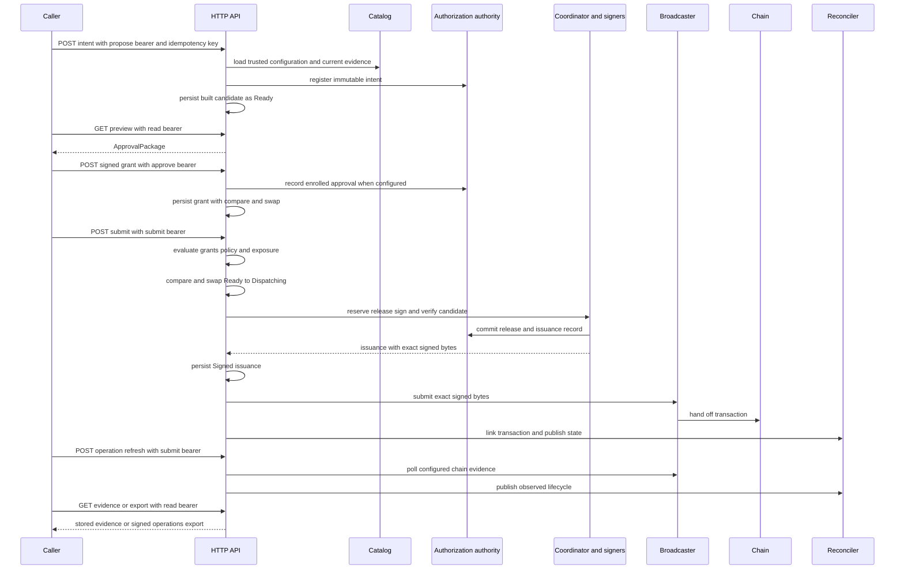

# HTTP intent lifecycle

The development custody API is an intake and evidence surface, not an arbitrary-signing service. An `Intent` becomes a built, immutable candidate only after the API selects configuration and current evidence from its deployment-owned `Catalog`; the caller cannot supply a key, adapter, destination record, policy, or signing payload. It then connects that candidate to the usual [build and coordination](build-and-coordinate.md), [independent approval](independent-approval.md), and [broadcast/finality](broadcast-and-finality.md) boundaries.

A successful HTTP request is deliberately narrow. `POST /v1/intents/{id}/submit` means signed issuance evidence was durably retained and a broadcast attempt was recorded; it is neither an RPC acknowledgement, chain inclusion, nor finality. Read the operation and refresh its chain evidence before treating a payment as complete.

## Trust and authorization boundaries

All routes require an exact `Authorization: Bearer <token>` header. A bearer is a random, domain-provisioned capability: the API stores its SHA-256 digest and rechecks the active credential roster, requested vault, and requested `Scope` on each operation. Removing a credential from that active roster revokes even a previously authenticated/cloned principal. The router has a 1 MiB body limit and intentionally exposes no CORS wildcard, enrollment, key import, administrative mutation, or arbitrary-transaction endpoint; deployment supplies TLS termination and bearer provisioning.

Bearer capabilities and approval credentials are different security objects:

| Object | What it authorizes | What it does **not** establish |
| --- | --- | --- |
| API bearer capability | One or more vaults with `read`, `propose`, `approve`, or `submit` route scope | An approval signature, policy quorum, authority reservation, or signing power |
| Approver credential and signed `ApprovalGrant` | A separately verified approver identity and a signed commitment to this intent/package | HTTP access or permission to submit a payment |
| Authority grant/receipt | Stateful authorization and release in the coordinator/signer protocol | Chain acceptance or finality |

`POST /v1/intents` and cancel require `propose`; preview, intent, operation, evidence, balance, replay, and export reads require `read`; grant intake requires `approve`; submission and operation refresh require `submit`. The create route additionally requires that `proposer_credential_id` equal the bearer credential ID. Approval intake similarly requires that the grant name the authenticated approver credential, so possession of an `approve` bearer alone cannot upload a grant for someone else.

For an operation-family route, the API first resolves the family to its vault from authority state, then authorizes that vault. Institution-wide event replay and export are stricter: the caller must have `read` access to every vault represented by the catalog **and** retained reconciler or authority records, including a vault omitted by a partial catalog.

## API lifecycle



*API intake uses scoped bearer access, while approval, authority issuance, broadcast, and reconciliation preserve their separate trust and persistence boundaries.*

### 1. Create a trusted candidate

`POST /v1/intents` requires a nonempty `Idempotency-Key` of at most 128 bytes. The API rejects a wrong schema version, malformed intent ID, mismatched institution/environment, blank external reference, proposer mismatch, or insufficient `propose` scope before building. Idempotency is keyed by institution, the literal route `POST /v1/intents`, and the header value. Repeating the same immutable intent returns the stored candidate; attempting to reuse the intent ID or idempotency binding for changed content conflicts.

The builder input is assembled exclusively from `Catalog`: vault, wallet, key descriptor, asset, versioned destination, profile and adapter, active authority policy, enrolled signing participants, and evidence from the profile's `EvidenceSource`. It assigns the deterministic authority operation family, API candidate ID/revision, and current build time. Thus the returned `IntentRecord.built` contains the native candidate, verified effects, `ApprovalPackage`, and preview commitment—not authorization or a chain submission.

Create has multiple durable systems, so its error is not a proof that nothing happened: building, authority registration, SQLite insertion, or lifecycle publication can fail after an earlier step. Callers should read the intent or operation rather than generate a second payment request.

### 2. Preview and ingest an independent approval

`GET /v1/intents/{id}/preview` returns the stored `ApprovalPackage` under read scope. An approval client must verify its own pinned administrator roots and decode native bytes; API display text is not an authorization decision. See [Independent approval workflow](independent-approval.md) for the offline verification and signing process.

`POST /v1/intents/{id}/approvals` accepts grants only while dispatch is `Ready`. It checks the authenticated approver binding plus intent ID/hash, institution, environment, and vault, then verifies signature, expiry, and the enrolled credential roster. A grant ID is idempotent only if the full grant body matches; reuse with different content conflicts, and the API caps stored grants at the policy kernel maximum.

When the authority has an approval-credential roster, grant ingestion also writes to authority approval state. If that authority write committed but the API-store acknowledgment was lost, retry detects the recorded identical grant and repairs the API record without replaying the authority mutation. Recording a grant still does not say that quorum is met: submit re-verifies grants and policy against current time, policy epoch, exposure, and enrollment.

### 3. Dispatch, signing, and the irreversible boundary

The first submit loads the record under `submit` scope, calculates an exposure view, and evaluates the built package and stored grants. `ApprovalRequired` and policy denial occur while it remains `Ready`; they do not poison the dispatch marker. An allowed request resolves the enrolled signing participant set and profile, then uses SQLite compare-and-swap to persist `Ready → Dispatching` **before** it invokes the coordinator. This prevents concurrent submitters from starting two coordinators and races with cancellation from overwriting the winner.

The coordinator executes reserve, signer preparation, authority release, native assembly, and verification as documented in [Build, authorize, and coordinate signing](build-and-coordinate.md). On a completed result, the API CAS-persistes the `Issuance`—envelope, release receipt, issuance record, and verified signed native transaction—and marks the record `Signed` before it links and hands the exact signed bytes to the broadcaster.

There are two materially different retry cases:

- If `issuance` is stored, submit never signs again. It links and rebroadcasts that stored transaction, so a lost HTTP acknowledgement or lost RPC acknowledgement reuses exactly the same bytes.
- If the dispatch marker is already `Dispatching` but no completed issuance is stored, the API returns `ISSUANCE_UNCERTAIN`. A coordinator or signer may have crossed the possible-issuance boundary, so it neither retries signing nor permits cancellation. Inspect operation evidence and resolve through the uncertainty procedure rather than constructing a replacement payment.

A coordinator error is retained as `last_error` when the API can persist it, but dispatch stays marked. Errors after signing or broadcast can likewise describe an outcome that already took effect.

### 4. Broadcast, refresh, and finality

The broadcaster records attempt evidence rather than treating a chain-client failure as a failed payment. The API response after `broadcaster.submit` returns the persisted `IntentRecord`; a chain-client error can be recorded as `SubmissionUnknown` while HTTP still succeeds because durable issuance evidence exists. A later `POST /v1/intents/{id}/submit` rebroadcasts the stored bytes only.

`GET /v1/operations/{family}` is a read-scoped snapshot containing the current lifecycle, coordinator issuance summary, and broadcaster submission record; it does not poll an RPC endpoint. `POST /v1/operations/{family}/refresh` requires submit scope, polls configured chain evidence, and republishes state to the reconciler when the intake record remains available. Only `FINALIZED_SUCCESS` denotes final success under the enrolled profile. For observation agreement, reorg, quarantine, and proof-based resolution of unknown issuance/submission, follow [Broadcast, finality, and uncertain outcomes](broadcast-and-finality.md).

Cancellation is intentionally weaker than transaction replacement: `POST /v1/intents/{id}/cancel` CAS-persistes `Ready → Cancelled` with propose scope and is idempotent once cancelled. It cannot revoke a native signature; after dispatch starts it returns `ISSUANCE_UNCERTAIN`.

## Durable intake state and failure handling

`ApiStore` is a separate SQLite persistence domain for public operation material. Opening it configures WAL, `synchronous=FULL`, and a five-second busy timeout; it records and enforces a single institution/environment binding. Corrupt stored JSON is `RecoveryRequired`, and database failures map to `AuthorityUnavailable`/HTTP 503. It does not store custody shares and does not replace the authority, signer, coordinator, broadcaster, or reconciler stores; see [Durable state and recovery](../operations/durable-state-and-recovery.md).

The store's `replace(old, new)` compares the complete prior serialized record in the SQL `WHERE` clause. A failed CAS is a conflict: reread current state rather than blindly retrying a mutation. It protects approval accumulation, cancellation, dispatch start, issuance attachment, and error recording across independent API processes.

HTTP errors serialize the domain error body. Invalid request and unverifiable-transaction errors map to 400; an absent resource maps to 404; invalid/malformed/unknown bearer authentication is 401; scope mismatch and invalid grant signature are 403; conflicts, policy/approval requirements, and uncertainty are generally 409; unavailable authority/storage or recovery-required state is 503. A stopped async worker maps to 500 and expressly does not establish whether its work took effect. For every mutation with an ambiguous response, inspect the persisted intent and operation evidence before retrying.

## Evidence, replay, and export

`GET /v1/operations/{family}/evidence` resolves the family to its intent and returns its stored `IntentRecord`: original intent, candidate/package, approvals, dispatch status, issuance material, signed bytes, and last error. It is the per-operation evidence needed alongside coordinator and broadcaster records.

`GET /v1/events?after=N&limit=N` returns signed reconciler lifecycle observations in strictly ascending, institution-global sequence after an exclusive cursor. Consumers should independently pin event keys, verify each signature, persist their cursor only after processing, deduplicate repeat delivery, and replay gaps. Events are observations, not a transactional issuance audit.

`GET /v1/export` requires institution-wide read scope and returns schema version 1 with the reconciler operations export and an authority checkpoint. It contains no custody shares. It is neither a cross-store atomic backup nor a recovery package: full reconstruction also needs individual API operation evidence, other producers' issuance records, and declared chain evidence. For journal/export interpretation and treasury balances, see [Reconciliation and treasury workflows](../operations/reconciliation-and-treasury-workflows.md).

## Focused tests and local stack

Run the API-level suite with:

```sh
cargo test -p oic-service-api --test http_flow --locked
```

It covers scoped/invalid bearer handling, route idempotency conflicts, approval-required non-dispatch, signed-grant idempotency, EVM and Solana execution, finality refresh, durable reopen, signed event replay, evidence retrieval, lost RPC acknowledgements, two-connection dispatch/cancel races, institution-wide authorization, and recovery of an authority-committed approval.

The local development stack merges these `/v1` routes with `/local/v1` diagnostics and simulator controls. Its middleware advances simulated chains before each request. Local controls require a separate operator bearer (and fault injection must be explicitly enabled), so they are not part of the custody API authorization model. Its OS-process acceptance test validates independent approval, real native signatures, restart preservation, exact-byte rebroadcast, finality-gated balance effects, signed export verification, and refusal to re-sign after ambiguous release:

```sh
cargo test -p oic-service-local-stack --test money_loop --locked
```
