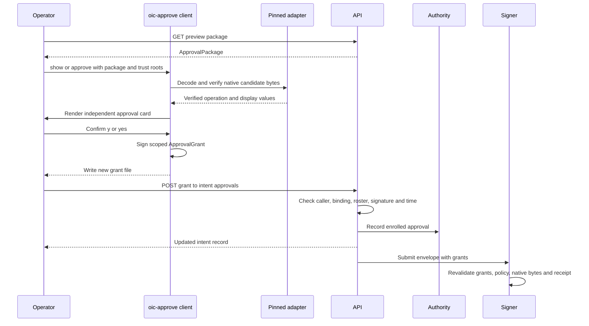

# Independent approval

Independent approval separates an approver's trusted review and signature from the coordinator, API, and MPC signing shares. The `oic-approve` CLI decodes the package's native candidate bytes with adapters compiled into the client; it does not trust console-provided descriptive text. Its trust file supplies the administrator roster and quorum, enrolled chain profiles, and accepted adapter build hashes. The client currently pins EVM and Solana adapters.

This workflow produces an `ApprovalGrant`, not a payment authorization by itself. The grant is later accepted by the API and is checked again by every signer alongside the package, policy, native bytes, and authority receipt. For policy outcomes after collection, see [Policy evaluation](../concepts/policy-evaluation.md); for how the builder and coordinator construct the later envelope, see [Build and coordinate](build-and-coordinate.md).

## End-to-end flow



This sequence shows the package retrieval, local decoding and confirmation path, then the distinct API ingestion and signer revalidation boundaries.

## Establish trust and protect the approver credential

`init-trust` creates a trust-root JSON file from out-of-band administrator public keys, a quorum, and one or more enrolled `ChainProfile` files. It records the verifier build hashes of the adapters compiled into the binary. On every use the client validates a nonzero satisfiable quorum, distinct administrator credentials and keys, distinct profiles, a pinned adapter for every profile, and acceptance of that adapter's build hash. A package cannot select a new adapter or profile merely by supplying its text.

```sh
./target/debug/oic-approve init-trust \
  --out /tmp/oic-trust.json \
  --admin-key "admin-a=<ED25519_PUBLIC_KEY_HEX>" \
  --admin-key "admin-b=<ED25519_PUBLIC_KEY_HEX>" \
  --admin-quorum 2 --profile /path/to/enrolled-profile.json
```

`keygen` creates a separate Ed25519 approval credential; creating it does **not** enroll it in the authority's approver roster. The file is newly created with mode `0600` on Unix and encrypts the 32-byte seed with PBKDF2-HMAC-SHA256 (at least 600,000 iterations) and ChaCha20-Poly1305. Its format, credential id, role, public key, and KDF parameters are AEAD associated data, and decryption also checks that the recovered key matches the header public key. A wrong passphrase or modified protected data therefore refuses to open. Pass the passphrase by an environment variable rather than on the command line.

```sh
./target/debug/oic-approve keygen \
  --out /path/to/approver.key.json --credential-id treasury-1 \
  --role treasury_approver --passphrase-env OIC_APPROVER_PASSPHRASE
```

## Review and sign a grant

Retrieve the preview package through the authenticated API endpoint `GET /v1/intents/{id}/preview`, then copy it to the independently operated client. `show` parses the supported package schema and renders a card; `approve` follows the same verification path before it can sign.

```sh
./target/debug/oic-approve show \
  --trust /tmp/oic-trust.json --package /path/to/package.json

./target/debug/oic-approve approve \
  --trust /tmp/oic-trust.json --package /path/to/package.json \
  --key /path/to/approver.key.json --passphrase-env OIC_APPROVER_PASSPHRASE \
  --grant-id grant-1 --ttl-seconds 300 --out /path/to/grant.json
```

### What the card proves

The independent verifier first verifies administrator quorums on the policy and destination records. It checks that all registry objects agree on institution, environment, vault, policy, wallet, key epoch, profile, asset, and destination version; it requires an enrolled profile and its pinned adapter. It recomputes and binds the evidence hash, derives the wallet address from the registered public key, decodes the candidate bytes, and verifies those bytes against the intent. The displayed recipient comes from decoded native bytes, not an editable destination label.

A decoded recipient different from the registry address is still displayed with a warning so the operator can see the problem, but `show`, `approve`, and grant verification refuse it. Before approval, the CLI also rejects evidence timestamped in the future or older than the tightest evidence, policy, and profile window. The fixed-width card renders exact integer-derived amounts and sanitizes all untrusted display text, making controls, bidi characters, and non-ASCII text visible rather than executable terminal content.

Approval mode determines the signed scope:

- **Exact candidate** binds the candidate ID, revision, and recomputed preview hash.
- **Bounded direct transfer** binds wallet, network, asset, decoded amount, destination ID/version/address, fee ceiling, and maximum successful payments. Only adapter-defined fields may be filled later: EVM nonce, fee fields, and gas limit, or Solana recent blockhash.

`approve` requires a positive TTL and checked expiry arithmetic, reloads and re-renders the inputs, and refuses if the re-render differs from the confirmed card other than advancing evidence age. By default, only `y` or `yes` confirms; `--yes` skips that prompt, not verification. It will not overwrite an output path and writes only after successful local grant signing and self-verification. Thus rejection of verification, key decryption, or human confirmation leaves no grant file.

The resulting grant signs a domain-separated canonical hash of its body. Its body binds institution, environment, vault, intent and intent hash, policy and epoch, scope, approver credential and role, and a validity interval. A grant therefore cannot be moved to a different operation, vault, or policy epoch.

`--now <unix-seconds>` supplies a deterministic clock for inspection and tests; otherwise commands use the system clock. It should not be used to treat a stale production package as current.

## Verify and ingest the grant

A recipient can independently check one grant against the same package and supplied approver credential:

```sh
./target/debug/oic-approve verify-grant \
  --trust /tmp/oic-trust.json --package /path/to/package.json \
  --grant /path/to/grant.json \
  --approver "treasury-1=<ED25519_PUBLIC_KEY_HEX>=treasury_approver"
```

This checks the Ed25519 signature, enrolled credential/role supplied to this command, validity interval, package identity bindings, and either the exact preview or the bounded template. Shared grant-set verification fails the entire set when any grant is invalid, while returning distinct credential IDs for a valid set.

To ingest a grant, POST it to `POST /v1/intents/{id}/approvals` with an API bearer credential that has `Approve` scope for the intent vault. The API requires the grant credential to match the authenticated principal and checks the immutable intent, hash, institution, environment, and vault bindings. It verifies the signature and time against the authority's active approval-credential roster when available (otherwise its configured roster), rejects a changed reuse of a grant ID, caps the grant count, and accepts approvals only while the intent is `Ready`. With an authority roster, it also records one approval per credential at the authority before persisting the API record; repeating an identical grant supports recovery of a lost acknowledgement.

Submitting the intent is a later operation. It evaluates the collected grants and current policy, persists the dispatch transition before coordinator execution, and treats errors after dispatch as potentially uncertain rather than authorization to create a replacement payment. See [HTTP intent lifecycle](http-intent-lifecycle.md).

## Inspect the later signing envelope

```sh
./target/debug/oic-approve inspect-envelope \
  --trust /tmp/oic-trust.json --package /path/to/package.json \
  --envelope /path/to/envelope.json
```

`inspect-envelope` recomputes the envelope body hash and reports each binding that affects the approver's view: intent, candidate, profile and adapter build, key, policy and destination hashes, native bytes and signing payloads, decoded operation and evidence hashes, reservation, verified claims and fee/outflow maxima, grant bindings/scopes, and receipt body bindings. A mismatch is refused (or is a destination-mismatch exit), but the command deliberately does **not** authenticate the authority receipt signature: the authority public key is not a trust root for this client.

That limitation is intentional, not a substitute for the signer boundary. Each signer checks its enrolled authority key, receipt signature, receipt validity and session/envelope/candidate/policy/reservation bindings. It also revalidates every grant against its enrolled approver roster and clock, confirms each grant's intent/vault/policy/scope binding, rederives the native operation and bounded template where applicable, and evaluates local policy before honoring the reservation. This makes local envelope inspection diagnostic while keeping authorization enforcement at the authority and signer trust boundaries.

## Failure signals and test focus

| Exit | Meaning |
| --- | --- |
| 0 | Command succeeded |
| 2 | Usage or argument error |
| 3 | Verification, freshness, signature, scope, or confirmation refusal |
| 4 | Decoded destination differs from the registry destination |
| 5 | File read, parse, create, or write failure |

Focused integration tests cover exact EVM and Solana grants, bounded scopes and their allowed fillable fields, refusal on wrong role, expiry, changed candidate, wrong passphrase, and non-confirmation. They also exercise field-level envelope mismatch reporting, the destination-mismatch exit, and the real CLI path from key generation through approve, verify, and inspect. The verifier grant tests additionally cover tampered bodies, unknown credentials, role mismatch, expiry/not-yet-valid grants, and an invalid member causing grant-set verification to fail.

For object formats and security commitments, see [Security objects and encoding](../concepts/security-objects-and-encoding.md).
