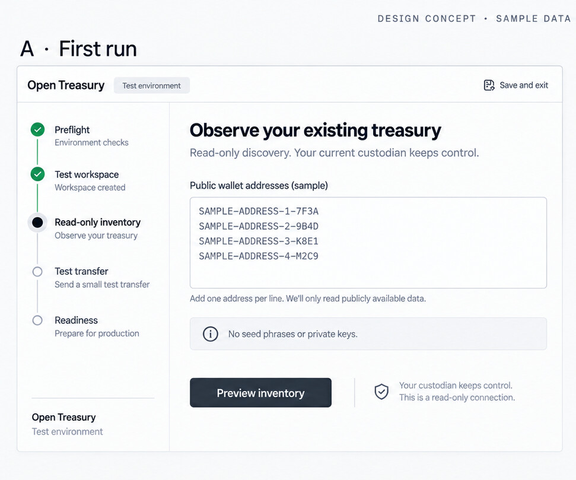
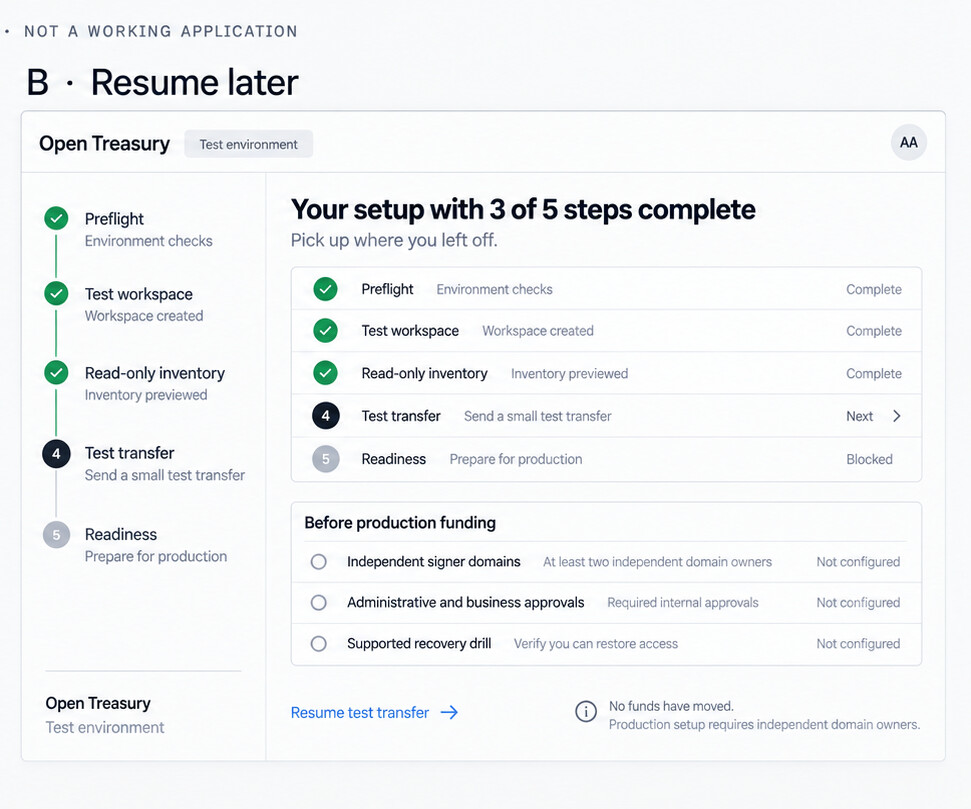
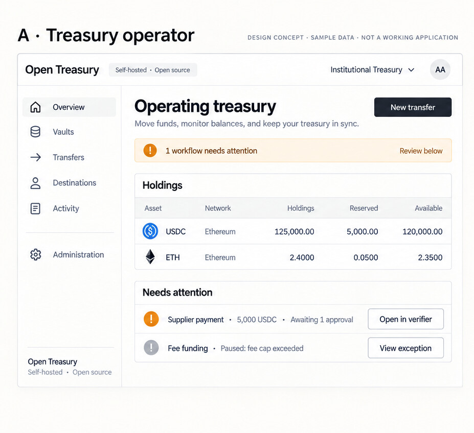
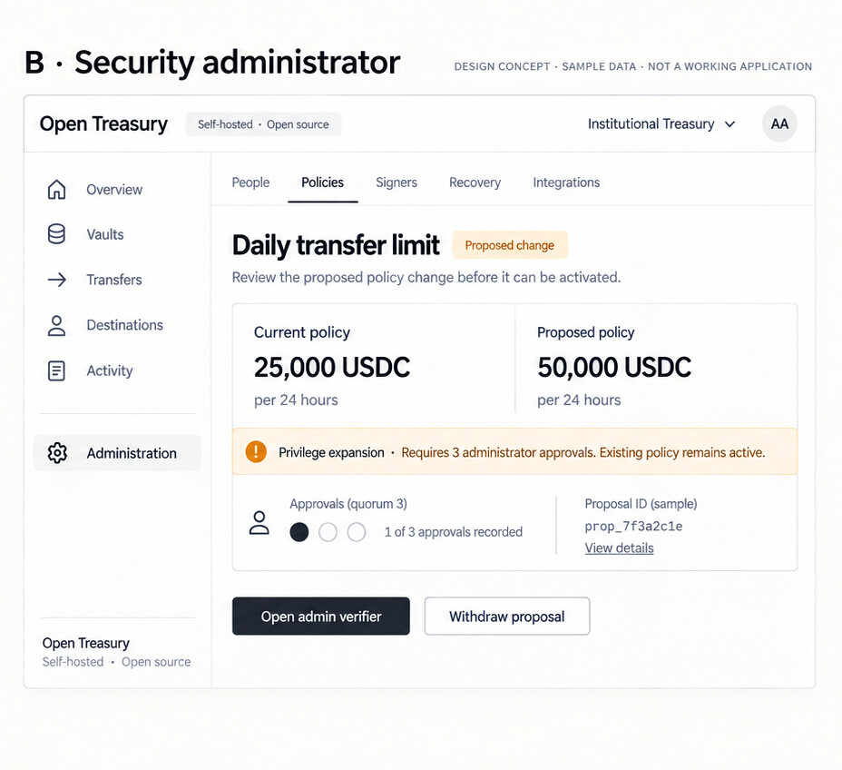

# Open Institutional Custody — RFC 0004

## Product experience, installation, migration, and UI coverage

Status: proposed product/design specification, not an implemented UI. Version 1, 2026-10-20.

Companions: [RFC 0001](../rfc-0001-open-institutional-custody.md), [RFC 0002](../rfc-0002-product-completion.md), [RFC 0003](../rfc-0003-institution-operated-signer-network.md).
Security semantics in those RFCs take precedence. Proposed UX defaults below are not changes to cryptographic or authorization contracts.

The [UI mockups](#illustrative-ui-mockups) and their image assets are included in this RFC folder.

## 1. Make the first useful session short, not the security boundary weak

**D1. Product promise:** one institution engineer can install a trial, observe existing treasury addresses, preview migration, and complete the supported local test-money loop in under 30 minutes. Production is a separate readiness gate. Actual funding can require other people, independent infrastructure, source-custodian approvals, and blockchain finality; do not promise a complete institution migration in 30 minutes.

**D2. Interface promise:** every supported institution-facing capability has a discoverable workflow, permission check, progress state, failure explanation, safe next action, and audit evidence. Not every Rust method becomes a button. MPC messages, nonce consumption, key-share loading, signature aggregation, and reservation release are internal mechanisms.

**D3. Free and open source:** the console, verifier, API, signer services, installer, export, backup/recovery tools, and operating documentation must all be buildable from published source. No license server, mandatory hosted account, proprietary core image, or paid unlock for essential security controls. Infrastructure, hardware, RPC providers, chain fees, and optional support still cost money. The workspace declares Apache-2.0 but has no tracked LICENSE file at this inspection; release/legal completion is a gate, not a claim already satisfied.

**D4. Users are institution staff.** Treasury operators, approvers, security administrators, domain operators, and auditors are the initial users. Own-treasury payments to registered counterparties are in scope. Retail customer accounts, customer-liability accounting, exchange trading, fiat settlement, arbitrary messages, contract approvals, and a dApp browser are not.

### Current implementation boundary

| Existing code, inspected | Product still to deliver |
|---|---|
| EVM/Solana verification, deterministic policy, reservation/issuance authority, signer core, development secp256k1 and FROST Ed25519 providers | Production EVM threshold ECDSA integration and supported backend recovery |
| Builder, coordinator, broadcaster; simulator evidence and chain clients; in-process signer endpoints | Real RPC integrations, remote signer services, RFC 0003 networking |
| Independent approval CLI and recomputed display; encrypted Ed25519 approval credentials | Independently distributed graphical verifier, passkeys, graphical administrative review |
| Deposit/workflow/journal/reconciliation domain objects | Reconciler, indexing, operational workflow controller, durable journal service |
| Audit chain/checkpoints and file-backed state components | Public authenticated API, complete event/query service, operator console, installer, production topology |

This RFC adds no application implementation. Library tests and domain types are not proof of a deployed product. In particular, FROST capability does not establish production recovery support; the current provider does not supply refresh/recover-or-replace. A green process-health indicator cannot override these gaps.

## 2. Use research maps to choose flows, then test the assumptions

The Figma material supplies methods, not evidence about our users. No institution interviews or live Fireblocks Console sessions were conducted. The personas, emotions, timing budgets, and design choices below are hypotheses. Public Fireblocks help/API documentation describes familiar tasks; it is not a deployed-behavior comparison or a security audit.

### Empathy hypotheses to validate

| Persona | Sees / hears | Says / does — hypothetical, not interview quotes | Thinks / feels — hypothesis | Design response and validation |
|---|---|---|---|---|
| E1: deploying engineer | Infrastructure tickets, secret handling, slow procurement | Needs one supported install path and an exact readiness report | Fears creating a fragile system they alone understand | Resumable setup, preflight, exportable configuration; observe an independent install |
| E2: treasury operator | Balances, payment requests, approval delays | Checks whether a payment is sent and whether it is safe to retry | Fears duplicate payment more than a technical error | Available/reserved separation, operation timeline, uncertainty cases; run a lost-acknowledgement task |
| E3: approver | Interruptions and requests with incomplete context | Reviews beneficiary, amount, fees, purpose | Fears rubber-stamping a substituted recipient | Independently decoded full review, no blind push approval; test a changed-recipient task |
| E4: security administrator / domain operator | Policy changes, personnel changes, domain alarms | Needs to explain who can change or sign what | Fears hidden residual access after offboarding | Before/after authority diff, domain ownership, recovery status; test revocation and outage tasks |
| E5: auditor / finance reviewer | Reports that disagree, missing explanations | Reconstructs the history behind a balance | Distrusts an unexplained green reconciliation badge | Checkpoint provenance, immutable corrections, export validation; reconstruct a sampled payment |

### Customer journey and service blueprint

| Stage | Staff goal / likely concern | Visible experience | Backstage prerequisite | Evidence / measure |
|---|---|---|---|---|
| Discover | Can I run and leave this without vendor permission? | Short scope statement, public source, limits and operating costs | Signed releases, license/dependency inventory, source-build recipe | Independent rebuild and dependency inventory |
| Install | Can I get something useful today? | Preflight → test workspace → first successful loop | Working distribution, deterministic examples, persisted setup | Wall-clock and hands-on time, blockers |
| Observe | What would migrate? | Watch-only import with explicit unsupported rows | Address validation, indexing and provenance | Coverage count, checkpoint freshness, rejected-row report |
| Configure | Who actually controls it? | Separate business/admin/MPC authority map | Enrollment, signed objects, domain-local provisioning | Approved roster, policies, domain ownership |
| Prove readiness | Can it fail safely? | Recovery drill and funding checklist | Supported backend recovery, retained issuance, fenced restore | Drill report, blockers, owner sign-off |
| Migrate | Can we move a small amount safely first? | Source-approved canary → reconciled receipt → staged funding | Old custodian withdrawal, new receiving address activation | Chain receipt distinct from source/venue accounting |
| Operate | What needs my action? | Task queue, transfer review, exceptions | Authorization, broadcaster, reconciler, notifications | Correct outcome, task completion time |
| Recover / exit | Can we regain control or leave? | Scoped incident runbook and portable exports | Safe restore/replacement and independent rebuild | Residual-authority inventory, independently verified export |

For discovery, interview and observe people in all five roles, including smaller teams holding multiple roles. Map the current Fireblocks/other-custodian journey before testing this future journey. Record observed actions separately from inferred feelings. Revise the maps when evidence contradicts them.

### Research-to-design traceability

| Reading | Method used here | Required artifact / consequence |
|---|---|---|
| Figma user flow | Persona, entry, steps, decisions, end | F1–F10 flows with safe branches and resumability |
| Figma user journey map | Lifecycle, touchpoints, friction | Journey above, including adoption and exit rather than only transfer screens |
| Figma empathy map | Separate observed and assumed needs | E1–E5 hypotheses; no invented research quotes |
| Figma customer journey map | Frontstage/backstage service blueprint | UI gates tied to actual backend readiness |
| Figma design basics: tokens, enterprise systems, button states, accessibility, wireframes, typography, validation/testing | Reusable semantic system and task validation | Section 9 component states; section 12 task-based acceptance |
| Fireblocks roles / segregation of duties | Initiate, business approve, administer, and sign are different powers | Section 3; distinct credentials and trusted surfaces |
| Fireblocks policy / transfer / cancellation docs | Familiar review context, configuration proposals, state-specific actions | Sections 6–8; preserve our own deny and issuance semantics |

The design-basics index lists 129 articles; the relevant topics above were sampled, not the entire library. The repeated empathy-map URL is one source.

## 3. One console, separate trusted approval, domain-local controls

### Surface boundaries

1. **Institution console:** balances, proposals, tasks, migration, configuration, audit. One application with role-aware navigation, not separate duplicated admin and user products.
2. **Independent verifier:** business-approval and administrative-review modes, with separate credentials and explicit purpose. Independently distributed and pinned as required by RFC 0003 §15. A second tab or subdomain served by the compromised console is insufficient. D1 verifies authority-signed records plus witness checkpoints; it does not claim D2 consensus proof.
3. **Domain-local administration:** signer enrollment, software acceptance, local halt, ceremony participation, and supported recovery on each independently administered domain. The central console shows requests/status; it cannot collect every domain's root credential or key share.

MPC signers are services, not a default human role with a generic Sign button. After business approvals are valid, the normal signer path enforces policy, reserves exposure, and signs. Administrative approval never silently grants business-approval or MPC authority.

### Proposed role presets, not an existing RBAC implementation

Roles are capability bundles scoped by institution, environment, vault, and action. Holding several roles must be visible; segregation rules still reject self-approval where forbidden. Identity login is distinct from cryptographic approval authority. The backend enforces all permissions, including direct API calls; hiding navigation is not enforcement.

| Capability | Viewer | Treasury operator | Business approver | Security administrator | Domain operator | Auditor |
|---|---|---|---|---|---|---|
| Read permitted funds and activity | Yes | Yes | Assigned scope | Security scope | Own-domain scope | Audit scope |
| Propose transfer / fee funding / sweep | — | Yes, within policy | — | — | — | — |
| Approve business operation | — | Separate grant only | Verifier + policy quorum | Separate grant only | — | — |
| Request destination or configuration change | — | Destination request | — | Yes | Own-domain request | — |
| Approve privileged configuration | — | — | — | Admin verifier + admin quorum | Separate admin grant only | — |
| Enroll/halt/recover a signer locally | — | — | — | Request/status only | Own domain, approved procedure | — |
| Emergency freeze | — | — | — | Only designated responder | Local halt only | — |
| Unfreeze or broaden authority | — | — | — | Admin quorum / activation rules | Local resume also needs its domain procedure | — |
| Export accounting/audit evidence | Scoped | Scoped | Scoped | Security export | Own-domain evidence | Yes, scoped |

Service accounts get the same scoped capabilities and explicit expiry/revocation, never an implicit admin vote. No universal owner or support-held reset key is introduced. Enrollment must prevent one person's three devices being counted as three people.

## 4. Make setup a guided first run and a resumable checklist

**D5. Recommended packaging:** a signed `oic` distribution containing the control-plane binary and embedded web assets, plus separately installable signer and verifier artifacts. Rust/Axum API and a TypeScript/React console with accessible primitives are the proposed stack. These artifact names describe a proposed interface, not an installer that exists in this checkout.

Ship one supported Linux reference topology first. A local developer recipe may collocate simulator signers, visibly marked development-only. Production provisioning emits separate domain packages and requires domain-local approval; it must not install all production shares under the same root account. Keep the authority's D1 administration separate too. Do not make Kubernetes, consensus-mode selection, or hardware-profile choice a first-run prerequisite.

### F1: first useful session — target budget, not measured performance

Entry: engineer opens the public quickstart on a supported machine. End: both local test transfers reconcile, events can be consumed, and a watch-only migration report is available without moving external funds.

| Target elapsed time | Screen / action | Persisted result | Blocked branch |
|---|---|---|---|
| 0–3 min | S01 preflight: OS/architecture, resource requirements, ports, writable state, version/signature verification | Named environment and diagnostic report | Missing prerequisite → precise fix and rerun; no misleading success |
| 3–6 min | S02 choose Test workspace or Observe existing treasury; create initial identity and recovery contact | Test-only identity; no production approval roots reused | Unsupported authentication/platform → explain supported route |
| 6–12 min | S03 seed local vaults, separate example roles, faucet/simulator funds; open guided example | Persisted setup/task state | Service unavailable → show responsible component and logs without secrets |
| 12–18 min | S04 import public addresses or documented CSV; show valid, duplicate, unsupported, unverified rows | Read-only inventory and migration preview | No RPC access → local demo still works; external discovery remains explicitly incomplete |
| 18–26 min | S05 local deposit → fee funding → approve in test verifier → transfer → reconcile on both profiles | Receipts, event sequence, journal evidence | Approval timeout or uncertain send → relevant flow below, not reset wizard |
| 26–30 min | S06 export test evidence; show production blockers and next domain owners | Shareable readiness/migration checklist | Missing production control remains a blocker, not a skipped checkbox |

Measure both source-build adoption from RFC 0002 and signed-release onboarding. State prerequisites prominently; record download/build time, external waits, total wall-clock, and hands-on time separately. Do not hide prerequisite installation or build time to manufacture a 30-minute result.

Use full-page setup for the first session; after the first useful result, move to an embedded checklist that survives navigation, logout, restart, and partial failure. Save non-secret configuration server-side; never stash secrets or approval keys in browser storage. Existing steps show their evidence, not only checkmarks. Production bootstrap needs a separately specified root-of-trust ceremony; an initial console user cannot self-promote by checking boxes.

### F2: production readiness and staged migration

Entry: watch-only inventory exists. End: a scoped migration batch has finalized, reconciled, and been reviewed; the old system remains authoritative for everything not migrated.

1. Select networks/assets/accounts, owner, purpose, source and target. Resolve unsupported assets, required memos/tags, token restrictions, and missing gas. An address label is not legal-identity verification.
2. Build a manifest with row identity, source provenance, network/asset identity, destination version, balances/checkpoint, proposed amount, fee ceiling, external reference, and status. CSV public-address import is the first universal path; Fireblocks API import is read-only and only shipped when its adapter is actually implemented.
3. Complete independent domain provisioning, admin/business enrollment, active supported backend, destination/receiving-address verification, authority durability/fencing, recovery drill, alerts, audit, and policy review. Print remaining common root accounts and correlated trust. Keep production funding gated until requirements are met.
4. Verify a newly generated receiving address independently before sharing it. Address activation requires monitoring and declared recovery readiness. Watch-only source addresses are never presented as ours to sign from.
5. Produce a small canary instruction for the old custodian. The operator approves the outbound transfer in Fireblocks/the source wallet; this console cannot sign for it. Wait for supported receipt finality and reconciliation; distinguish a source-system acknowledgement from chain receipt.
6. Approve explicitly selected remaining batches under institutional limits. Source-system delay, fees, dust, asset constraints, and chain finality remain visible. Never auto-translate and activate a source policy; import into a draft, report semantic gaps, and obtain fresh administrative approval.
7. Reconcile source/target amounts and fees and retain both evidence sets. Resume by the durable manifest row and business reference, never by resending every row. Stopping before issuance requires confirmed cancellation in the system controlling the source; after issuance, reversing a settled movement can require an independently authorized return transfer, not Undo.

No seed phrase, plaintext full-key import, promise of retained addresses, universal key-share compatibility, or automatic decommissioning of the old custodian. Keep source credentials least-privileged, protected server-side, and revocable after discovery.

## 5. Screen registry and navigation

Primary console navigation: **Overview · Vaults · Transfers · Approvals · Destinations · Operations · Activity**. Administration appears only with relevant read permissions. Search accepts business reference, intent, transaction ID, vault, destination, and case; search results never cross authorization boundaries. The environment and institution are persistent and explicit, with unmistakable Test/Production labeling.

| Screens | Purpose and primary action | Representative states that must be designed |
|---|---|---|
| S01–S06 Setup | Preflight, identity, local example, discovery, first loop, readiness | Fresh install, resumable partial state, missing dependency, unsupported profile, test complete/production blocked |
| S07 Overview | Needs my action first; holdings and freshness second; start transfer | Empty, healthy within scope, approval wait, stale checkpoint, paused workflow, frozen scope |
| S08 Vault list/detail | Purpose and wallet/network breakdown; receive or propose transfer | Watch-only vs signing-controlled, inactive/active deposit address, insufficient gas, reserved exposure |
| S09 Transfer composer | Source → registered destination → amount/fees → review | Invalid network/asset, unavailable funds, denied policy, stale evidence, duplicate reference |
| S10 Transfer detail | Follow one business intent, candidates, issuance and chain outcomes | Every lifecycle state in section 7; replacement lineage and uncertain submission |
| S11 Approval inbox | Scoped tasks with expiry; open independent verifier | Eligible/ineligible, already approved, expired, policy superseded, verifier unavailable |
| S12 Business verifier | Independently inspect and approve exact candidate or bounded intent | Verified, stale, mismatched root/destination/payload, self-approval denied, submission pending/recorded |
| S13 Destinations | Request/register versioned beneficiaries and own accounts | Draft, awaiting admin approval, activation delay, active, superseded, revoked |
| S14 Operations | Deposits, fee funding, sweeps, treasury funding; inspect linked child intents | Pending/running/paused/exhausted, duplicate trigger, unsupported token quarantine |
| S15 Case detail | Explain and assign a blocker; choose safe remediation | Unknown issuance, RPC disagreement, stale index, reorg, journal mismatch, insufficient gas |
| S16 Activity/export | Search events, evidence and journal; export scoped report | Empty, filter match, sequence gap, denied export, export ready/failed |
| S17 People/access | Invitations, login and each authority independently | Invited, enrolled, pending quorum, device replacement, partial offboarding, revoked |
| S18 Policies | Draft, simulate, compare and propose restricted policy | Syntax/semantic invalidity, hard denial, historical impact, pending quorum/delay, activated/superseded |
| S19 Admin proposal/verifier | Before/after scope and authority; independent admin review | Stale base version, unsatisfiable quorum, expanding privilege, rejected/expired, activated receipt |
| S20 Signers/authority | Domain ownership, roster, generations and approved builds | Disconnected, local halt, wrong generation, stale policy, restore required, unsupported capability |
| S21 Domain-local console | Domain approval, key ceremony, local halt and supported recovery | Request staged, identity mismatch, ceremony failed, old process fenced, recovery blocked/complete |
| S22 Recovery/readiness | Drill results, encrypted-kit metadata and recovery/exit runbook | Not configured, stale drill, permitted domain loss, beyond supported recovery profile |
| S23 Integrations | Scoped API credentials, event subscriptions and delivery health | Pending admin approval, expired/revoked, retrying/suspended, signature rotation, replay gap |
| S24 Migration | Discovery, semantic-gap report, canary and batch manifest | Read-only, validation errors, readiness blocked, source approval pending, reconciled, partially migrated |

All screen families need loading, empty, unavailable, permission-denied, and stale-data treatments where applicable. A missing backend capability is an explicit unsupported feature, not an enabled mock control. Details use stable URLs and preserve safe filters on Back; no secrets in URLs.

## 6. Specify the important flows before drawing every screen

### F3: propose, independently approve, and follow a transfer

Entry: New transfer or a vault's Send action (prefilled source). Fields: purpose, external business reference, source vault/wallet/network, registered destination/version, exact asset identity, decimal amount, maximum native fee, optional private note. Amounts become integer base-unit strings; never JavaScript floating point. Show estimated fee separately from the enforced ceiling. Max must account for reservations, native fees, and chain-specific account/rent requirements.

1. Build/decode/verify → evaluate policy and fresh evidence → show review. Explain relevant rule/limit, remaining exposure, required distinct approvers, and approval mode. A preview is not permission to sign.
2. Submit once with a persisted idempotency key. A network timeout offers Check request status; it must not create a second intent. A corrected business request deliberately gets a new revision/reference according to API rules.
3. Inbox notification carries only a pointer. Open verifier fetches and verifies the objects through its own trusted implementation. No Approve button in the untrusted console and no approval from the notification alone.
4. Verifier shows institution/environment, actual network/asset identity, source, full beneficiary address and registry version, exact amount, maximum fee, purpose, policy epoch, evidence age, expiry, and what the credential authorizes. Technical hashes/base units are available without replacing readable meaning. A bounded grant spells out fields that may change later.
5. Verifier signs a business grant with the appropriate credential. Only show Approval recorded after verified authority acknowledgement/finalization. Lost acknowledgement shows Check approval status. Reject is a separate audited product command to specify in the API; no fabricated cryptographic grant or negative-vote semantics are implied by current code.
6. Console follows reservation, issuance, signing, submission, inclusion, finality, and reconciliation. It labels each, with time and provenance. Fee or recipient changes outside the grant require fresh authorization. MPC services sign through the existing protected path, never through a browser key-share endpoint.

Policy denial, credential/root mismatch, unsupported semantics, and stale evidence fail closed. Fix the underlying proposal/evidence; never offer Override and send. A decline changes the request outcome according to explicitly specified policy; it cannot retract an already committed issuance.

### F4: configuration proposals and policy publication

Entry: edit a policy, destination, member, approved build, chain, recovery setting, or authority. End: activated version has an independently verifiable receipt, or the proposal is rejected/expired/withdrawn without changing the active version.

Edit draft → validate restricted schema → simulate representative/historical operations → review before/after diff → submit proposal → independent admin verification → required quorum → any activation delay → activation receipt. Always show current and proposed values, affected vaults/capabilities, submitter, base version, expiry, required administrators, collected approvals, and effective epoch/time. Privilege expansion is explicit. Historical simulation is explanatory, not proof of safety.

Snapshot the applicable approval requirement at submission; changing that requirement is itself governed configuration. The activation service revalidates the proposal against current state and rejects stale-base or now-invalid authority rather than silently applying a conflicting diff. No one-click self-approval, and no service account silently satisfying a human quorum. Exact rejection/expiry rules must be settled with the administrative API before implementation; this RFC does not copy Fireblocks' single-denial rule into our kernel.

Our policy engine has hard-deny dominance and fail-closed evaluation. Do not offer drag-to-prioritize rules with Fireblocks' first-match meaning. Show effective constraints, deny explanations, scope, and evaluation results. Starting templates are drafts with named owners and bounded limits; sample policy is not production policy.

### F5: receive and operate bounded funding/sweeps

A Receive panel shows network, asset restrictions, full address/QR, monitoring readiness, and verification evidence. It must not mark an inactive or watch-only address as a ready controlled deposit address. Incoming transfers show observed → accepted/finalized according to profile, or quarantine/unsupported state. Unknown tokens do not get automatic fee funding.

Operations show the trigger and dedup identity, source/recipient set, child intents/dependencies, per-step attempts, native spend cap/remaining allowance, and pause reason. Fee funding precedes an asset sweep only when its settlement dependency is met. A paused workflow offers inspect/fix underlying issue or a separately approved configuration proposal; Resume rechecks policy/evidence and cannot raise the ceiling. The controller never bypasses normal approvals/reservations.

### F6: resolve uncertainty, outage, or reconciliation disagreement

The case opens with four facts: affected funds/scope; whether a signature may exist; evidence and age; safe actions and responsible owner. Keep signed/submitted-unknown candidates reserved. Prefer Check evidence / Inspect attempt / Rebroadcast identical signed transaction when supported. Never turn an RPC timeout into Failed, Cancelled, or a newly signed payment.

RPC disagreement or stale index data blocks the affected scope and explains required evidence. Journal mismatch opens a scoped case and authorized correction procedure, never Mark balanced. A reorg preserves the old observation and correction history. An internal sweep records both wallet effects and fees without inventing revenue. Exchange-chain receipt is not exchange-account credit.

### F7: enroll, replace a device, and offboard a person

Invitation → scoped login enrollment → separate approval/admin credential enrollment proposal → independent verification/quorum → active authority. An email reset restores no approval/admin authority. A new device repeats stronger replacement controls; revoked keys remain in historical evidence.

Offboarding shows six independent rows: console sessions, proposer/API credentials, business grants, administrative credentials, automation delegations, and MPC/recovery authority. Each row shows revoked, still active, or manual migration required. Already issued signatures cannot be revoked with logout. Removing a person who controlled a signer/recovery path requires the supported replacement/rotation procedure. Do not display All access removed while any residual authority remains.

### F8: emergency freeze, domain halt, and recovery

A designated responder can freeze the specified vault/global scope with reason and explicit consequences. Show the ordered commit point and prior potentially issued operations: freeze prevents new release after that point; it is not a chain cancellation. Local domain halt is separate and can reduce availability without globally freezing other domains. Unfreeze and privilege expansion require administrative authorization; local resume also follows domain procedure.

Recovery first classifies the failure: one permitted signer loss, authority restore, lost approver device, or beyond-profile loss. Show prerequisites, supported backend capabilities, owners per domain, checkpoint/generation checks, and permitted steps. Restore into a fenced environment, compare issuance/checkpoints, and demonstrate the supported drill before declaring readiness. A zip-file download is not a completed recovery test. If the backend lacks required replacement/recovery, block the flow and report the unsupported failure case; never reconstruct a full key in the browser.

### F9: integrate and export without making the API a bypass

Create scoped expiring API credentials through governed enrollment; distinguish request/observe/approve/admin capabilities. Secrets appear only through the approved delivery mechanism and never in ordinary logs, exports, URLs, screenshots, or notifications. Each webhook endpoint shows subscribed event kinds, signing-key version, delivery attempts, last acknowledged sequence, and replay range. Replay means event redelivery, not payment replay. Consumers deduplicate and repair sequence gaps.

Audit export includes filter scope, actor, commitments, versions, lifecycle/evidence references, journal corrections, checkpoint/signature material, sequence completeness, and schema version. Verify it independently. Redacted support bundles are opt-in and previewable; raw shares, approval private keys, preprocessing, and RPC/service secrets never enter them. A downloaded file is not proof of completeness until verified.

### F10: upgrade and exit

Show current/proposed build, provenance, compatibility, affected adapters/measurements, in-flight operations, domain owners, and recovery point. Stage an approved compatible rollout or a safe halt; do not suggest restoring an old snapshot to undo committed issuance. Reaccept software roots through administrative controls where required.

Exit exports policy, destinations, operations, observations, journal, exceptions, public verification material, and recovery instructions in documented formats. Rebuild and continue under the declared profile without the project's hosted services. Moving funds out remains a normal authorized transfer; exporting history or uninstalling the console does not revoke keys/shares or settle funds.

## 7. Map exact lifecycle states to truthful actions

`crates/domain-types/src/objects.rs::LifecycleState` is the current source of names. UI labels group implementation stages, but detail exposes the exact state. Chain settlement and accounting reconciliation are separate facts.

| Rust states | Display / safe action | Exposure and cancellation meaning |
|---|---|---|
| Draft, Built, Verified, PolicyEvaluated | Draft / Checking / Policy checked; edit or submit where permitted | Not yet a sent payment; do not imply signing |
| AwaitingApproval | Awaiting approvals; open verifier, inspect expiry | No unverified quorum progress; cancel only through confirmed pre-issuance abort |
| Reserved, Authorized | Funds reserved / Authorized; inspect | Held exposure; abort must atomically win against release |
| IssuanceCommitted, Signing | Signature may exist / Signing | Release committed; ordinary cancellation is no longer safe |
| SignatureObserved | Signed; inspect or approved initial submit | Outstanding exposure retained |
| Submitted | Submitted to network; inspect tx/attempt | Not finalized; never safe to simply resend a new payment |
| Included | Included, awaiting finality | Retain applicable exposure and canonicality evidence |
| FinalizedSuccess | Finalized successfully; show separate reconciliation state | Principal and actual fees accounted, not an extra release of the same amount |
| FinalizedFailure | Finalized with execution failure; inspect actual fees | Fees may have been spent; new payment is a deliberate new authorization |
| Rejected, ApprovalExpired, AbortedBeforeIssuance | Rejected / Approval expired / Cancelled before issuance | Terminal only when server confirms the pre-issuance outcome |
| IssuanceUnknown, SubmissionUnknown | Outcome uncertain; investigate | Signature may exist; keep exposure, no blind re-signing |
| Reorged | Chain reorganization; tracking canonical outcome | Do not silently retain a stale Success label or release uncertain exposure |
| ReplacementPending | Replacement pending; inspect original/candidate family | New candidate requires appropriate authorization; chain-specific exclusivity |
| DefinitivelyInvalidated | Proven unable to execute; inspect evidence | Release only as confirmed by authoritative chain-specific transition |

**Cancellation race:** UI requests Abort before issuance and waits for the authority result. If release wins, replace the pending cancellation message with Signature may exist; no funds-released toast. A frontend's old enabled button is not evidence of cancelability. EVM same-nonce replacements and Solana fresh-blockhash candidates have different safety rules; there is no universal Retry/Speed up/Drop action.

Map backend error codes to human meaning plus a safe remedy. Examples: `BudgetExceeded` → limit and reserved amount; `StaleEvidence` → refresh evidence; `AuthorityUnavailable` → new issuance paused; `RecoveryRequired` → domain-owned recovery; `IssuanceUncertain` → case, not retry. Show support correlation IDs without secret-bearing error dumps.

## 8. Rust-to-UI coverage is a contract, not a function browser

Status key: **L** existing library behavior (not deployed service/UI); **T** existing types/traits only for the described operational feature; **P** proposed service/UX. Source paths are workspace-relative. This matrix covers semantic capabilities; pure encoders, hashes, accessors and protocol rounds are deliberately not individual controls.

| Capability / Rust owner | Status | UI responsibility / screens | Credential or boundary |
|---|---|---|---|
| `services/builder/src/lib.rs`: build, evaluate, required_approvals, envelope_body | L + P API | Compose, explain policy/fees/evidence, revision-bound review; S09/S10/S12 | Proposer; verifier independently recomputes meaning |
| `crates/policy-kernel/src/lib.rs`: evaluate; hashing module | L + P editor/simulation | Constraint editor, denied reasons and impact preview; S18/S19 | Admin proposals; hashes stay automatic |
| `crates/domain-types/src/objects.rs`: CounterpartyDestination and signed policy objects | L verification + P registry | Versioned request/review/activate/revoke; S13/S19 | Administrative quorum, no address-only bypass |
| `crates/authorization-state/src/authority.rs`: register_intent, reserve, exposure_view | L + P API | Stable business reference, reserved/remaining views; S08/S10 | Atomic authority transitions, not editable counters |
| Same authority: release, abort_before_issuance, approval-expiry aborts | L + P commands | Issuance warning, atomic cancellation result, expiry; S10/S15 | Release internal only; never a Release funds override |
| Same authority: set_policy, current_policy, freeze, unfreeze, freeze_record | L + P proposal service | Active version, before/after review, incident scope/receipt; S18–S20 | Admin credentials; designated freeze responder |
| Same authority: record_observation, reservation/family, checkpoint, releases_before | L + P evidence/query service | Candidate lineage, evidence, retained exposure, ordered freeze impact; S10/S15/S16 | Readable evidence; no manual invalidation claim |
| `services/coordinator/src/lib.rs`: execute; `endpoint.rs` signer interface | L (in-process only) + P remote | Signing progress, participant availability, errors; S10/S20 | No direct signer endpoint in ordinary browser |
| `services/broadcaster/src/broadcaster.rs`: submit, rebroadcast, recover, poll, resolve_unknown | L (simulator clients) + P real RPC | Attempts, same-bytes rebroadcast, uncertain-outcome investigation; S10/S15 | Normal authorization and evidence; recover is not key recovery |
| `crates/approval-verifier/src/client.rs` and `display.rs` | L + P graphical client | Independently decoded approval review; S12 | Business approval key; current Ed25519 CLI ≠ proposed passkey implementation |
| `apps/independent-approval-client/src/main.rs`: init-trust, keygen, show, approve, verify-grant, inspect-envelope | Existing CLI + P GUI | Trust enrollment, encrypted local credential, inspect/approve/verify; S12/S17 | Independently distributed client; config approval mode still P |
| `crates/signer/src/lib.rs`: open, generation, load_key, verification/session/protocol/release/aggregate/abort | L + P domain shell | Domain generation, approved descriptor, ceremony/session result, safe local halt; S20/S21 | Internal key-share handling; do not expose each method as an API button |
| `crates/crypto-provider/src/lib.rs`, FROST/development providers | L/T, capability-dependent | Supported scheme/topology/ceremony/recovery status; S20–S22 | DKG/share/protocol rounds stay domain-local; no arbitrary signing |
| `crates/one-time-state-ledger`, authority store/fencing | L + P diagnostics | Restore/fencing readiness and recovery-required state; S20–S22 | No nonce reset, counter edit, share export, or snapshot rewind |
| `crates/domain-types/src/operations.rs`: DepositAddress, movement, cursor/backfill, cases | T + P reconciler | Receive activation, monitoring coverage, deposits, backfill cases; S08/S14/S15 | Evidence-backed acceptance, not mark-paid overrides |
| Same operations: JournalEntry, Holdings, ReconciliationCheckpoint | T + P reconciler/journal | Canonical/reserved/available, freshness, discrepancy and export; S07/S08/S15/S16 | No balancing entry to hide discrepancies |
| Same operations: WorkflowRecord, GasFundingRule, sweep/treasury rules | T + P controller | Bounded rules, child intents, pause/exhaustion; S14/S18 | Ordinary intents and shared reservations |
| `crates/audit/src/chain.rs`: append/head/events_since/checkpoint, verify_event/verify_chain | L + P query/export | Subject/actor/event filters, checkpoints and independent export verification; S16 | Scope-controlled reads; service signatures ≠ approval powers |
| RFC 0003 roster, peer channels, local halt, D1/D2 and verifier proofs | P | Domain roster/owners/connectivity; exact deployed trust profile; S19–S22 | Do not show Commonware/BFT as deployed today |
| RFC 0001/0002 public API, identity, integrations and installer | P | S01–S06/S17/S23/S24 | AuthN/RBAC/idempotency/versioned events required before live actions |

Definition of done for each supported action: source owner → public command/query → role/scope enforcement → state transitions → UI entry/review/progress/error → audit evidence → operator task test. Missing any link means not productized. Developer-only primitives get documented internal coverage, not fake UI parity.

## 9. Make a small design system excellent

**D6. Visual direction:** calm, light, data-first treasury workbench; strong typography, restrained borders, generous review space, compact operational tables, and one clear primary action per task. Avoid decorative portfolio charts or dark trading-terminal density as the default. These are proposed design choices, not a tested preference claim.

| Layer | Specification |
|---|---|
| Tokens | Two layers: reference palette/spacing/type and semantic surface/text/border/action/status. Git is source of truth; generate matching Figma variables/code when implementation starts. Avoid a separate token framework until needed. |
| Typography | System sans initially, 16px main text, 14px dense table minimum, tabular numerals for quantities, monospace for addresses/IDs. Clear labels above inputs. Never shrink full approval addresses to fit. |
| Layout | 4px spacing basis; 8/12/16/24/32px common steps. Approx. 224px desktop navigation; fluid content; focused review reading column. Desktop operational tables may scroll in a labeled region; narrow approvals stack without losing security fields. |
| Color | Neutral background and surface; high-contrast primary action. Green only for a specifically verified outcome, amber for attention/wait/uncertainty, red for denied/danger. Text/icon accompany every color. No All systems operational badge over a paused workflow. |
| Actions | Explicit verbs: Propose transfer, Open verifier, Approve operation, Propose policy change, Freeze vault. Avoid ambiguous Confirm or Retry. Loading/pressed/focus/disabled states; disabled reasons must be available without hover. |
| Security review | Full network/asset/destination/amount/fee/purpose, credential purpose, policy version, expiry, independent verification result. Before/after diff for administration; never just a green checkmark. |
| Tables | Stable row identities; task-oriented default sort; server-side scoped filters/pagination; available/reserved/canonical amounts separate. Secondary values never masquerade as spendable funds. |
| Notifications | In-app tasks with verified deep links; email/push opt-in and privacy-aware. No secrets or approve-from-push shortcut. Show expected action, responsible role and expiry, not only an unread count. |
| Freshness | Evidence/checkpoint time and height per relevant scope. Disconnect/stale banners retain last-known values with a clear stale label; never show stale available funds as live spendable balance. |

Required components: AppShell, EnvironmentLabel, TaskQueue, Amount, AssetIdentity, FullAddress, StatusWithReason, Freshness, TransferComposer, ReviewCard, ConfigDiff, QuorumProgress, OperationTimeline, CasePanel, DomainCard, SetupChecklist, ReadinessGate, FilterableTable, ExportPanel. Prefer accessible library primitives to custom dialogs/menus; do not create a novel interaction for each Rust capability.

Each component needs meaningful default, loading, empty, error, stale-data, and permission-denied states where applicable. Separate UI component reuse from trusted-verifier distribution: sharing reviewed decoder/display source is useful; letting the console replace verifier code is not.

Accessibility target: WCAG 2.2 AA, including 4.5:1 normal-text contrast, keyboard access, visible focus, semantic tables/forms, field-level and summary errors, announced asynchronous progress, and non-color status. Minimum WCAG target sizing applies; prefer 44px touch actions in narrow verifier flows. Respect reduced motion and browser zoom; never make an irreversible action depend on hover or a gesture. Full addresses wrap/copy safely with no invisible substitutions. Test 390px and 1280px widths and 200% zoom; those are web layouts, not native mobile-app verification.

### Illustrative UI mockups

These generated concepts use sample data; they are not screenshots of a working application. “Open Treasury” is a concept label, not a settled product name. The workflows and security requirements in this RFC take precedence over illustrative labels.

#### First run: read-only treasury discovery

Observe existing addresses without taking signing authority from the source custodian.

#### Resume later: setup progress and production blockers

Resume the checklist instead of restarting. Production readiness requires the declared independent-domain topology, separate approvals, and an actual supported recovery drill.

#### Treasury operator: holdings and tasks

Show available funds and actionable exceptions without hiding a paused workflow behind a healthy-process badge.

#### Security administrator: review a policy expansion

Keep active and proposed authority distinct. The main console hands approval to the independently trusted administrative verifier.

## 10. APIs must carry the facts the UI needs

Use RFC 0001 public resources and RFC 0003 node contracts rather than inventing a second browser-to-signer protocol. Generate typed clients from the implemented versioned OpenAPI. The proposed API still needs concrete schemas; this section specifies required behavior, not existing endpoints.

- Read models include institution/environment/scope, stable ID, version, exact state, as-of sequence/checkpoint and freshness, relevant evidence links, and reason codes. Monetary quantities are decimal integer strings with authenticated asset decimals.
- Commands are scoped, authorized and audited; use idempotency and optimistic base-version checks. A `202` means accepted for the documented stage, not sent or settled. Unknown command outcome offers status recovery under the same key.
- Server-calculated allowed actions and reason codes help render controls, but every command rechecks current authorization/state atomically. UI capabilities are advisory, not bearer permission.
- Intent, candidate, approval, issuance, submission attempt, chain observation, workflow, case, and journal are different linked objects. Do not squash them into a single status or overload a transaction hash as business identity.
- A persistent sequenced lifecycle feed supports replay and dedup after disconnect; polling can be the initial transport. Preserve filters, repair gaps, and show uncertainty. A live transport is not a substitute for durable ordering.
- Independent clients fetch signed objects and validate them locally; no API boolean such as verified=true substitutes for verification. Deep links identify objects, not arbitrary payloads the console asks a passkey to sign.
- Authentication, CSRF/session protections, scopes, safe secret delivery, export access, and rate limits apply to console and direct calls. Administrative proposal/rejection/expiry semantics and root bootstrap need explicit implementation contracts before enabling those screens.

## 11. Borrow familiar tasks from Fireblocks, preserve our semantics

| Documented Fireblocks pattern | Adopt | Deliberate difference / limitation |
|---|---|---|
| Initiator / approver / signer and separate admin quorum | Clear authority labels and task queues | Our MPC shares are service/domain-local; approval/admin credentials remain separate. No SaaS support-assigned owner or support bypass. |
| Accounts and asset views, context-prefilled transfer | Vaults plus asset/network breakdown, contextual Send/Receive | No implied exchange/fiat account integration or USD-equivalent budget without its own trusted model. |
| Named, approved destinations | Versioned registry, full network/address review | A name does not verify legal identity. No one-time-address bypass in v1. |
| Policy publication and administrative approval | Draft/diff/quorum/activation lifecycle | Fireblocks uses first-match rules; ours has hard-deny dominance. Do not copy ordering semantics. |
| Activity and state-specific cancellation | Timeline, attempts, safe allowed actions | Our cutoff is ordered signature-enabling release, potentially before RPC broadcast. Timeout is not final failure. |
| Transfer review context | Exact amount, network, beneficiary, notes and fees | Public current docs say normal transfers have no fee-speed selector. Our fee UI exposes our actual estimated/maximum-fee semantics, not an assumed copy. |
| Backup before funding and audit export | Readiness checklist, tested recovery, filterable evidence | Never claim unsupported share replacement, production recovery, or retained-address migration. |

No feature superiority claim follows from these documents. Compare actual tasks on matched supported deployments after implementation. Do not copy Fireblocks' raw/typed-message, staking, dApp, or trading menus into an unsupported product.

## 12. Deliver vertical workflows and measure completion

| Stage | Result to deliver | Acceptance gate |
|---|---|---|
| P0: contracts and wireframes | Role/scope rules, concrete API schemas, setup/transfer/admin/case/verifier state designs | Source/action inventory has no unsupported live buttons; security owners review semantics |
| P1: first complete local loop | Installer + API + reconciler + minimal console + independent test verifier; real persisted flow on both simulators | Install → receive → fund fees → approve → send → reconcile → export; restart midway without duplicate effects |
| P2: independently operable | Domain provisioning, real supported RPCs, enrollment/offboarding, admin proposals, recovery, upgrades | Applicable RFC 0001/0002/0003 security and operations gates; external-frontend substitution task fails safely |
| P3: migration and restricted pilot | Read-only discovery, semantic-gap report, independent canary, staged manifest | Named institution owners, actual supported backend/recovery, external review, stop criteria and complete readiness evidence |
| P4: expand on observed demand | One selected integration/chain/operation at a time | Its authorization/economic effects, UI states, recovery, and export are complete |

Do not block P1 on a polished multi-chain portfolio dashboard; do not allow a polished dashboard to substitute for P2. Real-value EVM funding remains blocked while the production threshold backend and its recovery profile are incomplete.

### UX acceptance tasks, not vanity screen counts

- **U01 install:** at least five independent engineers attempt the supported quickstart without private coaching. Publish total/hands-on times, prerequisites, failures and logs with secrets removed. Proposed gate: all complete the required local loop and event consumption; p90 total time ≤30 minutes. Report the small sample; do not generalize it as a production guarantee.
- **U02 migration:** operator imports mixed valid/duplicate/wrong-network/unsupported rows, reviews a source-policy semantic gap, and resumes a partially completed canary. No unsupported row is silently migrated and no source policy is silently activated.
- **U03 transfer:** operator proposes an asymmetric amount/fee example; approver verifies full beneficiary/network; alter recipient after approval and show the independent client blocks it. Test exact and bounded modes separately.
- **U04 uncertainty:** crash or lose acknowledgement after release and after RPC submission. Operator identifies that funds remain reserved and does not create a duplicate. Controls offer status/evidence and identical-byte rebroadcast only when safe.
- **U05 admin:** expand a limit with a pending proposal; active policy remains unchanged until the required quorum/activation. Test stale base version, one missing administrator, and self-approval rules.
- **U06 exception:** fee cap pauses workflow; operator explains why and uses a permitted remedy without raising authority silently. Repeat a trigger; no duplicate funding.
- **U07 offboarding/recovery:** remove login but leave an approval or share authority deliberately active. UI must not claim complete offboarding. Lose one allowed domain and execute the supported drill, or clearly block if unsupported.
- **U08 audit:** independent reviewer reconstructs a sampled payment and a reorg correction from export, detects a missing sequence, and distinguishes chain receipt from accounting/venue credit.
- **U09 accessibility:** keyboard-only composer/verifier/admin review; screen-reader labels and errors; 390px layout and 200% zoom. Test copy/full-address visibility and not just screenshot similarity.

These are planned acceptance tests, not results achieved in this RFC. Instrument task start/end, blocker, active work, external wait, and outcome locally; telemetry/export is opt-in, contains no keys/addresses unless explicitly approved, and is not mandatory for operation. Research participants use test money and approved/redacted data.

## 13. Decisions, risks, and what remains unspecified

Recommended defaults for prototyping: light operator workbench; one role-aware console; independently distributed verifier; test-first guided setup plus persistent checklist; public-address CSV discovery first; D1 reference deployment before optional D2. They are easy to revise and do not authorize production deployment.

- **Q1 — first production provisioning target:** recommend one supported Linux reference topology with separately administered domain hosts; alternative is an institution-selected cloud recipe. Default is the provider-neutral topology for wireframes. Exact deployment commands wait for pilot infrastructure and security requirements, not a universal Install securely button.
- **Q2 — verifier distribution/platform:** recommend signed desktop distribution as the initial graphical trust boundary; a signed extension is an alternative. Select after a concrete platform/RP-ID/origin and independent-update test. Default prototypes depict an app handoff without claiming cross-platform passkey support. Current CLI remains the actual available verifier.
- **R1 — recovery/backend gap:** the UI can look ready before key replacement works. Earliest signal: a required recovery action is absent from provider capabilities. Block production activation and pick/complete a supported backend profile.
- **R2 — correlated authority:** one engineer may provision every root under one account. Earliest signal: repeated root/domain ownership in readiness inventory. Show the correlation and refuse to label it independent.
- **R3 — unsupported custody migration:** an asset, policy, or signing protocol may not map. Earliest signal: unresolved manifest rows or semantic gaps. Keep those watch-only/in the source system; do not offer a generic signing escape hatch.
- **R4 — unvalidated ease and personas:** no observed operator timing or interview evidence exists. Earliest signal: independent users fail setup or misinterpret uncertainty. Revise flows and rerun the same tasks before making adoption claims.

Not yet specified: concrete API wire schemas and auth/session choice; production root bootstrap and admin rejection semantics; exact supported OS/CPU/hardware matrix and topology; durable service-store selection; per-backend recovery steps; passkey platform compatibility; Fireblocks read-only import field mapping; institutional retention/compliance needs. Each waits on implementation contracts, backend selection, or pilot research. This is a product-experience baseline, not a claim to have closed those engineering decisions.

Alternatives rejected for the initial product: duplicated admin/operator apps (navigation can vary without duplicating workflows); a button for every Rust method (exposes internals and unsafe authority); single-root production quickstart (collapses failure domains); in-console approval alone (same delivery compromise); automatic policy/key migration (no universal semantic/protocol equivalence); a fully custom UI primitive library (adds work without a product benefit).

## 14. Sources and evidence limits

Repository evidence: the three companion RFCs; `handoff.md`; workspace members in `Cargo.toml`; the Rust owners in section 8. Current implementation claims came from source inspection, not a fresh execution of the Rust suite. Design concepts are illustrative sample data, not screenshots of running custody software.

Figma methods and selected design-basics readings:

- [User flow](https://www.figma.com/resource-library/user-flow/)
- [User journey map](https://www.figma.com/resource-library/user-journey-map/)
- [Empathy map](https://www.figma.com/resource-library/empathy-map/)
- [Customer journey map](https://www.figma.com/resource-library/what-is-a-customer-journey-map/)
- [Design basics index](https://www.figma.com/resource-library/design-basics/)
- [Design tokens](https://www.figma.com/resource-library/design-tokens/)
- [Design token architecture](https://www.figma.com/resource-library/design-token-architecture/)
- [Enterprise design systems](https://www.figma.com/resource-library/enterprise-design-systems/)
- [Button states](https://www.figma.com/resource-library/button-states/)
- [UX validation](https://www.figma.com/resource-library/ux-validation/)
- [UI design principles](https://www.figma.com/resource-library/ui-design-principles/)
- [Accessible and inclusive design](https://www.figma.com/resource-library/creating-accessible-and-inclusive-design/)
- [Wireframing](https://www.figma.com/resource-library/what-is-wireframing/)
- [Usability testing](https://www.figma.com/resource-library/usability-testing/)
- [Typography in design](https://www.figma.com/resource-library/typography-in-design/)

Fireblocks first-party documentation, consulted 2026-10-20 (Console documentation is distinct from observation of an authenticated Console):

- [User roles](https://support.fireblocks.io/hc/en-us/articles/360012832959-User-roles)
- [Segregation of duties](https://developers.fireblocks.com/docs/segregate-duties)
- [Admin quorum](https://support.fireblocks.io/hc/en-us/articles/360017665119)
- [Policies and first-match semantics](https://support.fireblocks.io/hc/en-us/articles/29184395887772-About-Policies)
- [Console navigation](https://support.fireblocks.io/hc/en-us/articles/360019174680-Introduction-to-the-Fireblocks-Console)
- [Account structure](https://support.fireblocks.io/hc/en-us/articles/6986895761948-Account-and-wallet-structure)
- [Transfer fields and approval/signing stages](https://support.fireblocks.io/hc/en-us/articles/360016614180-Withdrawing-Assets)
- [Transaction states](https://developers.fireblocks.com/reference/statuses)
- [Cancellation](https://support.fireblocks.io/hc/en-us/articles/14298285316892)
- [Address registration](https://developers.fireblocks.com/docs/whitelist-addresses)
- [Audit log](https://support.fireblocks.io/hc/en-us/articles/360015646820-Audit-Log)
- [API users](https://support.fireblocks.io/hc/en-us/articles/4407823826194-Add-API-users)
- [Webhooks](https://developers.fireblocks.com/reference/webhooks-overview)
- [Backup and recovery](https://support.fireblocks.io/hc/en-us/articles/360012223099-About-Backup-and-Recovery)

Public pages are mutable and may lag deployed behavior. No proprietary screenshots, private APIs, source-provider access, or fair-comparison benchmark results are asserted.
